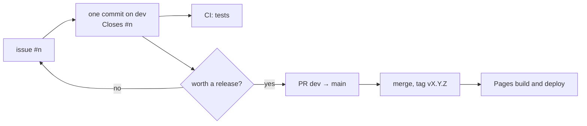

# Development

This file owns the rules for changing leveraged-investing-simulator that aren't every repo's: those
are in Claude-Code-Setup's `development-shared.md`, which binds here too. How
to install, run, test and deploy is in the [README](../README.md); the
architecture and module contracts are in
[documentation/DataFlow.md](../documentation/DataFlow.md).

## Checks

What a round runs before it ends (CLAUDE.md PROCEDURE-4):

| Check | Command | What it covers |
| --- | --- | --- |
| Test suite | `npm test` (`vitest run`) | `tests/unit/**/*.test.js` and `tests/integration/**/*.test.js` (`vitest.config.js`), against the committed `build/*.wasm` |
| WASM build | `npm run asbuild` | that `assembly/` compiles; only when `assembly/` changed |

There is no linter or formatter. The benchmark (`npm run perf`) is not a
check: it takes minutes and its numbers depend on the machine.

`.claude/agent-profile.json` lists `npm test` (exactly that form), so the
agent runs the suite each round. `npm run asbuild` is not listed, because it
rewrites the committed `build/` files: after an `assembly/` change it is a
step for the user.

## Branches and releases

The user's rule (2026-11-09):

- **`dev` is where work lands, one commit per GitHub issue.** Each commit
  does what one issue asks, and its message ends with `Closes #<n>`. CI runs
  the tests on every push to any branch.
- **`main` holds only releases.** When `dev` is worth a release, a pull
  request merges `dev` into `main`, and the merge is tagged `vX.Y.Z` on
  `main`. The push to `main` builds and deploys the Pages site. GitHub
  closes the issues the release's commits name when they reach `main`, the
  default branch.
- The release pull request is always merged with a merge commit, never
  squashed, so `dev` and `main` never diverge and each issue's commit stays
  on `main`.
- `main` is not protected, by choice: the rule holds by convention.
- `main` before this rule: `v0.1.0` to `v0.3.0`, then `81ef2ff`, the
  untagged Claude Code setup commit.

## Change workflow

1. Read [documentation/DataFlow.md](../documentation/DataFlow.md) before
   changing `scripts/` or `assembly/`. It is the design aimed at, not a
   description of the code (CLAUDE.md, Design docs are aspirational).
2. A change to `assembly/`: rebuild with `npm run asbuild`, and commit the
   rebuilt `build/` files with the source. The tests and CI's test job
   load the committed files; only the Pages deploy rebuilds them.
3. A new oscillator or tail model: follow DataFlow.md, Future Extensibility
   (a composite function in `assembly/math.ts`, its `PROVIDERS` entry, its
   `PROVIDER_ID_MAP` entry in `config.js`, the dropdown option in
   `index.html`).
4. Tests: a unit test in `tests/unit/` for UI and JS logic, an integration
   test in `tests/integration/` for the orchestrator, worker and WASM
   pipeline. Run `npm test`.
5. Docs: update the README, DataFlow.md, or `build/README.md`, whichever owns
   what changed.

## Environments

- **Language:** JavaScript (ES modules, `"type": "module"` in `package.json`)
  in the browser and Node; AssemblyScript 0.27 (`assembly/`, compiled by
  `asc` with `asconfig.json`) for the WASM modules.
- **Node:** the minimum is in the README's Requirements, set by Vitest 5.
  Both workflows pin Node 26. Node and npm are installed on this machine
  (`C:\Program Files\nodejs`): Node v26.13.0 (2026-11-09); npm's version is
  unchecked.
- **Dependencies:** dev-only, in `package.json` and `package-lock.json`:
  `assemblyscript` 0.27, `vite` 8 (dev server), `vitest` 5 and `jsdom` 25
  (tests). Plotly is loaded from a CDN by `index.html`.
- **Browser:** any with WebAssembly and Web Worker support.
- **Agent profile:** `.claude/agent-profile.json` names no interpreter, and
  lists one command, `npm test`.

## Generated files

Everything leveraged-investing-simulator's tools and tests generate goes under `temp/`, which
`.gitignore` ignores and the agent may read (development-shared.md, Generated files).
Each location is set in the tool's own config file, never with a flag on the
command line. The one exception is `build/`: the compiled WASM is the
deployed product, committed on purpose.

What each tool writes today, and where it should go. Rows marked
**pending** are moved under `temp/` by
[docs/long_term_plan.md](long_term_plan.md), project 1.

| Kind | Tool | Location today | Target | Configured in |
| --- | --- | --- | --- | --- |
| Compiled WASM and bindings | AssemblyScript `asc` | `build/` (committed) | `build/`, by design | `asconfig.json` targets; `package.json` `asbuild:*` scripts |
| Test runner's cache | Vitest | `node_modules/.vite/vitest/` (Vitest default) | `temp/cache/vitest/` | **pending**: `vitest.config.js` `cacheDir` |
| Dev server's dependency cache | Vite | `node_modules/.vite/` (Vite default) | `temp/cache/vite/` | **pending**: no `vite.config.js` yet |
| Test results | Vitest JSON reporter | `vitest-report.json`, `vitest-summary.json` at the root, committed; nothing in the repo's config writes them | `temp/test-results/` | **pending**: `vitest.config.js` `outputFile` |
| Benchmark report | `tests/perf/performanceBenchmark.js` | `performance-report.log` at the root (ignored by `*.log`) | `temp/test-results/` | **pending**: `REPORT_PATH` in the script, and the upload path in `.github/workflows/test.yml` |

No coverage is configured, and the code writes no logs to disk.

## CI

Both workflows are in `.github/workflows/`:

- **Tests** (`test.yml`), on every push to any branch and every pull
  request, as Branches and releases asks: `npm ci` and `npm test` on
  Node 26, then the `performance` job runs `npm run perf` and uploads
  `performance-report.log` as an artifact; the benchmark too runs on every
  push for now ([docs/plan.md](plan.md), F.2). It does not rebuild the
  WASM, so it tests the committed `build/` files.
- **Deploy to GitHub Pages** (`jekyll-gh-pages.yml`), on push to `main` (a
  release merge) and by hand, on Node 26: `npm ci`, `npm run asbuild`, a
  Jekyll build with `_config.yml`, a check that the site has `index.html`,
  `config.js`, `styles.css` and `build/sim.wasm`, then the deploy. It
  doesn't wait for the tests yet, so it deploys even when they fail
  ([docs/plan.md](plan.md), F.1).

The repo is public, on the personal account `vibqetowi`. `main` has no
branch protection or required checks, by choice (Branches and releases).
