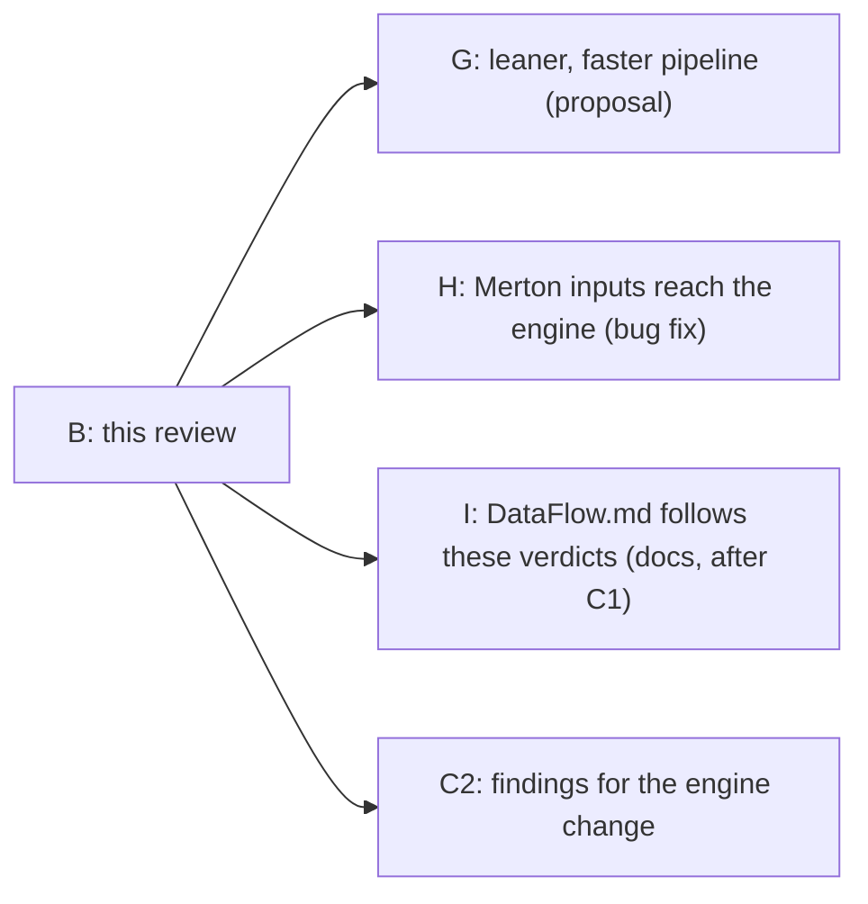
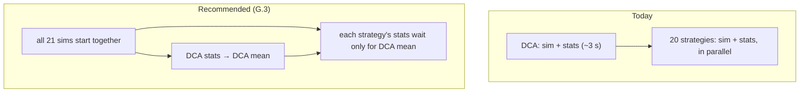
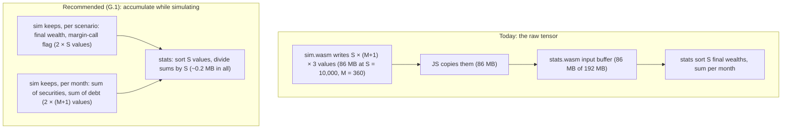

# Architecture review

[DataFlow.md](DataFlow.md) (the design aimed at) weighed against the code,
section by section: what the doc says, what the code does, which is better,
and what to do. Checked on 2026-11-09 against `dev` at `81ef2ff` plus the
uncommitted commits E (bug fixes) and C1 (DataFlow.md's leveraged-DCA
rewrite). Commit B of [docs/plan.md](plan.md). Until a point here is acted
on, CLAUDE.md's "Design docs are aspirational" still holds for it.

## Bottom line

The design is sound, and the code follows it on the big things: one worker
per strategy, precompiled composite providers picked by an integer,
schedules computed once, stats kept out of the orchestrator. Five findings
matter:

| # | Finding                                                                                                                                                                                            | Cost of leaving it                                                                                                                                                                                                                  | Recommendation                                                                                                                                            | Plan                                                                                                                                                                                 |
| - | -------------------------------------------------------------------------------------------------------------------------------------------------------------------------------------------------- | ----------------------------------------------------------------------------------------------------------------------------------------------------------------------------------------------------------------------------------- | --------------------------------------------------------------------------------------------------------------------------------------------------------- | ------------------------------------------------------------------------------------------------------------------------------------------------------------------------------------ |
| 1 | Every worker holds the full raw tensor (every scenario × every month × 3 states) three times: in `sim.wasm`'s 192 MB output buffer, in a JS copy, and in `stats.wasm`'s 192 MB input buffer. | About 260 MB written per strategy worker, ~5 GB across the 20 that run at once; likely a large part of the 2–4 s `wasm-init` per worker in your log (unmeasured); and a hard cap: a 40-year loan overflows the buffer and fails. | Stats need far less than the tensor. Accumulate them while simulating, and drop the tensor (diagram R1).                                                  | G.1 becnhmark first before any fix                                                                                                                                                   |
| 2 | Each worker fetches and compiles both WASM modules itself, and 21 workers start at once whatever the machine's core count.                                                                         | Compile time paid 21 times; cores oversubscribed.                                                                                                                                                                                   | Compile once in the orchestrator and hand the module to a pool of `navigator.hardwareConcurrency` workers.                                              | G.2                                                                                                                                                                                  |
| 3 | The 20 leveraged strategies wait for the whole DCA run before they start (~3 s of a ~13.6 s run in your log), though only their stats need DCA's mean.                                             | ~20% of the run spent waiting.                                                                                                                                                                                                      | Start all simulations together; only each strategy's outcome split waits for DCA's mean.                                                                  | G.3                                                                                                                                                                                  |
| 4 | When a worker fails, the others run on (up to their 10-minute timeout) and the error surfaces only after `Promise.all` rejects.                                                                  | Wasted CPU after a failure.                                                                                                                                                                                                         | Terminate the others on the first failure. The doc's request IDs and job state machine aren't needed while the Calculate button is disabled during a run. | G.4                                                                                                                                                                                  |
| 5 | Custom mode's Merton inputs (jump intensity, mean, volatility) are editable but never read; the engine hard-codes its jumps (`math.ts:43-49`).                                                   | The page lets you change parameters that change nothing.                                                                                                                                                                            | Pass them to the engine, as Merton's model defines them. A bug fix.                                                                                       | H comment: tyou should change the inputs of the calculator intlleigently dependinf on the simulation engine chosen <br /><br />whicy are we expisoing endpoints that are useless??? |

The rest are doc corrections (the code is better, or the doc contradicts
itself): commit I.



## 1. Saga and fan-out

**Doc:** a saga. One request ID, one job per strategy, all dispatched at
once, a request/job state machine, messages accepted only when both IDs
match, and on any failure or timeout the other workers are cancelled.

**Code** (`scripts/simulationOrchestrator.js`):

- Two tiers, not one fan-out. The DCA benchmark runs alone first
  (lines 181-188), because each leveraged strategy's stats need DCA's mean
  wealth to split "sucker" from "profit" outcomes (`stats.ts`, the
  `benchmarkMean` input). Then the 20 strategies run in parallel
  (lines 217-224).
- No request or job IDs: each worker is one promise, joined by
  `strategyIndex` (lines 60-96, 281).
- A 10-minute timeout per worker (line 68); a failure rejects
  `Promise.all`, but the other workers aren't terminated.

**Verdict:** the two tiers are a real need the doc misses; the request IDs
and state machine are machinery for a problem the page doesn't have (a run
can't overlap another: Calculate is disabled until it ends). Cancelling on
failure is right and cheap.

**Recommendation:** keep promises, no IDs. Start every simulation at once
and make only the stats step wait for DCA's mean (G.3); terminate the rest
on the first failure (G.4). The doc describes that (I).



## 2. Composite providers

**Doc:** each (oscillator, tail model) pair is precompiled into its own
function in `math.ts`, registered in `PROVIDERS`, picked by one integer;
`PROVIDER_ID_MAP` maps the UI's pair to it. The doc puts the map in
`calculatorHandler.js` (UI Selection Mapping) and also says the
orchestrator resolves it (Module Contracts): it contradicts itself.

**Code:** matches the pattern (`math.ts:95-151`). `PROVIDER_ID_MAP` is in
`config.js`; `calculatorHandler.js` resolves it.

**Verdict:** the code is better: the map is configuration, and one module
resolves it.

**Recommendation:** the doc says so (I). A note for later performance work:
the composites pass the oscillator and jump as function values into
`runGenericSimulationTemplate`, and `index.ts` calls the provider through
`PROVIDERS` every month, so the hot loop makes indirect calls. Measure
before changing anything (`npm run perf`); not a plan row.

## 3. State vector and memory layout

**Doc:** a `SimState` struct (drift, vol, prev_return, regime, target LTV,
prime rate, inflation) and a `Config` struct with GARCH, Heston and Merton
fields, laid out in C.

**Code:** flat `f64` buffers indexed by named constants in
`assembly/contracts.ts`: config at `CONFIG_*` (10 fields), state at
`STATE_SECURITIES`, `STATE_DEBT`, `STATE_LIQUIDATION` (a margin-call flag
the doc doesn't mention, which stats reads). Drift and volatility are
config, not state; no GARCH/Heston/regime fields exist, because no such
model exists yet.

**Verdict:** the code is better: one source of truth (`contracts.ts`),
shared by the WASM modules and the worker's marshalling, and nothing for
models that don't exist.

**Recommendation:** the doc points to `contracts.ts` instead of restating
a layout, names the liquidation flag, and keeps the model state fields as
"added with the first stateful model (GARCH)" (I).

## 4. Schedules

**Doc:** deposits and the LTV schedule computed once by the orchestrator.

**Code:** matches (`simulationOrchestrator.js:143-174`), with `months + 1`
entries (the doc's snippet has `nMonths`: off by one, I).

**Verdict and recommendation:** keep. C2 changes only what the LTV
schedule means (the purchasing LTV), not how it's built.

## 5. Monthly step order and the engine change (C2)

The doc already describes leveraged DCA (C1's rewrite); the code still
holds the portfolio at a target LTV (`math.ts:153-211`). Closing that gap
is C2. The architecture needs no change for it: the purchase rule lives in
one place, `runGenericSimulationTemplate` (`math.ts:172-173`, `deposit` and
`purchaseToRestoreTargetLTV`), and the schedule already carries one LTV per
month. Three findings for C2 (sent to the session planning it):

- **A wiped-out account.** When a fall leaves debt above the securities,
  the margin call sells everything and debt remains (`math.ts:190`). Under
  leveraged DCA the budget would then buy at `L` on top of that deficit,
  and the next margin call would sell it again. The correct model: the
  shortfall is owed. The budget repays it first, unlevered, and leveraged
  buying resumes once it's gone. The run counts as a margin call (it
  already does).
- **Strategy spacing at high leverage.** `generateLTVSteps`
  (`simulationOrchestrator.js:106-123`) spaces strategies evenly in LTV.
  Leverage is `1 / (1 − LTV)`, so with the free input's 98% maximum, 0% to
  90% (1x to 10x) takes most strategies and 90% to 98% (10x to 50x) gets
  two or three. Spacing evenly in leverage (or its logarithm) spreads them
  where the outcomes differ.
- **The input's ceiling and the engine's.** The free input goes to 99.9%;
  `clampTargetLTV` (`math.ts:176-178`) silently clamps at 99%. Either the
  input stops at 99%, or the clamp moves to 99.9% (1,000x): pick one, so
  what's shown is what's run.

## 6. Module contracts

| Module                        | Doc                                                                                 | Code                                                                                                      | Verdict                                               |
| ----------------------------- | ----------------------------------------------------------------------------------- | --------------------------------------------------------------------------------------------------------- | ----------------------------------------------------- |
| `sim.wasm`                  | returns raw state paths, `scenarios × (months + 1)` per state                    | matches, into a fixed 24M-value buffer (`index.ts:21`)                                                  | the contract is the problem: finding 1                |
| math                          | one composite per combination; configurable Merton, GARCH, seed                     | composites match; Merton hard-coded; no seed                                                              | Merton: finding 5. Seed: see below                    |
| `stats.wasm`                | mean, median, p90, survival, outcome categories summing to all scenarios, histogram | matches since E.12 (all runs counted, histogram trimmed)                                                  | keep                                                  |
| `simulationWorker.js`       | raw tensors stay in the worker                                                      | they do, but copied through JS (`simulationWorker.js:77-79, 104-127`)                                   | finding 1                                             |
| `simulationOrchestrator.js` | saga                                                                                | two tiers, no IDs, no cancel                                                                              | section 1                                             |
| `calculatorHandler.js`      | reads inputs, resolves the provider                                                 | matches; also writes to a `summaryCurrentLtv` element `index.html` doesn't have (lines 360-363, dead) | drop the dead lines with G or H                       |
| `math.wasm`                 | not in the doc                                                                      | built by `asbuild:math`, loaded by nothing                                                              | already parked: `docs/long_term_plan.md`, project 2 |

**Seed:** runs use `Math.random()` seeded per instance, so no two runs are
alike and tests can't check values. A seed input would make runs
reproducible. Not needed now; recorded here only.

## 7. Required invariants

**Doc:** "Every scenario and every month appears in the raw output."

**Verdict:** this invariant is what forces finding 1. What the page shows
needs, per scenario, its final wealth and whether it was ever
margin-called, and, per month, the sums of securities and debt across
scenarios. All of it can be accumulated while simulating.

**Recommendation:** replace it with "every scenario contributes to every
statistic", and make the per-month sums and per-scenario results the
contract (G.1, then I).

**R1, what crosses from simulation to stats:**



The figures are computed from the code's buffer sizes and your run's
dimensions (10,000 scenarios, 360 months, 3 states), not measured; the
~5 GB is the 20 strategy workers of the second tier at ~260 MB each. G.1
also removes the 24-million-value cap, and with it the failure at loan
periods past about 39 years (20,000 DCA scenarios × 481 months × 3 =
28.9M).

**G1, what calls what after G (a large refactor, so diagrams before code):**

```mermaid
sequenceDiagram
    participant H as calculatorHandler
    participant O as orchestrator
    participant P as worker pool (≤ cores)
    participant W as worker
    H->>O: run(request)
    O->>O: compile sim.wasm and stats.wasm once
    O->>P: 21 jobs + compiled modules
    P->>W: job
    W->>W: simulate, accumulating per-scenario and per-month results
    W-->>O: DCA's results first (job 0)
    O-->>W: DCA mean, to every waiting job
    W->>W: stats (outcome split needs DCA mean)
    W-->>O: strategy result
    O-->>H: all 21 results (or the first error; the rest terminated)
```

## What this review doesn't settle

- Whether indirect calls in the hot loop cost anything measurable
  (section 2): `npm run perf` before and after G answers it.
- The browser's actual memory use: the figures above are arithmetic. The
  DevTools Memory panel during a run would confirm them; a step for the
  user, after G if wanted.
