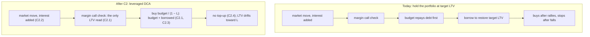
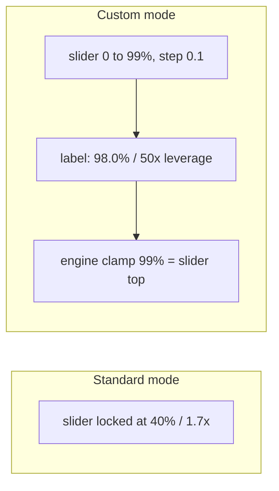
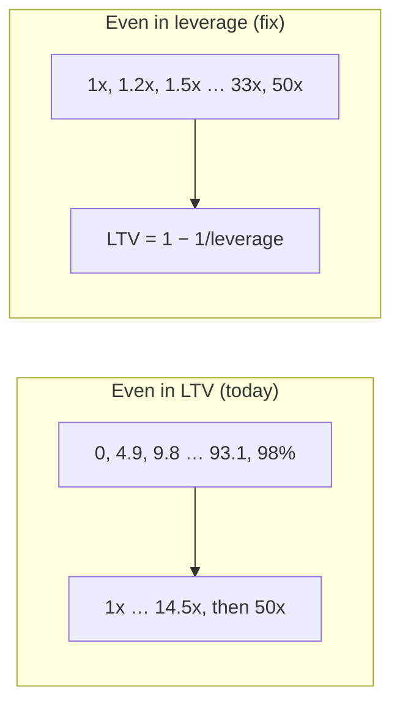
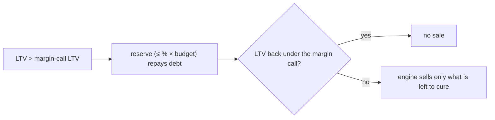
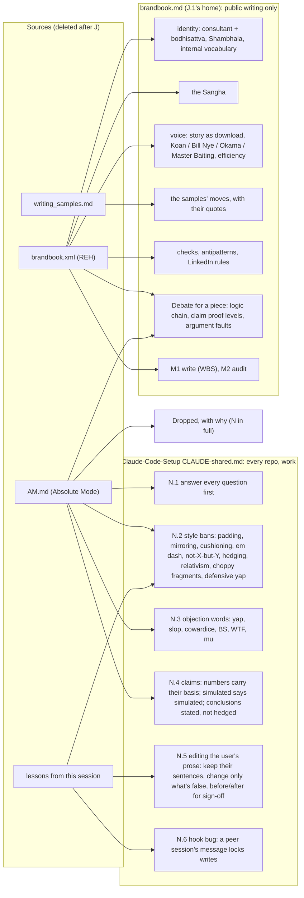

# Plan

Goal, in order (the user's critical path): **CI for the release workflow
(F) → architecture review (B) → Merton inputs (H) → docs and copy (C1) →
leveraged DCA engine (C2) → discretionary reserve (D) → leaner pipeline (G)
→ DataFlow.md follows the review (I).** The engine moves from "hold a
target LTV" to "leveraged DCA": every month's purchase is made at a fixed
purchasing LTV, whatever the portfolio's own LTV is.

State, checked 2026-11-10 (second `/review`): local `dev` is at
`3b04257` ("Point the copy rule at the brandbook", J's message), **not
pushed**: `origin/dev` is still `ac73b09` (E). `3b04257` holds more than J:
it also holds C1.1 to C1.5 (the flat copy C1.6 is to redo), B's
`docs/architecture-review.md` and the edited `docs/bugs.md`, all under J's
message and `Closes #7`. Split it before pushing (Your steps, Now). The
working tree is clean. `main` is at `81ef2ff` (the Claude Code setup),
tagged history `v0.1.0` to `v0.3.0` below it. Open issues: #4 (E, closes
when E reaches `main`), #5 (C1), #6 (B), #7 (J); F, H, C2, D, G and I open
theirs under their `/go`. Claude-Code-Setup's commit N landed as
`291b9d2` (CRAFT-10 and the rest). Work lands on `dev`, one commit per issue, and only releases reach
`main` (DEVELOPMENT.md, Branches and releases). Two agent sessions plan in
parallel: one keeps F, B, H, G, I and this header; the other keeps C1, C2
and D. Off-path work is parked in `docs/long_term_plan.md`.

## Commits

- **F. CI for the release workflow** (F.1, F.2): next for the other
  session, after C1 is committed (both change `README.md`). Deploy Pages
  only after Tests pass on `main`; benchmark only release pull requests.
- **B. Architecture review** (B.1, #6): landed, uncommitted. Commit it any
  time: it overlaps nothing (Your steps, Now).
- **H. Merton inputs reach the engine** (H.1 to H.3): bug fix; before C2
  (both change `math.ts`).
- **C1. Docs and copy: leveraged DCA** (C1.1 to C1.9, #5): C1.1 to C1.5
  landed, and were committed by mistake inside `3b04257`; once split
  (Your steps, Now) they're uncommitted again. Its copy lost your voice
  and has finance and design errors (table C1-audit); C1.6 to C1.9 fix
  them. Waiting for C1.7's answer and C1.6's line table, then `/go C1`.
- **C2. Leverage engine: leveraged DCA** (C2.1 to C2.9): after C1 and H.
  Makes the engine true to C1's docs. Design settled.
- **D. Discretionary reserve** (D.1 to D.3): after C2. At a margin call,
  you pay in up to a % of the budget, which repays debt before anything is
  sold. Design settled. `v0.4.0` is released after D.
- **G. Leaner, faster pipeline** (G.1 to G.4): after D. Proposal, waiting
  for G's sign-off.
- **I. DataFlow.md follows the review** (I.1): after G and C1. Docs only.
- **J. One brandbook, the tone guide retired** (J.1 to J.4, #7):
  committed locally as `3b04257`, together with C1, B and `docs/bugs.md`;
  recommitted alone by the split (Your steps, Now), with
  `temp/commit-message-J.txt` (the same message).

## Awaiting sign-off

| #    | Item                                                                                                                                                                                                                           | Sign off | Recommendation & explanation                                                                                                                                                                                                                                                                                                                                                                                                                                                                                                                                                                                                                                                                                                                | Comments |
| ---- | ------------------------------------------------------------------------------------------------------------------------------------------------------------------------------------------------------------------------------ | -------- | ------------------------------------------------------------------------------------------------------------------------------------------------------------------------------------------------------------------------------------------------------------------------------------------------------------------------------------------------------------------------------------------------------------------------------------------------------------------------------------------------------------------------------------------------------------------------------------------------------------------------------------------------------------------------------------------------------------------------------------------- | -------- |
| C1.6 | Put C1's copy back in your voice: your sentences kept wherever still true, only what the new rule made false changed, new lines in your voice.                                                                                 | [ ]      | Your instruction (2026-11-09: "squished the voice", "AI slop"); I flattened it, and that's my defect. The lines, yours beside mine, are table C1-voice in [C1 in full](#c1-docs-and-copy-leveraged-dca-c11-to-c16). **Paused (2026-11-10):** the table's lines are full of defensive yap (row 14's "That's where the discount is" is your Exhibit A). J has written the brandbook (`temp/brandbook.md`); I redo the lines against it, as its M1 WBS (§4), for your sign-off, drawn from `temp/associated-linkedin-posts.md`. Table C1-audit (2026-11-10) now says which lines fail brand, design or finance; the new table covers every "fail" there. **Q:** none yet; the new table comes next round, after C1.7's answer. |          |
| C1.7 | Delete the improvement tips (`_classifyStrategy`, `_suggestFixes`, `getFixStrategyHeaderText` in `scripts/copywritingHelper.js`), which the page never shows.                                                          | [ ]      | Nothing calls them: `generateVerdict` returns `fixSuggestion: []` (`copywritingHelper.js:370`) and no other file names them. C1 rewrote dead copy, and three of its tips are false under leveraged DCA (C1-audit rows 27 and 28). Deleting them drops C1.6's rows 13 and 14. The alternative is to show them again, which is a product change with its own copy round. **Q:** delete (recommended) or show them?                                                                                                                                                                                                                                                                                                                |          |
| G    | Rework the pipeline as the review recommends: stats accumulated while simulating (no raw tensor), WASM compiled once with a worker pool sized to the cores, all simulations started together, the rest cancelled on a failure. | [ ]      | Proposal, from [the review](architecture-review.md), findings 1 to 4, diagrams R1 and G1. Today each strategy worker writes ~260 MB, ~5 GB across a run (arithmetic, unmeasured), compiles the WASM itself, and the leveraged strategies wait ~3 s for DCA; a loan past ~39 years overflows the buffer and fails. Expected: much less memory, a faster run, no length cap. Costs a rework of four files and a new sim→stats contract; `npm run perf` before and after measures it. **Q:** do G?                                                                                                                                                                                                                                     |          |

## Your steps

### Now

- Split `3b04257` before pushing it: it holds J, C1.1 to C1.5, B and
  `docs/bugs.md` under J's message. Undo the commit (the files keep their
  content), then commit J and B alone, one line at a time:

  ```powershell
  git reset HEAD~1
  git add CLAUDE.md docs/plan.md
  git commit -F temp/commit-message-J.txt
  git add docs/architecture-review.md
  git commit -F temp/commit-message-B.txt
  git push
  git status
  ```

  `git status` should then list only C1's files (`README.md`,
  `documentation/DataFlow.md`, `index.html`,
  `scripts/copywritingHelper.js`, the new
  `tests/unit/leveragedDcaCopy.test.js`) and `docs/bugs.md`. This
  replaces the separate "Commit B" step below.
- Refresh `<root>/CLAUDE.md`: this session still loads the copy from
  before Claude-Code-Setup's `291b9d2` (it has no CRAFT-10 or
  TRANSPARENCY-10). Dry run, then apply, from the `Dev` folder:

  ```powershell
  pwsh -File Claude-Code-Setup/setup-root.ps1
  pwsh -File Claude-Code-Setup/setup-root.ps1 --apply
  ```
- `docs/bugs.md`: E fixed both bugs in it. Check them in the browser
  (`npm run dev`: the page opens in Standard Mode with its defaults; after
  a calculation the strategy slider moves the histogram and the position
  text), then: `git rm -f docs/bugs.md`
- Answer C1.7 (the dead tips); C1.6's new line table follows, then
  `/go C1`.
- Tick or comment G.
- Once you're happy with the rewritten history: `git branch -D backup/pre-rewrite`
- E alone is a fix release if you want the live site repaired now: say
  so, and the other session opens the pull request `dev` → `main`
  (`v0.3.1`, say).

### After `/go C1`

Commit C1, with only its files, one line at a time:

```powershell
git add documentation/DataFlow.md README.md index.html scripts/copywritingHelper.js tests/unit/leveragedDcaCopy.test.js docs/plan.md
git diff --cached --stat
git commit -F temp/commit-message-C1.txt
git push
```

The `--stat` line should list those six files and nothing else. Then
`npm run dev` and read the new copy; the numbers still come from today's
engine until C2.

### After commit C2

- `npm run asbuild`, then commit the rebuilt `build/` with the source
  (DEVELOPMENT.md, Change workflow 2), with C2's own `git add` and
  `temp/commit-message-C2.txt`.
- `npm run dev`, Custom Mode: the max purchasing LTV slider reaches 98.0% /
  50x leverage and 99.0% / 100x; the strategies between 0 and the max are
  spread out in leverage (C2.9).

### After commit D

- The same two steps as after C2, with D's files and
  `temp/commit-message-D.txt`.

## Signed off

| #    | Item                                                                                                                                                                                                                             | Sign off | Recommendation & explanation                                                                                                                                                            | Comments |
| ---- | -------------------------------------------------------------------------------------------------------------------------------------------------------------------------------------------------------------------------------- | -------- | --------------------------------------------------------------------------------------------------------------------------------------------------------------------------------------- | -------- |
| F.1  | Deploy Pages only after Tests pass on `main`.                                                                                                                                                                                  | [x]      | Your answer ("test first and don't deploy if the tests don't even pass").                                                                                                               |          |
| F.2  | Run the benchmark only on release pull requests.                                                                                                                                                                                 | [x]      | You ticked it.                                                                                                                                                                          |          |
| B.1  | Write `docs/architecture-review.md`.                                                                                                                                                                                           | [x]      | Done (2026-11-09), uncommitted.                                                                                                                                                         |          |
| H.1  | Merton's jump intensity, mean and volatility reach the engine as config values.                                                                                                                                                  | [x]      | Bug fix ([review](architecture-review.md), finding 5): Custom mode lets you edit them (`index.html:196-215`), but nothing reads them and `math.ts:43-49` hard-codes the jumps.       |          |
| H.2  | The engine draws jumps as Merton's model defines them: Poisson arrivals at the given intensity, lognormal sizes with the given mean and volatility.                                                                              | [x]      | Settled as the correct model (CLAUDE.md, finance questions): `config.js`'s defaults were chosen to match today's hard-coded jumps on average, so Standard mode's results barely move. |          |
| H.3  | Tests for H.                                                                                                                                                                                                                     | [x]      | Follows from H.1 and H.2.                                                                                                                                                               |          |
| I.1  | `documentation/DataFlow.md` follows the review's verdicts where the code is better (the two tiers, `PROVIDER_ID_MAP` in `config.js`, `contracts.ts` as the layout, the liquidation flag, the schedule's `months + 1`). | [x]      | Follows from CLAUDE.md, Design docs are aspirational: the review settles each point, and the doc then follows.                                                                          |          |
| C1.1 | `documentation/DataFlow.md` describes leveraged DCA: the monthly step and the strategy mapping.                                                                                                                                | [x]      | Your instruction: the docs lead, the code follows. Done.                                                                                                                                |          |
| C1.2 | The README's opening paragraph says what leveraged DCA is.                                                                                                                                                                       | [x]      | Follows from C1.1. Done; its wording is redone by C1.6.                                                                                                                                 |          |
| C1.3 | The page's copy teaches leveraged DCA, and "Max Test LTV" becomes "Max Purchasing LTV".                                                                                                                                          | [x]      | Your instruction. Done; its wording is redone by C1.6.                                                                                                                                  |          |
| C1.4 | The copy tests follow C1.3.                                                                                                                                                                                                      | [x]      | Done: `tests/unit/leveragedDcaCopy.test.js`.                                                                                                                                          |          |
| C1.5 | C1 also writes D's reserve into the docs and the copy; `v0.4.0` waits for D.                                                                                                                                                   | [x]      | Your "yes". Done.                                                                                                                                                                       |          |
| C1.8 | "More leverage means higher returns" says "average returns", and the copy says the typical (median) outcome peaks and then falls.                                                                                                | [x]      | Finance fix, mine to settle (CLAUDE.md): true of the mean, false of the median, which is what the page's summary compares. C1-audit row 29.                                             |          |
| C1.9 | The page's three definitions of the outcomes agree: Ruin is "at or below" total real deposits, as the code counts it.                                                                                                            | [x]      | Bug fix: `index.html:99` says "below", `copywritingHelper.js:398` and `stats.ts` count "at or below". C1-audit row 30.                                                            |          |
| H.4  | Merton's default mean jump matches today's jumps: `JUMP_MU` −0.258, not −0.225.                                                                                                                                              | [x]      | Bug fix, H in full.                                                                                                                                                                     |          |
| C2.1 | Each month buys `budget / (1 − LTV)` and borrows the difference; the investor never acts on the portfolio's LTV, which only the margin call reads.                                                                            | [x]      | Your answer: a budget of 10 at a 50% LTV buys 20. Basis and caveats: [C2 in full](#c2-leverage-engine-leveraged-dca-c21-to-c29), table C0.                                               |          |
| C2.2 | Interest stays capitalized: it is added to the debt, not paid from the budget.                                                                                                                                                   | [x]      | Your answer ("don't reinvent the wheel"); today's engine (`math.ts:169-170`).                                                                                                         |          |
| C2.3 | The monthly budget always buys; it never repays debt.                                                                                                                                                                            | [x]      | Follows from your instruction: today the budget repays debt first (`math.ts:197-202`), which stops buying after a fall.                                                               |          |
| C2.4 | No borrowing to bring the LTV back to target; the LTV drifts with the market.                                                                                                                                                    | [x]      | Your instruction. Margin calls stay as they are (`math.ts:184-195`).                                                                                                                  |          |
| C2.6 | The max purchasing LTV is a slider labelled "LTV / leverage" (e.g. "98.0% / 50x leverage"): Custom mode 0 to 99% in steps of 0.1, Standard locked at 40%; no margin-call ceiling; 99% is also the engine's clamp.                | [x]      | Your instructions: "let the hedge funds get 50x leverage", then "make the slider again … 98%/50x leverage".                                                                            |          |
| C2.7 | The `config.js` "max test LTV" comments and the "DCA Ruin" / "DCA Survived" chart labels, moved from C1.                                                                                                                       | [x]      | They sit in files C1 doesn't otherwise touch; C2 changes `calculatorHandler.js` anyway.                                                                                               |          |
| C2.9 | Space the strategies evenly in leverage, not in LTV.                                                                                                                                                                             | [x]      | Bug fix (your comment: "this should've always been the case"); it shows since E.2 opened Custom mode up to 100%.                                                                        |          |
| J.1  | The brandbook stays untracked, in `temp/brandbook.md`.                                                                                                                                                                         | [x]      | Your `/go J`: "don't write a tracked brandbook, it stays in temp".                                                                                                                    |          |
| J.2  | The split of J-MECE: REH in the brandbook, AM where it applies in Claude-Code-Setup's commit N, the rest dropped with why.                                                                                                       | [x]      | Your `/go J` took my recommendation.                                                                                                                                                  |          |
| D.1  | A new input, the reserve as a % of the monthly budget, defaulting to 0%.                                                                                                                                                         | [x]      | Your instruction (10% on a budget of 500 is up to 50 a month).                                                                                                                          |          |
| D.2  | The reserve is paid in at the margin call only, before anything is sold.                                                                                                                                                         | [x]      | Your answer: "you get an email about a margin call and scramble to come up with cash".                                                                                                  |          |
| D.3  | The reserve repays debt; whatever goes unused in a month is not carried over.                                                                                                                                                    | [x]      | Your answer ("um duh").                                                                                                                                                                 |          |

## The items in full

### F. CI for the release workflow (F.1, F.2)

Its own GitHub issue, opened under `/go F`. The merge strategy (always a
merge commit) is your answer of 2026-11-09, already in DEVELOPMENT.md;
protecting `main` was declined (CLAUDE.md, Known, not a risk). It changes
`README.md`'s Production section, which C1 also changes, so F starts after
C1 is committed.

- F.1 `.github/workflows/jekyll-gh-pages.yml`: trigger on `workflow_run`
  of Tests (completed, branch `main`) and deploy only when it succeeded,
  keeping `workflow_dispatch`; drop the `push` trigger. Docs:
  DEVELOPMENT.md, CI; README, Production.
- F.2 `.github/workflows/test.yml`, `performance` job: run only on
  `pull_request` into `main`. Docs: DEVELOPMENT.md, CI.

### B. Architecture review (B.1)

- B.1 done (2026-11-09), uncommitted: `docs/architecture-review.md`, issue
  #6, message `temp/commit-message-B.txt`. Its findings became G
  (pipeline, proposal), H (Merton inputs, bug fix), I (DataFlow verdicts),
  and three notes for C2 (settled under C2: C2.6's 99% top, C2.9, and the
  wiped-out account, which needs no change).

### H. Merton inputs reach the engine (H.1 to H.3)

- H.1 `assembly/contracts.ts`: `CONFIG_JUMP_LAMBDA`, `CONFIG_JUMP_MU`,
  `CONFIG_JUMP_SIGMA` (indices 10 to 12; the input buffer has 20);
  `scripts/simulationWorker.js` (`marshalInputs`) writes them;
  `scripts/calculatorHandler.js` reads the three inputs into the request
  (Standard mode: `MERTON_PARAMS_DEFAULTS`); `scripts/simulationOrchestrator.js`
  passes them through.
- H.2 `assembly/math.ts`: `simulateMertonJumpFactor` takes λ (per year), μ
  and σ: each month a jump arrives with probability `1 − e^(−λ/12)`, and
  its factor is `exp(μ + σ·Z)`. Rebuild `build/` (your step).
- H.3 tests: `tests/unit/` (the request carries the three inputs, Standard
  mode the defaults); `tests/integration/orchestrator-worker-wasm.test.js`
  (λ = 0 with Merton gives the same distribution shape as no jumps: no
  jump ever fires). Docs: DataFlow.md, math's Configuration; and the
  page's copy, which describes today's jumps and becomes false with H.2:
  `index.html:405-406` (the 1/96 trial, the uniform −15% to −30% draw)
  and `:449` (Black Swan Frequency), in the voice rules of CLAUDE.md, Copy
  keeps the user's voice.
- H.4 `config.js:72`: `JUMP_MU` −0.258. Its comment says −0.225 is the
  midpoint of today's −15% to −30% range, but that midpoint is a simple
  return: today's mean jump factor is 0.775 (`math.ts:46`). A lognormal
  jump `exp(μ + σZ)` has mean `exp(μ + σ²/2)`, so μ = ln(0.775) −
  0.075²/2 ≈ −0.258. At −0.225 the mean jump is exp(−0.2222) ≈ 0.80, a
  −20% crash instead of −22.5%, and Standard mode gets milder than
  today. Tests: H.3's unit test checks the default.

### C1. Docs and copy: leveraged DCA (C1.1 to C1.6)

Your rule (CLAUDE.md, Design docs are aspirational): the docs lead. C1
writes leveraged DCA into the design doc, the README and the page's copy;
C2 then makes the engine true to it. Until C2 lands, `dev`'s page explains
leveraged DCA while its numbers come from today's target-LTV engine; only
releases reach `main`, so the live site never shows that.

C1.1 to C1.5 are done in `documentation/DataFlow.md`, `README.md`,
`index.html`, `scripts/copywritingHelper.js` and the new
`tests/unit/leveragedDcaCopy.test.js`; issue #5. They sit in the local
commit `3b04257` by mistake until the split (Your steps, Now). `npm test`
at the end of `/go C1` (2026-11-09): 12 files, 69 tests, all passed.
What's left is C1.6 to C1.9.

**C1-audit, every line of copy C1 wrote, and the old lines it made
false** (checked 2026-11-10 at `3b04257`). Brand: `temp/brandbook.md`
(product copy is Bill Nye in Okama's register, §3.3; efficiency, §3.3;
CRAFT-10 for your lines). Design: the signed-off rows C2.1 to C2.9 and
D.1 to D.3. Finance: correct as finance, and true to the engine where the
engine already does it. "Pass" means nothing to change.

| #  | Where                                       | Line (short)                                                                                                          | Brand                                                                                         | Design                                                                                          | Finance                                                                                                                                                                                                   |
| -- | ------------------------------------------- | --------------------------------------------------------------------------------------------------------------------- | --------------------------------------------------------------------------------------------- | ----------------------------------------------------------------------------------------------- | --------------------------------------------------------------------------------------------------------------------------------------------------------------------------------------------------------- |
| 1  | `README.md:3`                             | "In leveraged DCA, each month's budget is topped up …" (4 sentences)                                                 | **Fail**: neutral explainer; your sentence was one line                                 | Pass                                                                                            | Pass                                                                                                                                                                                                      |
| 2  | Preamble, opening                           | "Leveraged DCA is plain DCA with a fixed share of every purchase borrowed. …"                                        | **Fail**: 3 sentences of textbook                                                       | Pass                                                                                            | Pass                                                                                                                                                                                                      |
| 3  | Working example, intro                      | "$1,000 / (1 − 50%) = $2,000 … the same in every kind of month"                                                     | **Fail**: a formula where your "$1,000 deposit + $1,000 borrowing" said it              | Pass                                                                                            | Pass                                                                                                                                                                                                      |
| 4  | Good month                                  | "… nudges it back up toward 50%. No extra borrowing chases the rally."                                               | **Fail**: the second sentence defends                                                   | Pass                                                                                            | Pass                                                                                                                                                                                                      |
| 5  | Flat month                                  | "… LTV creeps up whenever the portfolio returns less than the loan rate. The loan rate is the hurdle …"             | **Fail**: 3 sentences; the hurdle is the payload, keep it                               | Pass                                                                                            | Pass, as an approximation (each purchase also pulls the LTV toward 50%)                                                                                                                                   |
| 6  | Bad month                                   | "… buying low, and pulls the LTV back down … the lender sells only what that reserve can't cover."                  | **Fail**: long                                                                          | Pass (D.2)                                                                                      | Pass                                                                                                                                                                                                      |
| 7  | "Why Not Hold a Target LTV?"                | "… adds exposure after gains and cuts it after losses …"                                                            | **Fail**: textbook; your part 3 post says it better                                     | Pass                                                                                            | Pass                                                                                                                                                                                                      |
| 8  | Comparison table                            | "Kinda (a margin call needs cash on hand)"                                                                            | **Fail**: your joke lost                                                                | Pass                                                                                            | **Fail**: a margin call needs no cash; the lender sells. Cash is the optional reserve (D)                                                                                                           |
| 9  | "What the Simulator Calculates", question   | "what share of each purchase can responsibly be borrowed?"                                                            | Pass                                                                                          | Pass                                                                                            | Pass                                                                                                                                                                                                      |
| 10 | Same, next line                             | "Too high and the first major crash forces margin-call sales."                                                        | **Fail** (CRAFT-10): your "liquidation happens in the first major crash" was still true | Pass                                                                                            | Pass                                                                                                                                                                                                      |
| 11 | Same, closing line                          | "… up to the max purchasing LTV, whose ceiling sits just below the margin-call threshold."                           | **Fail**: your "automatically … smooth, readable increments" dropped                   | **Fail**: C2.6 has no ceiling (0 to 99%)                                                  | Pass                                                                                                                                                                                                      |
| 12 | Same, last paragraph                        | "… so the simulated margin-call odds are a floor, not a ceiling."                                                    | **Fail**: repeats row 26                                                                | Pass                                                                                            | **Fail**: "floor" claims a strict bound; monthly checks understate margin calls, but "No Voluntary Sales" overstates them, so the net direction is unknown. Say "understated by the monthly checks" |
| 13 | Strategy narrative                          | "buys every month at a purchasing LTV of X: that share of each purchase is borrowed, and …"                          | **Fail**: explainer                                                                     | Pass                                                                                            | Pass                                                                                                                                                                                                      |
| 14 | Mode descriptions                           | Standard: term swapped; Custom: adds "the same leveraged purchase every month"                                        | Standard pass; Custom **fail** (CRAFT-10: more than the term changed)                   | Pass                                                                                            | Pass                                                                                                                                                                                                      |
| 15 | Tips, Dangerous (new)                       | "Lower the Purchasing LTV." / "Set a Discretionary Reserve."                                                          | **Fail**: second sentences explain                                                      | Pass                                                                                            | Pass. Dead copy: C1.7                                                                                                                                                                                     |
| 16 | Tips, Marginal (new)                        | "Keep Buying Every Month. The same leveraged purchase in bad months …"                                               | **Fail**: "so what?" fails; the model always buys, there's nothing to keep doing        | Pass                                                                                            | Pass. Dead copy: C1.7                                                                                                                                                                                     |
| 17 | Reserve tooltip (for D)                     | "How much extra you could find in a month by cutting discretionary spending …"                                       | **Fail**: 3 explaining sentences                                                        | Pass (D.1 to D.3)                                                                               | Pass                                                                                                                                                                                                      |
| 18 | Budget tooltip                              | "Every month, the whole budget buys … The budget never repays debt."                                                 | Pass: your tooltip was technical too                                                          | Pass                                                                                            | Pass                                                                                                                                                                                                      |
| 19 | Initial deposit tooltip                     | "It is the first purchase, made at the purchasing LTV …"                                                             | Pass                                                                                          | Pass                                                                                            | Pass                                                                                                                                                                                                      |
| 20 | Max purchasing LTV tooltip                  | "Its ceiling follows the margin call: it can't be set above the margin-call threshold minus 5 points …"              | **Fail**: your sentence ("roughly 20 pretty steps …") dropped                          | **Fail**: C2.6, no ceiling                                                                | Pass                                                                                                                                                                                                      |
| 21 | Margin call tooltip                         | "The portfolio LTV at which the lender forces a sale. … The max purchasing LTV's ceiling moves with it."             | **Fail** (CRAFT-10): your line was still true                                           | **Fail**: no ceiling                                                                      | Pass                                                                                                                                                                                                      |
| 22 | Slider title, Current Position              | "Explore Purchasing LTVs", "Purchasing LTV of"                                                                        | Pass (mechanical)                                                                             | Pass                                                                                            | Pass                                                                                                                                                                                                      |
| 23 | Methodology steps 1 and 2                   | "invests the initial deposit as a first purchase …" / "the portfolio's own LTV is never targeted"                    | Pass (technical section)                                                                      | Pass                                                                                            | Pass                                                                                                                                                                                                      |
| 24 | Methodology, Check margin                   | "… the lender sells just enough securities to bring the LTV back to the threshold."                                  | Pass                                                                                          | Pass (D.2)                                                                                      | Pass: the engine sells to the threshold (`math.ts:190`)                                                                                                                                                 |
| 25 | Methodology, Leveraged purchase             | "The whole monthly budget buys …"                                                                                    | Pass                                                                                          | Pass (C2.1, C2.3, C2.4)                                                                         | Pass                                                                                                                                                                                                      |
| 26 | Limitation, Monthly Margin Checks           | "… so margin calls are understated."                                                                                 | Pass                                                                                          | Pass                                                                                            | Pass                                                                                                                                                                                                      |
| 27 | Tip, Pointless (old, kept)                  | "Increase the Monthly Deposit. Larger deposits make debt a shrinking percentage of portfolio value."                  | n/a                                                                                           | **Fail**: the budget is levered at L, so debt grows with it; the LTV doesn't move         | **Fail**, same reason. Dead copy: C1.7                                                                                                                                                              |
| 28 | Tips, Dangerous (old, kept)                 | "Reduce the Loan Amount … less than a third of portfolio value" / "Add More Collateral … without further borrowing" | n/a                                                                                           | **Fail**: no such lever; `loanAmount` is a hidden input fixed at 0 (`index.html:248`) | "A third" has no source. Dead copy: C1.7                                                                                                                                                                  |
| 29 | What the Simulator Calculates (yours, kept) | "In general, over a long time horizon, more leverage means higher returns."                                           | Yours                                                                                         | Pass                                                                                            | **Fail for the median**: C1.8, below                                                                                                                                                                |
| 30 | Outputs, Ruin (yours, untouched)            | "Ended with real net worth below total real deposits"                                                                 | Yours                                                                                         | Pass                                                                                            | **Fail**: the code counts "at or below" (`copywritingHelper.js:398`); C1.9                                                                                                                        |

Not checked: "Margin Call Threshold: 60% LTV — This is what Wealthsimple
uses" (`index.html:447`) needs a primary source (brandbook §2.2); I
haven't searched for one. Copy H.2 makes false is H.3's.

**C1.8, why "more leverage means higher returns" fails for the median.**
Leverage raises the average (mean) outcome whenever the market's
expected return beats the loan rate. The typical (median) outcome grows
at the compounded rate, roughly `r + f(μ − r) − f²σ²/2` at leverage `f`:
volatility drag grows with the square of leverage, so the median peaks
at `f* = (μ − r) / σ²` and falls after it. With Standard mode's defaults
(12.64% drift less 0.125 × 22.5% of jumps ≈ 9.8% expected return, 7.0%
loan rate, 13.75% volatility plus the jumps' variance, ≈ 2.55% a year
in total), `f*` ≈ 2.8% / 2.55% ≈ 1.1x, about a 10% LTV. This is an
estimate: annual, nominal, for constant leverage rebalanced continuously,
which leveraged DCA only approximates. It says that Standard mode's 40%
(1.7x) is probably past the median's peak; C2's simulated results will
show where the peak really is. The page's summary compares medians, so
the line has to say "average". The new wording is in C1.6's table.

- C1.7 (if delete) `scripts/copywritingHelper.js`: delete
  `_classifyStrategy`, `_suggestFixes`, `getFixStrategyHeaderText`.
  Tests: none name them (checked). C1.6's rows 13 and 14 go.
- C1.8 `scripts/copywritingHelper.js`: row 29's line, in C1.6's table.
- C1.9 `index.html:99`: "at or below total real deposits".

**C1.6, why the copy failed.** I rewrote your copy as neutral explainer
prose: long sentences, no asides, your jokes gone ("LTV needs monitoring"
became "a margin call needs cash on hand"), and a "Why Not Hold a Target
LTV?" section that explains in a textbook voice what your part 3 post
already said better. The rule is now in CLAUDE.md, Copy keeps the user's
voice: keep your sentences, change only what's false, write new lines the
way the samples do, and show the lines here first. DataFlow.md stays
technical.

**C1-voice, the lines** (yours before C1, and what replaces my version):

| #  | Where                                                 | Yours (before C1)                                                                                                                                                                                                                            | Proposed                                                                                                                                                                                                                                                                                                                                                                                                                                                     |
| -- | ----------------------------------------------------- | -------------------------------------------------------------------------------------------------------------------------------------------------------------------------------------------------------------------------------------------- | ------------------------------------------------------------------------------------------------------------------------------------------------------------------------------------------------------------------------------------------------------------------------------------------------------------------------------------------------------------------------------------------------------------------------------------------------------------ |
| 1  | README, first sentence                                | "A browser-based simulator for comparing leveraged investing strategies with plain dollar-cost averaging."                                                                                                                                   | "A browser-based simulator for leveraged dollar-cost averaging: borrow a fixed share of every monthly purchase, never sell on purpose, and find the line between stonks and stupid." Then your sentence on WASM, as it was; my 4-sentence paragraph goes.                                                                                                                                                                                                    |
| 2  | Preamble, opening                                     | "Leveraged DCA introduces two additions: maintaining a target LTV and avoiding voluntary sales. The same amount is deposited every period. How much gets bought depends on where LTV sits relative to target."                               | "**Leveraged DCA is DCA with one addition: borrow a fixed share of every purchase.** Same budget every month. Same leverage on every buy. No voluntary sales. What the market does to the portfolio's LTV after that is the market's business, until the margin call."                                                                                                                                                                                 |
| 3  | Working example, intro                                | "Monthly budget of $1,000, target LTV of 50% (2:1 leverage). At target, every $1 of equity supports $1 of debt, so the baseline purchase is $2,000 ($1,000 deposit + $1,000 borrowing):"                                                     | "Monthly budget of $1,000, purchasing LTV of 50% (2:1 leverage). Every month, your $1,000 plus $1,000 borrowed buys $2,000. Every. Month. That's the whole rule:"                                                                                                                                                                                                                                                                                            |
| 4  | Good month                                            | "Growth pushed LTV below target. The $1,000 budget pays down debt … borrows and buys more than $2,000 …"                                                                                                                                   | "**Good month (portfolio up):** LTV drifts below 50%. Still buys $2,000. No chasing the rally."                                                                                                                                                                                                                                                                                                                                                        |
| 5  | Okay month                                            | "LTV drifted near target. $1,000 pays down debt, simulator borrows to buy ~$2,000."                                                                                                                                                          | "**Okay month (flat):** Still $2,000. Interest quietly grows the debt, so LTV creeps up whenever returns trail the loan rate. The loan rate is the bar the market has to clear."                                                                                                                                                                                                                                                                       |
| 6  | Bad month                                             | "LTV is above target. The $1,000 budget reduces debt, modestly improving LTV. No new securities are purchased."                                                                                                                              | "**Bad month (portfolio crashed):** LTV is above 50%. Still buys $2,000, now on sale, which drags LTV back toward 50%. If LTV crosses the margin call, you get the email and scramble for cash: the discretionary reserve repays debt first, and the lender only sells what's left."                                                                                                                                                                   |
| 7  | New section, replaces my "Why Not Hold a Target LTV?" | (none)                                                                                                                                                                                                                                       | "**Version 1 Was Momentum Trading With Extra Steps.** The first version of this simulator held the whole portfolio at a target LTV. Since it only ever buys, the only way to hold a ratio is to cower during downturns when prices are cheap, and borrow more after rallies when they aren't. For finance folks: momentum trading with extra steps. For everyone else: a dog chasing its tail 🤦 So now it doesn't." (your part 3 post, near verbatim) |
| 8  | Comparison table, Leveraged DCA × Resilient          | "Kinda (LTV needs monitoring)"                                                                                                                                                                                                               | "Kinda (margin calls exist)"                                                                                                                                                                                                                                                                                                                                                                                                                                 |
| 9  | "What the Simulator Calculates", question             | "what's the maximum LTV that can be responsibly maintained?"                                                                                                                                                                                 | "what share of every purchase can responsibly be borrowed?"                                                                                                                                                                                                                                                                                                                                                                                                  |
| 10 | Same, next line                                       | "Too low and there are low chances of excess returns. Too high and liquidation happens in the first major crash. The simulator runs thousands of randomized market scenarios across the full 0% to a maximum test LTV …"                    | Yours, verbatim, with "a maximum test LTV" → "the max purchasing LTV".                                                                                                                                                                                                                                                                                                                                                                                      |
| 11 | Same, closing line                                    | "In general, over a long time horizon, more leverage means higher returns. The calculator starts at the DCA base case (0% LTV) and automatically tests the leverage spectrum up to the selected maximum LTV in smooth, readable increments." | Yours, verbatim, with "selected maximum LTV" → "max purchasing LTV". Then: "One caveat: the simulator checks for margin calls monthly. Your broker checks daily. Read the margin call odds as optimistic."                                                                                                                                                                                                                                                  |
| 12 | Strategy narrative                                    | "The selected strategy maintains a target LTV of X while the portfolio evolves through monthly market movements and deposits."                                                                                                               | "The selected strategy borrows X of every monthly purchase and lets the portfolio's LTV fend for itself."                                                                                                                                                                                                                                                                                                                                                    |
| 13 | Tip (Dangerous)                                       | "Increase the Monthly Deposit. Larger deposits reduce the target-LTV exposure more quickly …"                                                                                                                                               | "**Borrow Less Per Purchase.** A lower purchasing LTV keeps the portfolio further from the margin call." and "**Keep a Reserve.** Cash you can find when the margin call email arrives repays debt instead of selling at the bottom."                                                                                                                                                                                                            |
| 14 | Tips (Marginal)                                       | "Lower the LTV by 5%." / "Maintain the Monthly Deposit. Consistent deposits support the target-LTV mechanism …"                                                                                                                             | "Lower the purchasing LTV by 5 points." (rest of your sentence kept) / "**Keep Buying in Bad Months.** That's where the discount is."                                                                                                                                                                                                                                                                                                                  |
| 15 | Mode descriptions                                     | "… the monthly-deposit and max-test-LTV framework …" / "… maximum tested LTV …"                                                                                                                                                          | Yours, with "max-test-LTV" → "max-purchasing-LTV" and "maximum tested LTV" → "max purchasing LTV". Nothing else changes.                                                                                                                                                                                                                                                                                                                                   |
| 16 | Max LTV tooltip                                       | "The simulator automatically tests a full spectrum of strategies from 0% (DCA baseline) up to this maximum LTV, using roughly 20 pretty steps so the range is smooth and readable. …"                                                       | "The share of each purchase that's borrowed. " + yours, verbatim ("this maximum LTV" → "this maximum") + "In Custom Mode, go wild: up to 99%. 98% is 50x leverage, 99% is 100x. The simulator won't stop you. The margin call will."                                                                                                                                                                                                                        |
| 17 | Margin call tooltip                                   | "The maximum LTV before the lender forces liquidation. X is a common baseline."                                                                                                                                                              | Yours, verbatim.                                                                                                                                                                                                                                                                                                                                                                                                                                             |
| 18 | Budget tooltip, last sentences                        | "Each month, this amount pays down outstanding debt first. If LTV falls below target …"                                                                                                                                                     | "Each month, the whole budget buys, topped up with borrowing at the purchasing LTV. It never pays down debt."                                                                                                                                                                                                                                                                                                                                                |
| 19 | Methodology step list                                 | "Check margin: If LTV exceeds the threshold, the lender forces a liquidation to restore the margin requirement." / "Deposit: …" / "LTV restore: …"                                                                                         | "Check margin: If LTV exceeds the threshold, the discretionary reserve repays debt first. If that's not enough, the lender forces a liquidation to restore the margin requirement." / "Leveraged purchase: The monthly budget plus borrowing at the purchasing LTV buys securities." + your inflation sentence, verbatim. "LTV restore" goes.                                                                                                                |
| 20 | New limitation                                        | (none)                                                                                                                                                                                                                                       | "**Monthly Margin Checks:** Lenders check daily; the simulator checks monthly. Dips that recover within the month never trigger a margin call here, so the margin call odds are optimistic."                                                                                                                                                                                                                                                           |
| 21 | Reserve tooltip (for D)                               | (none)                                                                                                                                                                                                                                       | "How much extra you could scrounge up in a bad month (skip the takeout), as a % of the monthly budget. Only used when the margin call email arrives, and it goes to repaying debt. Unused reserve isn't saved."                                                                                                                                                                                                                                              |

Kept from my version, because it's mechanical and has no voice to lose:
the "Max Purchasing LTV" label, "Explore Purchasing LTVs", "Purchasing LTV
of", and DataFlow.md.

- C1.6.1 `scripts/copywritingHelper.js`: rows 2 to 15 and 21.
- C1.6.2 `index.html`: rows 16 to 20.
- C1.6.3 `README.md`: row 1.
- C1.6.4 `tests/unit/leveragedDcaCopy.test.js`: follows the new lines.
  Run `npm test`.
- C1.6.5 `temp/commit-message-C1.txt`: says the copy keeps the existing
  voice.
- C1.6.6 `documentation/DataFlow.md`: drop the "capped at the margin-call
  LTV minus 5 points" I wrote (lines 103 and 129): the purchasing LTV is
  any value from 0 to 0.99 (100x), and buying at or above the margin call
  is allowed and shows as near-zero survival (C2.6). Strategy Mapping says
  the strategies are spaced evenly in leverage (C2.9).

### C2. Leverage engine: leveraged DCA (C2.1 to C2.9)

**C0, your proposal against mine, point by point** (the rows were C.1 to
C.6 then):

| # | Your point                                                                                                                  | Me                                                                               | Basis                                                                                                                                                                                 |
| - | --------------------------------------------------------------------------------------------------------------------------- | -------------------------------------------------------------------------------- | ------------------------------------------------------------------------------------------------------------------------------------------------------------------------------------- |
| 1 | A budget of 10 at a 50% LTV buys 20.                                                                                        | **Agree**                                                                  | That is what an LTV of 50% means (debt / value = 10 / 20), and the margin-call threshold is an LTV too, so one unit throughout.                                                       |
| 2 | Leverage is constant only in the buy phase: each purchase is made at the target LTV, and the portfolio's LTV is left alone. | **Agree; it's valid, and it's the strategy itself, not a simplification.** | It's how a passive investor with a margin account behaves. It also partly corrects itself: a purchase at LTV L moves the portfolio's LTV toward L. So C2 needs no rebalancing rule.   |
| 3 | "We don't monitor the real LTV unless we're margin called."                                                                 | **Agree on the behaviour**                                                 | The engine still computes the LTV every month to know whether a margin call happened (`math.ts:187`); the investor never acts on it.                                                |
| 4 | Interest is added to the debt (C2.2).                                                                                       | **Agree**                                                                  | The debt grows without any purchase, so when the market returns less than the loan rate, the LTV climbs even without a crash. The copy teaches it: the loan rate is the bar to clear. |
| 5 | (mine) A purchasing LTV at or above the margin call.                                                                        | **Allowed (C2.6)**                                                         | Each purchase pulls the LTV toward L, so the portfolio is margin-called every month; it shows as survival near zero.                                                                  |
| 6 | (a model limit) Margin calls are checked once a month.                                                                      | **Caveat, no change**                                                      | Brokers check daily, so the results understate margin calls; the copy says so.                                                                                                        |
| 7 | The reserve is a separate commit.                                                                                           | **Agree: commit D**                                                        | D.2 keeps point 3 true: the reserve is paid in at the margin call only.                                                                                                               |

The initial deposit (month 0) is bought at the purchasing LTV, as today
(`initializeLeveragedDCAState`, `math.ts:104-115`): the first purchase
under the same rule.

**C2-step, the monthly step, today and after C2:**



**The rule stays mechanical: no special cases** (your call, 2026-11-09).
The review asked about a wiped-out account, where a crash leaves more debt
than the portfolio is worth and the margin call sells everything. The
plain rule already handles it: next month's purchase adds `B / (1 − L)` of
securities and `B × L / (1 − L)` of debt; the margin call sells those
securities and repays the debt with them, so the leftover debt falls by
about `B` each month (give or take a month's market move), until it's
gone and buying sticks again. That's the same as the budget repaying the
deficit, with no extra rule. (I had planned an explicit rule, C2.8; it's
gone.)

**C2.6, the max purchasing LTV slider.** Your instructions: "let the hedge
funds get 50x leverage if they want", then "make the slider again …
display ltv as LTV / Ratio, so slider 98%/50x leverage". They replace your
earlier comment on a ceiling that follows the margin call. Leverage =
1 / (1 − LTV), so 50x is 98% and 100x is 99%; the LTV has to stay under
100% (at 100% the purchase divides by zero). The slider's top is 99%, the
engine's existing clamp (`math.ts:177`), so what's shown is what's run.
Standard mode stays locked at 40% (1.7x), under its locked 60% margin
call.



**C2.9, how the strategies are spaced (bug fix).**
`generateLTVSteps` (`scripts/simulationOrchestrator.js:99-130`) spaces ~20
strategies evenly in LTV. At a 98% max, 0% to 90% (1x to 10x) takes 18 of
them and 10x to 50x gets two. Risk and return scale with leverage, so the
steps are spaced evenly in leverage, each one the same multiple of the
last: 1x, 1.2x, 1.5x … 50x. At Standard's 40% (1.7x) it's close to today.



- C2.1 `assembly/math.ts`: replace `deposit` and `purchaseToRestoreTargetLTV`
  (`math.ts:197-211`) with one `leveragedPurchase(state, budget, L)`:
  securities += budget / (1 − L), debt += budget × L / (1 − L). Tests: at
  0% interest in a flat market the LTV stays at L; with interest it rises;
  after a fall the purchase is the same and the LTV moves back toward L;
  after a wipe-out the leftover debt falls by about the budget each month.
  Also `tests/integration/orchestrator-worker-wasm.test.js`. Docs: none,
  C1 already describes it. Rebuilding `build/` is your step.
- C2.2 interest: unchanged (`accrueDebtInterest`).
- C2.3 the budget never repays debt (part of C2.1's change).
- C2.4 no top-up borrowing (part of C2.1's change); the 0% strategy stays
  plain DCA, so the benchmark is unchanged.
- C2.6 the max purchasing LTV slider:
  - C2.6.1 `index.html` `#ltvSlider`: `type="range"` (a number input
    today), `min="0"`, `max="99"`, `step="0.1"`;
    `scripts/calculatorHandler.js` `setMode`: Custom unlocks it up to 99,
    Standard locks it at `MAX_LTV`. Tests: `tests/unit/modeToggle.test.js`
    (Custom reaches 98 and 99, not 100; Standard stays at 40).
  - C2.6.2 `index.html`, `scripts/calculatorHandler.js`: the label shows
    "98.0% / 50x leverage", updated on input (one decimal under 10x).
    Tests: 98 shows "50x", 50 "2x", 40 "1.7x", 0 "1x".
  - C2.6.3 `assembly/math.ts` `clampTargetLTV`: unchanged at 0.99. Tests:
    0.995 is clamped to 0.99.
- C2.7 copy moved from C1:
  - C2.7.1 `config.js`: the comments "Default max test LTV" (lines 66-67)
    say "max purchasing LTV".
  - C2.7.2 `scripts/calculatorHandler.js:783-784`: plain DCA's histogram
    labels "DCA Ruin" / "DCA Survived" become "DCA below deposits" / "DCA
    above deposits" ("ruin" there means ending at or below real deposits,
    `stats.ts:123-124`; plain DCA can't be margin-called).
- C2.9 `scripts/simulationOrchestrator.js` `generateLTVSteps`: ~20 steps
  evenly spaced in log(leverage) from 1x to `1 / (1 − max)`, each turned
  back into an LTV; 0% stays the first. Tests: at a 98% max the steps'
  leverages have a constant ratio and end at 50x; at 40% the first and
  last are 0% and 40%. Docs: C1.6.6.

C2 opens its own issue under `/go C2`; `temp/commit-message-C2.txt` closes
it. Its `git add` names `assembly/`, `build/`, `index.html`, `config.js`,
`scripts/calculatorHandler.js`, `scripts/simulationOrchestrator.js` and
the tests it changed.

### D. Discretionary reserve (D.1 to D.3)

Your idea: when markets are down, people cut discretionary spending, so
you can put in up to a % of the budget on top of it (10% of 500 is up to
50 a month). Paid in at the margin call (D.2), to repay debt (D.3).

**D1, the margin call with the reserve:**



Why repaying debt beats buying: with value V and debt D, paying x toward
the debt gives LTV (D − x) / V, buying with it gives D / (V + x). At
V = 100, D = 65 and x = 5: repaying gives 60%, buying 61.9%.

- D.1 `config.js`, `index.html`, `scripts/calculatorHandler.js`: a
  "Discretionary Reserve (% of monthly budget)" input, default 0, passed
  to the engine; its copy is already in `copywritingHelper.js` (C1.5).
  Tests: the input's default and its range.
- D.2 `assembly/math.ts`: in the margin call, before `applyMarginCall`
  sells, the reserve repays debt; the sale covers only what remains.
  Tests: at a margin call the reserve cuts the forced sale by the reserve
  amount; at 0% nothing changes against C2.
- D.3 `assembly/math.ts`: the reserve is used only that month, never
  saved. Docs: none (C1 already describes it).

D opens its own issue under `/go D`; `temp/commit-message-D.txt` closes it.

### G. Leaner, faster pipeline (G.1 to G.4), proposal

What and why: [the review](architecture-review.md), findings 1 to 4,
diagrams R1 (what crosses from simulation to stats) and G1 (what calls
what afterwards). A large refactor, so no code until G is signed off.

- G.1 `assembly/index.ts`, `assembly/stats.ts`, `assembly/contracts.ts`,
  `scripts/simulationWorker.js`: the simulation keeps, per scenario, final
  wealth and a margin-call flag, and per month the sums of securities and
  debt; stats reads those instead of the raw tensor. The 24M-value buffers
  and `config.js`'s buffer check go. Tests: integration test of a 40-year
  run; the existing stats assertions.
- G.2 `scripts/simulationOrchestrator.js`, `scripts/simulationWorker.js`:
  compile both modules once (`WebAssembly.compileStreaming`) and post them
  to a pool of `navigator.hardwareConcurrency` workers.
- G.3 the same two files: all simulations start together; each strategy's
  stats wait for DCA's mean.
- G.4 `scripts/simulationOrchestrator.js`: on the first failure, terminate
  every other worker.
- `npm run perf` before and after, in the commit message.

### J. One brandbook, the tone guide retired (J.1 to J.4)

You're deleting `temp/tone_guide/` (`brandbook.xml`, `AM.md`,
`writing_samples.md`, my drafts). Everything worth keeping must land in
one place each, before that. My two drafts (`temp/tone_guide/brandbook.md`,
two versions) failed: the first mixed AM in as a "Part II", the second wove
AM's evidence rules into the brand. Neither was MECE.

**J-MECE, where each piece goes:**



AM's evidence levels, sources and argument faults (§2, §3.2.1 a to c and
e, §3.2.3, §3.2.5) go to the brandbook's Debate: they serve public claims,
and tagging every sentence of a coding session with a level is weight
without payoff. AM's style, objection words, cowardice and numbers go to
the shared rules (N.1 to N.4). Nothing goes to both; the brandbook cites N
instead of repeating it. Every other AM provision is dropped or already
covered, each with why, in Claude-Code-Setup's plan, N in full. Dropped
from REH: nothing.

Done (2026-11-10, `/go J`):

- J.1 `temp/brandbook.md`, untracked (your call; the "Brand" box's home).
- J.2 `temp/brandbook.md` written once, self-contained: three phases;
  Debate with the logic chain, proof levels and argument faults; the brand
  (identity and the bodhisattva in full, the Sangha, the voice, the moves
  with their quotes, checks, antipatterns, LinkedIn rules); M1 with its
  WBS; M2. Read it before C1.6.
- J.3 `CLAUDE.md`, "Copy keeps the user's voice": now points at the
  brandbook, at `temp/associated-linkedin-posts.md` (the series, kept by
  you for the posts to come), and at CRAFT-10 (N.5, landed in Claude-Code-Setup `291b9d2`).
- J.4 Claude-Code-Setup `docs/plan.md`, commit N: rewritten to N.1 to N.6,
  with AM provision by provision. N.1 to N.5 landed there as `291b9d2`;
  N.6 was replanned as its commit O. The tone guide is deleted; its
  leveraged-investing posts live on in `temp/associated-linkedin-posts.md`.

### I. DataFlow.md follows the review (I.1)

- I.1 `documentation/DataFlow.md`: the verdicts of the review's sections 1
  to 4, 6 and 7, and G's contract if G lands. After C1 is committed (C1
  changes the same file).

## Done and removed

- Commit A, the Claude Code setup: `81ef2ff` on `main`, on top of the
  rewritten history (`v0.1.0` `3c7bc95`, `v0.2.0` `27f0d12`, `v0.3.0`
  `ba0f512`). The old history is on the local branch `backup/pre-rewrite`.
- Commit E, the bug fixes: `ac73b09` on `dev` (issue #4, closed when it
  reaches `main`): the page opens in Standard mode, the strategy slider
  works again, the tests pass (12 files, 69 tests), statistics count all
  runs, the summary compares medians, and the stale `build/sim.*` and
  `build/math.*` were rebuilt. Your browser check of `docs/bugs.md`'s two
  bugs is still open (Your steps, Now).
