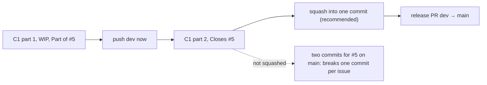
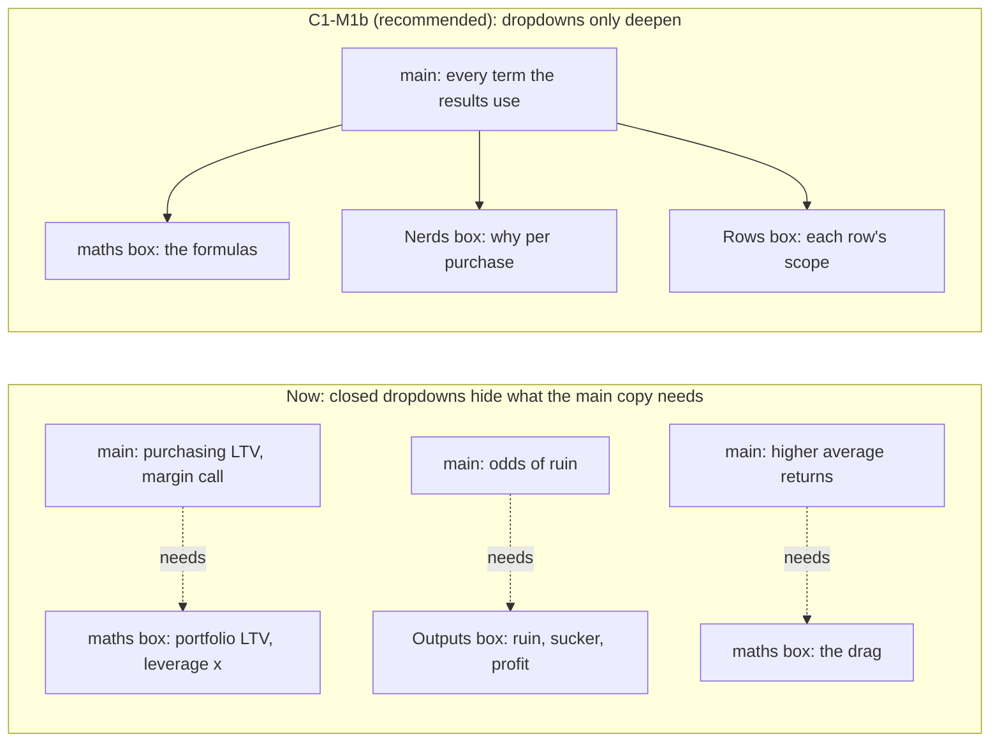
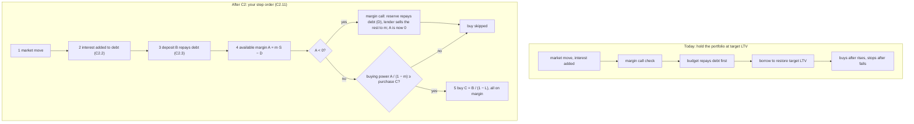
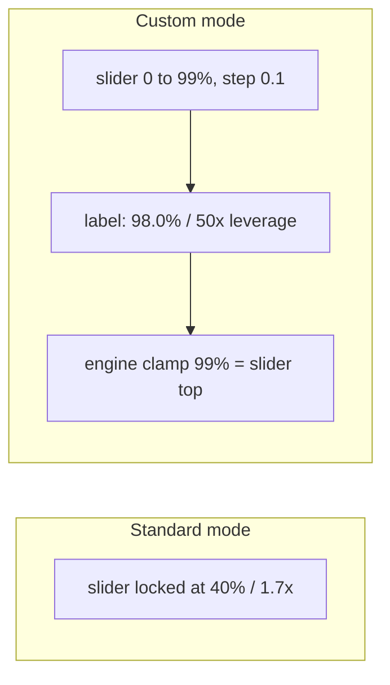
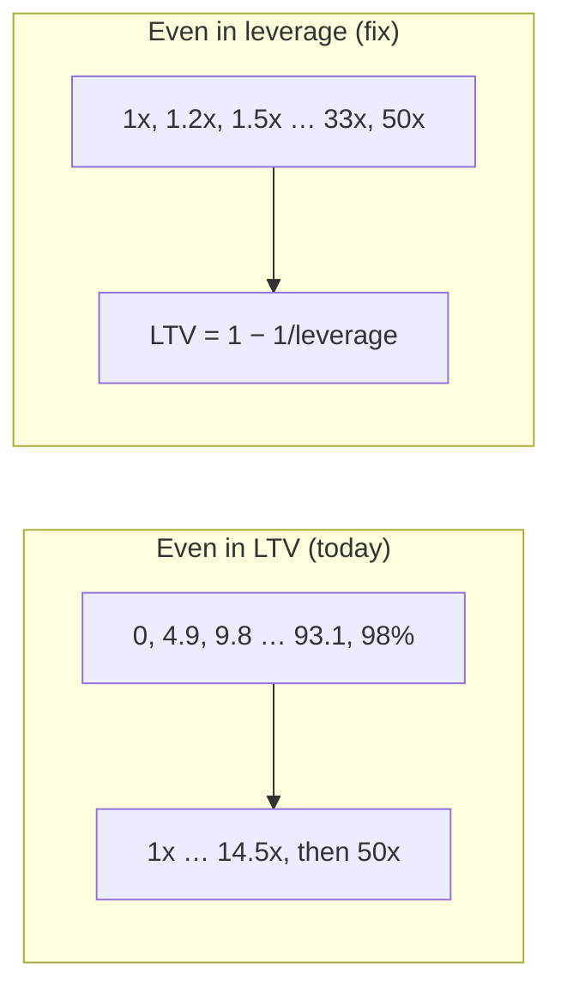
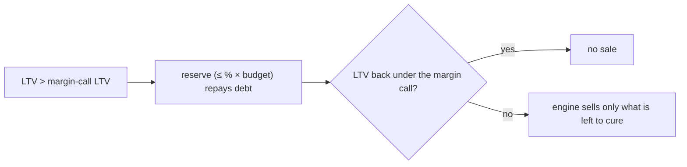

# Plan

Goal, in order (the user's critical path): **CI for the release workflow
(F) → Merton inputs (H) → docs and copy (C1) → leveraged DCA engine (C2)
→ discretionary reserve (D) → leaner pipeline (G) → DataFlow.md follows
the review (I).** The simulator models one behaviour: an investor with a
monthly budget and a margin account sets a recurring buy larger than the
budget, lets the margin account lend the difference, and meets margin
calls when they come. Every purchase is made at the same purchasing LTV,
whatever the portfolio's own LTV is.

State, checked 2026-11-13: `dev` is at
`8c1ac7e` (B), on `20b231a` (J) and `ac73b09` (E). `main` is at
`81ef2ff`. Uncommitted: C1 part 1 (C1.1 to C1.43, C1.45, C1.46, C1.48,
C1.50, your edits, and your move of `documentation/DataFlow.md` to
`docs/DataFlow.md`), which you're committing and pushing unfinished to
synchronize (2026-11-13), as "Part of #5" (Your steps). C1.44, C1.47,
C1.49, C1.51 and C1.52 stay open for C1 part 2, which closes #5. Open
issues: #4 (E), #6 (B), #7 (J), each closed when its commit reaches
`main`; #5 (C1). F, H, C2, D, G and I open theirs under
their `/go`. Work lands on `dev`, one commit per issue, and only releases
reach `main` (DEVELOPMENT.md, Branches and releases). Two agent sessions
plan in parallel: one keeps F, H, G, I and this header; the other keeps
C1, C2 and D. Off-path work is parked in `docs/long_term_plan.md`.

## Commits

- **F. CI for the release workflow** (F.1, F.2): after C1 is committed:
  both change `README.md` (C1 its disclaimer, F.1 Production).
- **H. Merton inputs reach the engine** (H.1 to H.4): bug fix; before C2
  (both change `math.ts`).
- **C1. Docs and copy: leveraged DCA** (#5), in two commits:
  - **part 1: landed, uncommitted, to be pushed unfinished**: C1.1 to
    C1.42, your edits, the settled C1-M1b items (C1.43, C1.45, C1.46,
    C1.48, C1.50 and K4), and your DataFlow.md move. `npm test`: 76 of
    76 (2026-11-13). Its message says "Part of #5", not "Closes #5".
  - **part 2: next, waiting for answers and `/go C1`**: C1.44, C1.47,
    C1.49, C1.51, C1.52. Ends `Closes #5`. Squashed into part 1 before
    the next release (C1-split).
- **C2. Leverage engine: leveraged DCA** (C2.1 to C2.11): after C1 and
  H. Makes the engine true to C1's docs. New: your monthly step order
  (C2.11), and a recurring buy skipped when the account can't fund it
  (C2.10).
- **D. Discretionary reserve** (D.1 to D.3): after C2. At a margin call,
  the investor pays in up to a % of the budget, which repays debt before
  anything is sold. `v0.4.0` is released after D.
- **G. Leaner, faster pipeline** (G.1 to G.4): after D. Proposal, parked
  until you raise it.
- **I. DataFlow.md follows the review** (I.1): after G and C1. Docs only.

## Awaiting sign-off

| # | Item | Sign off | Recommendation & explanation | Comments |
| --- | --- | --- | --- | --- |
| C1.44 | "Isn't This Insane?" gets two main-copy paragraphs after yours: the portfolio's LTV moves with the market; past the margin call threshold, the reserve, the forced sale and the skipped buy. | [ ] | Recommended ([C1-M1b](#c1-m1b-the-main-copy-carries-the-page-m1-2026-11-13)). Your edit cut the paragraph on this, and nothing in the main copy now says why an investor who never borrows past the purchasing LTV gets a margin call. The calculator's Margin Call Threshold input and the Nerds box both need it. **Q:** restore it, in C1-M1b's wording? | |
| C1.47 | What the Simulator Calculates says the median can fall while the average rises. | [ ] | Recommended (C1-M1b). The results report medians, and the main copy only says "higher average returns"; why the median falls is only in the maths dropdown. You called my earlier sentence on this "yap" (C1.8); your dropdown rule now asks for it in the main copy. That contradicts the earlier call, so it's yours. **Q:** add the clause? | |
| C1.49 | The judgement audit: each line that judges a product or a strategy, or reads as advice, gets a fact or an "I" in its place. | [ ] | [C1-judgements](#c1-judgements-what-reads-as-a-verdict-brandbook-538-534), K1 to K8. Brandbook §5.3.8 and §5.3.4 already say it; your "reckless" cut applied them. K4 landed as your words, still green. **Q:** which other K fixes, and K4 orange? I recommend K1, K5, K6, K8 and orange; K2 needs sources before commit; K3 and K7 are yours to call. | |
| G | Rework the pipeline as the review recommends. | [ ] | Proposal, [G in full](#g-leaner-faster-pipeline-g1-to-g4-proposal). **Later**, by your comment (2026-11-10). **Q:** do G? | |

## Your steps

### Now

- Once you're happy with the rewritten history:
  `git branch -D backup/pre-rewrite`
- `npm run dev` and read the page top to bottom with every dropdown
  closed. Check the new lines: J1's parentheticals, O7's "$2 of fund for
  every $1", the Nerds box, the thesis in What the Simulator Calculates,
  and Outputs as a plain section.
- Commit C1 part 1 and push it (`temp/commit-message-C1.txt` is marked
  WIP and ends `Part of #5`; it takes `docs/plan.md` and the other docs
  changed this week, since it's the first to be committed; `docs/bugs.md`'s
  removal is already staged):
  `git add index.html README.md scripts/copywritingHelper.js documentation/DataFlow.md docs/DataFlow.md tests/unit/leveragedDcaCopy.test.js .claude/commands CLAUDE.md docs/plan.md docs/long_term_plan.md docs/DEVELOPMENT.md docs/architecture-review.md docs/gap-audit.md`
  `git commit -F temp/commit-message-C1.txt`
  `git push origin dev`
- Then answer C1.44, C1.47 and C1.49 for `/go C1` (part 2).

### Before the next release

- Squash C1 part 2 into part 1, so `dev` keeps one commit per issue
  (C1-split). I write the exact rebase for you when part 2 is committed.
- E alone is a fix release if you want the live site repaired now: say
  so, and the other session opens the pull request `dev` → `main`
  (`v0.3.1`, say).

### After commit C2

- `npm run asbuild`, then commit the rebuilt `build/` with the source
  (DEVELOPMENT.md, Change workflow 2), with C2's own `git add` and
  `temp/commit-message-C2.txt`.
- `npm run dev`, Custom Mode: the max purchasing LTV slider reaches 98.0% /
  50x leverage and 99.0% / 100x; the strategies between 0 and the max are
  spread out in leverage (C2.9).

### After commit D

- The same two steps as after C2, with D's files and
  `temp/commit-message-D.txt`.

## Signed off

| # | Item | Sign off | Recommendation & explanation | Comments |
| --- | --- | --- | --- | --- |
| C1.51 | The preamble's stray closing `
` (`copywritingHelper.js`, after What the Simulator Calculates) goes. | [x] | Bug fix, found 2026-11-13: it closes nothing the preamble opens. Browsers drop it, so the page renders, but it's malformed. In C1 part 2. | |
| C1.52 | The four code comments that cite `documentation/DataFlow.md` cite `docs/DataFlow.md`, and `_config.yml` excludes `docs/DataFlow.md` instead of the gone `documentation/`. | [x] | Follows from your move (2026-11-13): `assembly/index.ts:17`, `assembly/stats.ts:15`, `config.js:55`, `scripts/simulationOrchestrator.js:143`; `_config.yml:10`. Without the exclude, the next Pages deploy publishes DataFlow.md, which it didn't before; the repo is public, so nothing new is exposed, and long-term project 2 later excludes all of `docs/`. Comments only, so no WASM rebuild. In C1 part 2. | |
| F.1 | Deploy Pages only after Tests pass on `main`. | [x] | Your answer ("test first and don't deploy if the tests don't even pass"). | |
| F.2 | Run the benchmark only on release pull requests. | [x] | You ticked it. | |
| H.1 | Merton's jump intensity, mean and volatility reach the engine as config values. | [x] | Bug fix ([review](architecture-review.md), finding 5): Custom mode lets you edit them (`index.html:196-215`), but nothing reads them and `math.ts:43-49` hard-codes the jumps. | |
| H.2 | The engine draws jumps as Merton's model defines them: Poisson arrivals at the given intensity, lognormal sizes with the given mean and volatility. | [x] | Settled as the correct model (CLAUDE.md, finance questions). | |
| H.3 | Tests for H. | [x] | Follows from H.1 and H.2. | |
| H.4 | Merton's default mean jump matches today's jumps: `JUMP_MU` −0.258, not −0.225. | [x] | Bug fix, H in full. | |
| I.1 | `docs/DataFlow.md` follows the review's verdicts where the code is better (the two tiers, `PROVIDER_ID_MAP` in `config.js`, `contracts.ts` as the layout, the liquidation flag, the schedule's `months + 1`). | [x] | Follows from CLAUDE.md, Design docs are aspirational. | |
| C2.12 | The Lifecycle Investing link points to Ayres and Nalebuff's paper, not to an unrelated one. | [x] | Bug fix: `index.html`'s link, `nber.org/papers/w5793`, is Bryan and Cecchetti's "Inflation and the Distribution of Price Changes" (1996). Ayres and Nalebuff is [NBER w14094](https://www.nber.org/papers/w14094) (June 2008), revised as "Diversification Across Time" (Journal of Portfolio Management, Winter 2013); checked 2026-11-13. It sits after the calculator, out of C1, and C2 already edits `index.html`. | |
| C2.1 | Each month buys `budget / (1 − LTV)` and borrows the difference; the investor never acts on the portfolio's LTV, which only the margin call reads. | [x] | Your answer: a budget of 10 at a 50% LTV buys 20. Table C0. | |
| C2.2 | Interest stays capitalized: it is added to the debt, not paid from the budget. | [x] | Your answer ("don't reinvent the wheel"); today's engine (`math.ts:169-170`). | |
| C2.3 | The monthly deposit repays debt first; the recurring buy is then drawn wholly on margin. | [x] | Your step order (C2.11). Same net effect as "budget + borrowed" when the buy goes through; it also lets the deposit cure a margin call before anything is sold. Replaces "the budget never repays debt". | |
| C2.11 | The monthly step: market move, interest, deposit repays debt, margin check (call if over), recurring buy if the account can fund it, else skipped. | [x] | Your proposal, with one correction of mine (C2-step): the funding test compares buying power with the whole purchase, not available margin with the borrowed part. Your test can buy straight into a margin call. | |
| C2.4 | No borrowing to bring the LTV back to target; the LTV drifts with the market. | [x] | Your instruction. Margin calls stay as they are (`math.ts:184-195`). | |
| C2.6 | The max purchasing LTV is a slider labelled "LTV / leverage" (e.g. "98.0% / 50x leverage"): Custom 0 to 99% in steps of 0.1, Standard locked at 40%; 99% is also the engine's clamp. | [x] | Your instructions. | |
| C2.7 | The `config.js` "max test LTV" comments and the "DCA Ruin" / "DCA Survived" chart labels. | [x] | They sit in files C1 doesn't otherwise touch. | |
| C2.9 | Space the strategies evenly in leverage, not in LTV. | [x] | Bug fix (your comment: "this should've always been the case"). | |
| C2.10 | The recurring buy is skipped in a month when the account's buying power is below the purchase; the deposit has already repaid debt. | [x] | Model fix: Wealthsimple skips a recurring buy when the margin account can't fund it ([help centre](https://help.wealthsimple.com/hc/en-ca/articles/9544942923547-Set-up-a-recurring-investment)). Today's engine always buys. Test in C2-step. | |
| D.1 | A new input, the reserve as a % of the monthly budget, defaulting to 0%. | [x] | Your instruction (10% on a budget of 500 is up to 50 a month). | |
| D.2 | The reserve is paid in at the margin call only, before anything is sold. | [x] | Your answer: "you get an email about a margin call and scramble to come up with cash". | |
| D.3 | The reserve repays debt; whatever goes unused in a month is not carried over. | [x] | Your answer ("um duh"). | |

## The items in full

### F. CI for the release workflow (F.1, F.2)

Its own GitHub issue, opened under `/go F`. The merge strategy (always a
merge commit) is your answer of 2026-11-09, already in DEVELOPMENT.md;
protecting `main` was declined (CLAUDE.md, Known, not a risk).

- F.1 `.github/workflows/jekyll-gh-pages.yml`: trigger on `workflow_run`
  of Tests (completed, branch `main`) and deploy only when it succeeded,
  keeping `workflow_dispatch`; drop the `push` trigger. Docs:
  DEVELOPMENT.md, CI; README, Production.
- F.2 `.github/workflows/test.yml`, `performance` job: run only on
  `pull_request` into `main`. Docs: DEVELOPMENT.md, CI.

### H. Merton inputs reach the engine (H.1 to H.4)

- H.1 `assembly/contracts.ts`: `CONFIG_JUMP_LAMBDA`, `CONFIG_JUMP_MU`,
  `CONFIG_JUMP_SIGMA` (indices 10 to 12; the input buffer has 20);
  `scripts/simulationWorker.js` (`marshalInputs`) writes them;
  `scripts/calculatorHandler.js` reads the three inputs into the request
  (Standard mode: `MERTON_PARAMS_DEFAULTS`); `scripts/simulationOrchestrator.js`
  passes them through.
- H.2 `assembly/math.ts`: `simulateMertonJumpFactor` takes λ (per year), μ
  and σ: each month a jump arrives with probability `1 − e^(−λ/12)`, and
  its factor is `exp(μ + σ·Z)`. Rebuild `build/` (your step).
- H.3 tests: `tests/unit/` (the request carries the three inputs, Standard
  mode the defaults); `tests/integration/orchestrator-worker-wasm.test.js`
  (λ = 0 with Merton gives the same distribution shape as no jumps). Docs:
  DataFlow.md, math's Configuration; and the page's copy, which describes
  today's jumps and becomes false with H.2: `index.html:406-407` and
  `:450`, shown before and after for sign-off (CRAFT-10).
- H.4 `config.js:72`: `JUMP_MU` −0.258. Its comment says −0.225 is the
  midpoint of today's −15% to −30% range, but that midpoint is a simple
  return: today's mean jump factor is 0.775 (`math.ts:46`). A lognormal
  jump `exp(μ + σZ)` has mean `exp(μ + σ²/2)`, so μ = ln(0.775) −
  0.075²/2 ≈ −0.258. At −0.225 the mean jump is exp(−0.2222) ≈ 0.80, a
  −20% crash instead of −22.5%. Tests: H.3's unit test checks the default.

### C1. Docs and copy: leveraged DCA (C1.44, C1.47, C1.49, C1.51, C1.52 open)

**C1-split, why two commits for one issue (2026-11-13).** You're pushing
part 1 unfinished to synchronize. Two rules it bends, named so neither is
broken silently: DEVELOPMENT.md (Branches and releases) wants one commit
per issue on `dev`, each ending `Closes #n`. Part 1 ends `Part of #5`, so
#5 isn't closed by a commit that doesn't finish it, and part 2 ends
`Closes #5`. Before the release pull request, part 2 is squashed into
part 1 (CLAUDE.md, Branches: I write the rebase, you run it). Squashing
rewrites pushed `dev` history, so it needs a force push of `dev`; `dev`
has no other contributors.

**State (2026-11-13, second `/go`, scoped by you to settled items).**
Landed, uncommitted: C1.1 to C1.42; your rewrite up to "Isn't This
Insane?"; and C1.43, C1.45, C1.46, C1.48, C1.50 and K4 as C1-M1b and
C1-thesis word them, with one change. C1.45 keeps the Nerds box's "The
simulator assumes … fluctuate with the market." sentence, because cutting
it depended on C1.44 putting that fact in the main copy. The lines of
the landed items stay below as their record until C1 is committed.
Issue #5's body is rewritten to match. `npm test`: 12 files, 76 of 76
pass.

If C1.44 lands: the Nerds box's "simulator assumes" sentence goes, and
the dropdown test's main-text ids and the order markers add
`where-it-breaks` and "discretionary reserve".

#### C1-M1b, the main copy carries the page (`/m1`, 2026-11-13)

**Where the rule was broken.** The rule (CLAUDE.md, This product's
copy): a reader who opens no dropdown understands every claim and can
read the results. Checked with every `.box--info` closed (all five are
collapsible, `styles.css:130`):

| # | Where | What only a dropdown carries | Whose | Fix |
| --- | --- | --- | --- | --- |
| R1 | My reading-order plan for "Isn't This Insane?" | I planned the maths dropdown to define LTV, leverage and the margin call threshold | mine | C1.43, C1.44 |
| R2 | My Nerds box opener | the page's design choice ("I hold leverage constant on each purchase") | mine | C1.44 puts it in the main copy; C1.45 cuts it from the box |
| R3 | Outputs box, `index.html:59-77` | ruin, sucker, profit, survival, real dollars: every word the results use | the page's, kept by me | C1.46 |
| R4 | J1, "two statistically underperforming and one with negative expected value" | which products: only What Each Row Covers maps robo-advisors and options to rows | yours | C1.43 |
| R5 | O7, "or 2x leverage"; "no LTV monitoring" | the leverage multiple and the portfolio's LTV, defined only in the maths box | mine, kept by you | C1.43 |
| R6 | What the Simulator Calculates, "higher average returns" | why the median the results report can fall: the drag, in the maths box | mine | C1.47 |

1. **§1.3.1.** From "it's my automation with a bigger number" to "I
   know what happens to it when the market falls, and I can read every
   result the calculator gives me", with every dropdown closed.
2. **Format.** Product page (§5.3), the micro-manual continued: the
   same investor, now in a fall.
3. **The takeaway.** The purchasing LTV is fixed; the portfolio's LTV
   isn't, and a fall pushes it toward the margin call. So what: the
   reader knows what the calculator's survival and ruin numbers count.
4. **Claims** (§6):
   - the debt doesn't move with prices, so a rise lowers the portfolio's
     LTV and a fall raises it: 1-D;
   - interest added to the debt raises it: 1-D, the engine's rule (C2.2);
   - holding a whole-portfolio LTV constant means buying after rises and
     selling after falls: 1-D (C1-PoW 4);
   - your "requires a level of market timing": **false**. A fixed
     rebalancing rule is mechanical, the opposite of timing; what it
     requires is selling into every fall. Fixed in C1.45;
   - your "but also consistently underperforms": **unsupported**. Your
     part 3 result came from an older engine, momentum-driven and with a
     wrong μ, so it supports nothing either way; and under
     the simulator's own model (GBM) continuously rebalanced constant
     leverage is the textbook growth case. Cut (§6.4.3, exaggeration);
   - your "leveraged ETFs are expected to underperform even further":
     FINRA 09-31 says their return over longer periods "can differ
     significantly", in either direction. Fixed to that;
   - your "contracts that generally expire daily": **false**. The swaps
     don't expire daily; the fund resets its exposure daily. Fixed;
     "aren't free" stays (financing cost, C1-PoW 6);
   - the median falling while the mean rises: C1.8 note, below.
5. **Outline, the lines.** *(yours)* marks your words.

   - **C1.43, R4, `index.html` `#framing-problem`** (your line, two
     parentheticals):

     > Before: All were framed as equally valid despite two
     > statistically underperforming and one with negative expected
     > value.
     >
     > After: All were framed as equally valid despite two statistically
     > underperforming (robo-advisors, managed portfolios) and one with
     > negative expected value (options).

   - **C1.43, R5, O7 `#investor-behaviour`:**

     > Before: a **purchasing LTV** (loan-to-value) of 50%, or 2x
     > leverage.
     >
     > After: a **purchasing LTV** (loan-to-value) of 50%, or 2x
     > leverage: $2 of fund for every $1 of the investor's own.

     > Before: no LTV monitoring, no selling, no rebalancing.
     >
     > After: no monitoring, no selling, no rebalancing.

   - **C1.44, Isn't This Insane?** Your two paragraphs stay (C1.49 K5
     asks about one word). Scene: the same investor, in a fall. Payload:
     the portfolio's LTV, the threshold, what the account does. §3.1.2:
     "cutting that month's discretionary spending", the scramble stated
     plainly, no comfort. §3.1.3: "The debt doesn't:", the one-word
     turn. New, after yours, `id="where-it-breaks"`:

     > Every purchase is made at the purchasing LTV, but the portfolio's
     > own LTV (all its debt ÷ its value) moves with the market. The
     > debt doesn't: a rise lowers the LTV, a fall raises it, and
     > interest added to the debt raises it a little every month.
     >
     > Past the broker's **margin call threshold**, the investor covers
     > what they can by cutting that month's discretionary spending (the
     > **discretionary reserve**), and the lender sells securities to
     > repay the rest. Until the account can fund the recurring
     > investment again, it doesn't go through.

   - **C1.45, For the Nerds: Why I Define Constant Leverage From the
     Buying Side** (your heading). Payload only: why not whole-portfolio
     constant leverage.

     > Before: **Holding constant leverage on the whole portfolio is
     > momentum trading: Buy high, sell low.** This is because [a plain
     > english explanaiton of when stonks ltv ffalls]
     >
     > After: **Holding constant leverage on the whole portfolio is
     > momentum trading: Buy high, sell low.** *(yours)* After a rise
     > the portfolio's LTV falls, so holding it constant means borrowing
     > to buy more at the higher price; after a fall it rises, so holding
     > it means selling at the lower price.

     > Before: From a simulation perspective, this project is interested
     > in realistic investor behaviour and outcomes. Constant LTV on the
     > whole portfolio not only requires constant monitoring and
     > rebalancing, it also requires a level of market timing that is not
     > realistic for most investors. The simulator assumes that the
     > investor sets a purchasing LTV and sticks to it, allowing the
     > portfolio's LTV to fluctuate with the market. but also
     > consistently underperforms.
     >
     > After: From a simulation perspective, this project is interested
     > in realistic investor behaviour and outcomes. *(yours)* Constant
     > LTV on the whole portfolio requires constant monitoring and
     > rebalancing, and selling into every fall, which is not realistic
     > for most investors.

     The "simulator assumes" sentence goes: C1.44 says it in the main
     copy, and one fact lives in one place.

     > Before: As an aside, leveraged ETFs are expected to underperform
     > even further due to their use of derivatives to achieve their
     > leverage. (basically contracts that generally expire daily and
     > aren't free) ([FINRA](…)). Leveraged DCA at a 67% purchasing LTV
     > is not 3x SPY.
     >
     > After: As an aside, leveraged ETFs do the same every day: they get
     > their leverage through derivatives (contracts such as swaps, which
     > aren't free) and reset it daily, so over longer periods their
     > return can differ significantly from the multiple
     > ([FINRA](https://www.finra.org/rules-guidance/notices/09-31)).
     > Leveraged DCA at a 67% purchasing LTV is not 3x SPY. *(the last
     > sentence yours)*

   - **C1.47, What the Simulator Calculates**, the bold line:

     > Before: **In general, over a long time horizon, more leverage
     > means higher average returns.**
     >
     > After: **In general, over a long time horizon, more leverage
     > means higher average returns.** The typical (median) outcome rises
     > less, then falls, because a loss takes a larger gain to undo.

   - **C1.46, `index.html` Outputs:** the `.box--info` wrapper goes; its
     heading becomes an `h4` and its list stays word for word, between
     What the Simulator Calculates and the calculator. No new lines.

6. **Acceptance** (§7.1):

   | Section | Step | §3.1.2 | §3.1.3 | Efficiency | Truth |
   | --- | --- | --- | --- | --- | --- |
   | J1, O7 | names given, terms defined where used | as yours | as yours | words added only where a term was missing | yours |
   | Isn't This Insane? | the fall, and what the account does | the scramble, no comfort | "The debt doesn't:" | two paragraphs, each one step | 1-D; C2.2; C1-PoW 1 |
   | Nerds box | why per purchase | the rule buys high, not the person | "Buy high, sell low" (yours) | one restating sentence cut | 1-D; FINRA 09-31; two claims cut |
   | Simulator Calculates | how to read the median | the odds shown | none needed | one clause | C1.8 note |
   | Outputs | the words the results use | none needed | "Sucker" (the page's) | unwrapped, unchanged | as before |

   No "you" or "your". Every dropdown now only deepens: the maths box
   gives the formulas, the Rows box each row's scope, the Nerds box the
   reasoning, the modeling box the simulator's assumption.

- C1.48 `tests/unit/leveragedDcaCopy.test.js`: the order markers become
  your order (the modeling box after "last decade risk", before
  "As Close to Ideal"; "For the Nerds: Why I Define Constant Leverage
  From the Buying Side"); `where-it-breaks` and "discretionary reserve"
  stay if C1.44 is ticked, else go; a new test: "at or below total real
  deposits" and "Sucker" are outside any `.box--info`. Run `npm test`.
- `temp/commit-message-C1.txt`: rewritten to the final copy.

#### C1-judgements, what reads as a verdict (brandbook §5.3.8, §5.3.4)

Your point (2026-11-13): "reckless" is a judgement, and a judgement on
a finance page is what gets an author sued. The brandbook already has
the rule: the page shows facts and odds, the reader judges (§5.3.8), and
an opinion is said as "I" (§5.3.4). So no new rule; these are the
lines that still break it, top to the calculator. I'm not a lawyer and
this is not legal review: it finds verdicts and advice-shaped lines, it
doesn't clear the page.

| K | Line | Why it reads as a verdict | Fix | Recommend |
| --- | --- | --- | --- | --- |
| K1 | "It's easy to get sucked into products that aren't built to serve the long-term interests of the investor" (yours) | a claim about products' purpose, stated as fact | "In my experience, it's easy to get sucked into …", the rest as is | yes |
| K2 | "two statistically underperforming and one with negative expected value" (yours) | factual claims about named product types, with no source on the page; I haven't verified them | sources in C1-PoW before commit (fund-performance scorecards for managed portfolios; research on retail options returns), or "in my view" | sources; your call |
| K3 | Table: Wealth Management "No (Usually)"; US Congress "Excess Returns: Yes" (yours) | a verdict on your own industry beside a disclaimer that says the project is unrelated to your work; the Congress row implies trading on inside information | none from me: it's your framework, scored as your opinion under "I arrived at the following framework" | your call |
| K4 | Table: Leveraged DCA "Excess Returns: Yes (Usually)" (yours) | the page's only endorsement of a borrowing strategy. The basis is the models and the research (C1.50), not a realistic setup, which is the question the calculator asks | "Yes (According to models)", your words (2026-11-13), in orange, because the page says the answer is open | yes; orange is mine |
| K5 | "Leverage sounds (and is) dangerous which is why most investors are taught to avoid it." (yours) | "dangerous" is "reckless" softened; "most investors are taught" is an unsourced claim | "Leverage sounds (and is) risky." The sentence before already states the fact (less than deposited) | yes |
| K6 | Heading "As Close to Ideal as Possible: Leveraged DCA" (yours, C1.40) | calls the borrowing strategy near-ideal: an endorsement, the most advice-shaped line on the page | "Leveraged DCA" or "One Fix: Leveraged DCA" | yes, "One Fix: Leveraged DCA" |
| K7 | "Sucker", an outcome label (the page's) | labels the investor, not the outcome; also in the results and the code | leave for C1; renaming it touches the calculator, which is out of C1 | leave |
| K8 | "No savings are needed" (mine, O7) | reads as encouragement to borrow without savings | "The loan needs no cash up front: the fund units bought are the collateral for the loan that bought them …" | yes |

"Isn't This Insane?" stays: it's the reader's question, not an
assertion. "Savings accounts exist for a reason." stays: it judges no
product. With K5 and K6, CLAUDE.md's table of the page's own lines
follows the new lines (CONSENT-2).

#### C1-thesis, the question only this page asks (C1.50)

Your reframe: the models and the Ayres and Nalebuff research say
leverage pays ("stonks"), and you'd expect it to; volatility decay works
against it; and nobody has checked it in the setup an investor actually
runs. That last part is what this simulator is for, and the page never
says so. Today "What the Simulator Calculates" opens on the question
(how the odds change) without saying why it's open.

- **§1.3.1.** From "the calculator will tell me how much leverage to
  use" to "the theory says yes; this checks whether it holds in my
  setup".
- **Scene:** the theory on paper, then the investor's account. Payload:
  the research's claim, the decay, what the simulator adds. §3.1.2: "On
  paper", equanimity about the promise, no comfort and no fear. §3.1.3:
  "On paper, leverage pays.", the dry understatement.
- **Claims:** Ayres and Nalebuff argue that buying stock on margin can
  reduce retirement risk: the title of NBER w14094 (2008), checked
  2026-11-13 (its abstract isn't on the page, so the line claims no
  more than the title); volatility drag: 1-D (the maths box); the three
  realistic features: the engine after C2 and D. I don't say what their
  model assumes, since I haven't read the paper.
- **The lines**, new, before the bold question, which stays:

  > On paper, leverage pays. Ayres and Nalebuff's
  > [Lifecycle Investing](https://www.nber.org/papers/w14094) argues
  > that buying stock on margin early in life can reduce retirement
  > risk. Volatility works against it: a loss takes a larger gain to
  > undo, and leverage magnifies both.
  >
  > I'm interested in whether it pays in a setup an investor actually
  > runs: one recurring investment in a margin account, a broker that
  > sells after a fall, and purchases that stop when the account can't
  > fund them.

- With C1.50, C1.47's clause becomes "The typical (median) outcome
  rises less, then falls, for that reason." The decay is said once.
- Acceptance: one paragraph of theory, one of the question; "I" for the
  interest (§5.3.4); no "you"; the decay stated once.

**C1-PoW, the claims the lines rest on** (brandbook §6, proof levels;
checked 2026-11-10, 6 rechecked 2026-11-11):

| # | Claim | Level and source |
| - | --- | --- |
| 1 | Recurring buys run in a margin account, paid from its available balance, margin included; skipped when it can't fund them. | Verified: [Wealthsimple, Set up a recurring investment](https://help.wealthsimple.com/hc/en-ca/articles/9544942923547-Set-up-a-recurring-investment). |
| 2 | During a margin call the account can only close positions until the call is met. | **Unverified**: a search summary of [Understanding margin calls](https://help.wealthsimple.com/hc/en-ca/articles/33647420196379-Understanding-margin-calls); the page returns 403 to me. Not written until read. |
| 3 | Wealthsimple files recurring investments under "Automations". | Verified: [Pause or cancel a recurring investment](https://help.wealthsimple.com/hc/en-ca/articles/35339473782299-Pause-or-cancel-a-recurring-investment). |
| 4 | Holding constant leverage means selling after falls and buying after rises. | 1-D: after a fall, equity shrinks faster than the position, so holding the ratio means selling. |
| 5 | Daily-reset leveraged ETFs return other than the multiple over periods longer than a day. | Sourced: FINRA, [Regulatory Notice 09-31](https://www.finra.org/rules-guidance/notices/09-31) (2009-06-11): "Due to the effects of compounding, their performance over longer periods of time can differ significantly". |
| 6 | Leveraged ETFs get exposure through swaps, futures and other derivatives. | Sourced 2026-11-11: FINRA 09-31: "through the use of swaps, futures contracts and other derivative instruments". |

**C1.8 note, why "more leverage means higher returns" fails for the
median.** Leverage raises the average (mean) outcome whenever the
market's expected return beats the loan rate. The median grows at the
compounded rate, roughly `r + f(μ − r) − f²σ²/2` at leverage `f`, so it
peaks at `f* = (μ − r) / σ²` and falls after it. With Standard mode's
defaults, `f*` ≈ 1.1x, about a 10% LTV (an estimate: annual, nominal,
for constant leverage rebalanced continuously, which leveraged DCA only
approximates). The page says "average"; C1.47 asks whether it also
says the median.

### C2. Leverage engine: leveraged DCA (C2.1 to C2.11)

**C0, your proposal against mine, point by point:**

| # | Your point | Me | Basis |
| - | --- | --- | --- |
| 1 | A budget of 10 at a 50% LTV buys 20. | **Agree** | That is what an LTV of 50% means (debt / value = 10 / 20). |
| 2 | Leverage is constant only in the buy phase: each purchase is made at the target LTV, and the portfolio's LTV is left alone. | **Agree; it's the strategy itself.** | It's how a passive investor with a margin account and a recurring buy behaves. A purchase at LTV L moves the portfolio's LTV toward L, so C2 needs no rebalancing rule. |
| 3 | "We don't monitor the real LTV unless we're margin called." | **Agree on the behaviour** | The engine still computes the LTV every month to know whether a margin call happened (`math.ts:187`); the investor never acts on it. |
| 4 | Interest is added to the debt (C2.2). | **Agree** | When the market returns less than the loan rate, the LTV climbs even without a crash. |
| 5 | (mine) A purchasing LTV at or above the margin call. | **Allowed (C2.6)** | With C2.10 such a buy is skipped whenever it would breach; it shows as survival near zero. |
| 6 | (a model limit) Margin calls are checked once a month. | **Caveat, no change** | Brokers check daily, so the results understate margin calls; the copy says so (Model Limitations). |
| 7 | The reserve is a separate commit. | **Agree: commit D** | D.2 keeps point 3 true: the reserve is paid in at the margin call only. |

The initial deposit (month 0) is bought at the purchasing LTV, as today
(`initializeLeveragedDCAState`, `math.ts:104-115`).

**C2-step, the monthly step, today and after C2:**

`m` is the margin-call LTV, `S` securities, `D` debt, `B` the month's
deposit, `L` the purchasing LTV. The purchase `C = B / (1 − L)` and the
borrowing `E = B × L / (1 − L)` are known every month, as you said.
After a buy, debt is up by `C − B = E` against the month before, the same
as C2.1's "budget + borrowed".

**The correction to your test (finance, mine to settle).** You proposed
"available margin ≥ expected borrowing `E`". Two things make the right
test "buying power ≥ the whole purchase `C`":

1. The deposit has already gone to the debt (step 3), so the whole
   purchase `C` is drawn from margin, not only `E`.
2. The shares bought are collateral too: each dollar bought adds `m`
   of borrowing room. So `A` of available margin funds `A / (1 − m)` of
   purchases: that's the buying power. The test is the same as "after
   the buy, LTV ≤ m".

Where the two differ, with `m` = 60%, `S` = 100, `L` = 20% and `B` = 10 (so
`C` = 12.5, `E` = 2.5), `D` = 57 after the deposit, `A` = 3:

- yours: 3 ≥ 2.5, buy. After it, LTV = 69.5 / 112.5 = 61.8%: a margin
  call next month, caused by the buy.
- buying power: 3 / 0.4 = 7.5 < 12.5, skip.

At `L` above `1 − m` (40% here) yours skips buys that fit; below it,
yours makes buys that breach.

**After a margin call the buy is skipped.** The sale stops at `m`, so
`A` = 0 and nothing can be bought. A reserve larger than the call needs
doesn't change that, since D.2 pays in only what's needed (D1). Buying
resumes the month the account has room. Wealthsimple also blocks buying
during a call (C1-PoW 2, unverified), which agrees.

**What the step order changes, against today.** The deposit now lands
before the margin check, so it cures part of a call before the lender
sells. Today the check comes first (`math.ts:184-202`). Margin calls get
slightly rarer and smaller. That's realistic: the deposit arrives as cash
in the margin account.

**The rule stays mechanical: no special cases** (your call, 2026-11-09).
A wiped-out account (more debt than the portfolio is worth) needs no
rule: its buys are skipped and each deposit repays debt until buying
fits again.

**C2.10, a skipped buy (model fix).** Wealthsimple: "If you don't have
enough available margin, your recurring investment won't go through"
([help centre](https://help.wealthsimple.com/hc/en-ca/articles/9544942923547-Set-up-a-recurring-investment),
2026-11-10). Today's engine buys every month whatever the account can
fund. The engine has one threshold, `m`, so it stands in for the
broker's margin requirement per security, which I couldn't read (403).
The copy says so in Limitations.

**C2.6, the max purchasing LTV slider.** Leverage = 1 / (1 − LTV), so
50x is 98% and 100x is 99%; at 100% the purchase divides by zero. The
slider's top is 99%, the engine's clamp (`math.ts:177`). Standard mode
stays locked at 40% (1.7x), under its locked 60% margin call.

**C2.9, how the strategies are spaced (bug fix).** `generateLTVSteps`
(`scripts/simulationOrchestrator.js:99-130`) spaces ~20 strategies evenly
in LTV; at a 98% max, 1x to 10x takes 18 of them. They're spaced evenly in
leverage instead: 1x, 1.2x, 1.5x … 50x.

- C2.1 `assembly/math.ts`: replace `purchaseToRestoreTargetLTV`
  (`math.ts:204-211`) with `recurringBuy(state, budget, L, m)`: if
  `(m·S − D) / (1 − m) ≥ budget / (1 − L)`, securities and debt each
  += `budget / (1 − L)`; else nothing. Tests: at 0% interest in a flat
  market the LTV stays at L; with interest it rises; after a fall the
  purchase is the same; the worked example above skips. Also
  `tests/integration/orchestrator-worker-wasm.test.js`. Rebuilding
  `build/` is your step.
- C2.2 interest: unchanged (`accrueDebtInterest`).
- C2.3 `assembly/math.ts`: `deposit` (`math.ts:197-202`) stays, moved
  before the margin check.
- C2.11 `assembly/math.ts`, the composite step: the order of C2-step
  (market, interest, deposit, margin call, buy). Tests: a month with a
  call buys nothing; a deposit that cures the call avoids the sale. Docs:
  DataFlow.md's Monthly Step Order already says it (C1).
- C2.4 no top-up borrowing (part of C2.1); the 0% strategy stays plain
  DCA, so the benchmark is unchanged.
- C2.6 the max purchasing LTV slider:
  - C2.6.1 `index.html` `#ltvSlider`: `type="range"`, `min="0"`,
    `max="99"`, `step="0.1"`; `scripts/calculatorHandler.js` `setMode`:
    Custom unlocks it up to 99, Standard locks it at `MAX_LTV`. Tests:
    `tests/unit/modeToggle.test.js`.
  - C2.6.2 `index.html`, `scripts/calculatorHandler.js`: the label shows
    "98.0% / 50x leverage". Tests: 98 shows "50x", 50 "2x", 40 "1.7x", 0
    "1x".
  - C2.6.3 `assembly/math.ts` `clampTargetLTV`: unchanged at 0.99. Tests:
    0.995 is clamped to 0.99.
- C2.7 copy in C2's files:
  - C2.7.1 `config.js`: the comments "Default max test LTV" (lines 66-67)
    say "max purchasing LTV".
  - C2.7.2 `scripts/calculatorHandler.js:783-784`: "DCA Ruin" / "DCA
    Survived" become "DCA below deposits" / "DCA above deposits".
- C2.9 `scripts/simulationOrchestrator.js` `generateLTVSteps`: ~20 steps
  evenly spaced in log(leverage) from 1x to `1 / (1 − max)`; 0% stays the
  first. Tests: constant ratio, ends at 50x for 98%; 0% and 40% at 40%.
- C2.10 the skip is C2.1's test. Tests: a wiped-out account recovers;
  at 40% under Standard nothing is skipped in a flat market. Docs:
  DataFlow.md already says it (C1).

C2 opens its own issue under `/go C2`; `temp/commit-message-C2.txt` closes
it. Its `git add` names `assembly/`, `build/`, `index.html`, `config.js`,
`scripts/calculatorHandler.js`, `scripts/simulationOrchestrator.js` and
the tests it changed.

### D. Discretionary reserve (D.1 to D.3)

Your idea: when markets are down, people cut discretionary spending, so
the investor can put in up to a % of the budget on top of it (10% of 500
is up to 50 a month). Paid in at the margin call (D.2), to repay debt
(D.3). C1 already describes the reserve in the copy and DataFlow.md.

**D1, the margin call with the reserve:**

Why repaying debt beats buying: with value V and debt D, paying x toward
the debt gives LTV (D − x) / V, buying with it gives D / (V + x). At
V = 100, D = 65 and x = 5: repaying gives 60%, buying 61.9%.

- D.1 `config.js`, `index.html`, `scripts/calculatorHandler.js`: a
  "Discretionary Reserve (% of Monthly Budget)" input, default 0, passed
  to the engine, with its tooltip beside it in `index.html`, like every
  other input's. Tests: the input's default and its range.
- D.2 `assembly/math.ts`: in the margin call, before `applyMarginCall`
  sells, the reserve repays debt, only as much as the call needs (up to
  its cap); the sale covers only what remains.
  Tests: the reserve cuts the forced sale by the reserve amount; at 0%
  nothing changes against C2.
- D.3 `assembly/math.ts`: the reserve is used only that month, never
  saved.

D opens its own issue under `/go D`; `temp/commit-message-D.txt` closes it.

### G. Leaner, faster pipeline (G.1 to G.4), proposal

What and why: [the review](architecture-review.md), findings 1 to 4,
diagrams R1 and G1. Today each strategy worker writes ~260 MB, ~5 GB
across a run (arithmetic, unmeasured), compiles the WASM itself, and the
leveraged strategies wait ~3 s for DCA; a loan past ~39 years overflows
the buffer. A large refactor, so no code until G is signed off.

- G.1 `assembly/index.ts`, `assembly/stats.ts`, `assembly/contracts.ts`,
  `scripts/simulationWorker.js`: the simulation keeps per-scenario final
  wealth and a margin-call flag, and per-month sums; stats reads those
  instead of the raw tensor. Tests: a 40-year run; the existing stats
  assertions.
- G.2 `scripts/simulationOrchestrator.js`, `scripts/simulationWorker.js`:
  compile both modules once and post them to a pool of
  `navigator.hardwareConcurrency` workers.
- G.3 the same two files: all simulations start together.
- G.4 `scripts/simulationOrchestrator.js`: on the first failure, terminate
  every other worker.
- `npm run perf` before and after, in the commit message.

### I. DataFlow.md follows the review (I.1)

- I.1 `docs/DataFlow.md`: the verdicts of the review's sections 1
  to 4, 6 and 7, and G's contract if G lands. After C1 is committed.

## Done and removed

- Commit A, the Claude Code setup: `81ef2ff` on `main`. The old history
  is on the local branch `backup/pre-rewrite`.
- Commit E, the bug fixes: `ac73b09` on `dev` (#4).
- Commit J, one brandbook: `20b231a` on `dev` (#7).
- Commit B, the architecture review: `8c1ac7e` on `dev` (#6).
- C1.1 to C1.42, landed and uncommitted (2026-11-13): their record is
  the working tree's diff and issue #5. Their planning history (the
  journey, the reading order, the line tables) was removed from this
  plan in the 2026-11-13 cleanup, since every row was done or
  superseded.
