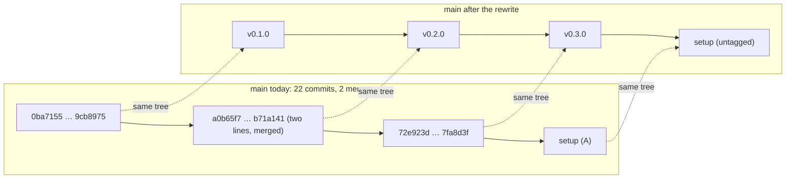
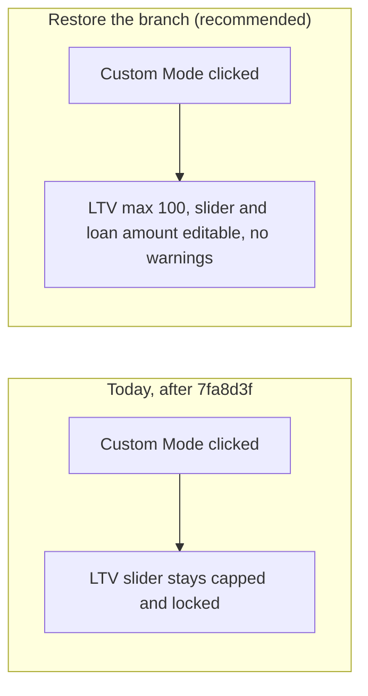
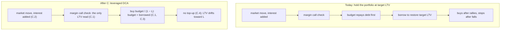
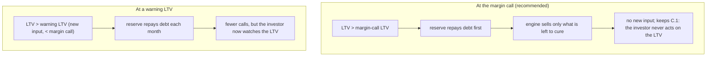

# Plan

Goal, in order (the user's critical path, 2026-11-06): **Claude Code setup in
one commit → rewrite the history into versions → repair the test suite →
architecture review → leverage engine change.** The engine moves from "hold
a target LTV" to "leveraged DCA": the target LTV applies to each month's
purchase, whatever the portfolio's LTV is. Checked on `main` at `7fa8d3f`
("fix copy"), 22 commits, no tags, on 2026-11-09. Commit A has landed,
uncommitted: the Claude-Code-Setup scaffold, the doc fixes, `npm test` in
the agent profile, CI on Node 26, plus your Vite 8 / Vitest 5 upgrade and
your `.vscode/settings.json`. The unit tests are broken on `main` itself
(commit E): CI's Tests workflow has failed on every push since 2026-09-20,
and Pages deployed anyway. No open GitHub issues. The repo is public
(`vibqetowi`); GitHub Pages deploys `main`. Design docs here are
aspirational (CLAUDE.md), so gaps between them and the code wait for the
review. Off-path work is parked in `docs/long_term_plan.md`. A second agent
session plans commit C; this session keeps A, E and this header. Letter D
is yours (the variable-consumption input, C.1's comment).

## Commits

- **A. Claude Code setup** (A.1 to A.7): landed, uncommitted. Commit it,
  then run the history rewrite (Your steps).
- **E. Repair the test suite** (E.1 to E.5): next, waiting for /go E. Fixes
  what `7fa8d3f` and `141ac62` broke, so B and C start from green tests.
- **B. Architecture review** (B.1): after E. A doc that weighs DataFlow.md
  against the code, point by point.
- **C. Leverage engine: leveraged DCA** (C.1 to C.6): after B; B may reshape
  it. Design settled (2026-11-09) but for C.6, a new finding.
- **D. Discretionary reserve** (D.1 to D.3): after C. The investor can add
  up to a % of the budget when the leverage gets dangerous. Waiting for
  D.2 and D.3.

## Awaiting sign-off

| #       | Item                                                                                                             | Sign off | Recommendation & explanation                                                                                                                                                                                                                                                                                                                                                            | Comments                                                                             |
| ------- | ---------------------------------------------------------------------------------------------------------------- | -------- | --------------------------------------------------------------------------------------------------------------------------------------------------------------------------------------------------------------------------------------------------------------------------------------------------------------------------------------------------------------------------------------- | ------------------------------------------------------------------------------------ |
| E.2     | Restore Custom mode's unlocking in `setMode` (LTV slider up to 100, slider and loan amount editable).          | [x ]     | See [E in full](#e-repair-the-test-suite-e1-to-e5), diagram E2. `7fa8d3f` cut the whole `else` branch and left `}}` (`scripts/calculatorHandler.js`, `setMode`), so Custom mode no longer unlocks the LTV; that looks accidental, next to a deliberate removal of the LTV warnings. Recommend restoring it, without the warning call. **Q:** was the removal on purpose? |                                                                                      |
| E.3     | Delete the empty `tests/unit/ltvValidation.test.js`, and the now-empty `validateAndColorLTV` with its calls. | [x ]     | You removed the LTV warnings (their markup is gone from `index.html`); the test file has no tests left, which Vitest counts as a failure, and the function body is empty. Recommend deleting both. **Q:** delete?                                                                                                                                                               |                                                                                      |
| E.5     | Make the Pages deploy wait for the tests to pass.                                                                | [ ]      | Proposal: the deploy doesn't depend on `test.yml`, so on 2026-09-26 it published a `config.js` that throws on load while Tests failed. A `workflow_run` trigger on Tests (success, `main`) in `jekyll-gh-pages.yml` closes that, within the Free plan; it delays each deploy by the test run (about 30 s). **Q:** add it?                                               | well no you shiould test first and dont deplouy if the tests dont even pass, duh wtf |
| C.1-OLD |                                                                                                                  | [ ]      | XC1REC                                                                                                                                                                                                                                                                                                                                                                                  | XC1COM <br /><br />XC1TAIL<br /><br />?????????                                     |
| C.2-OLD | Interest stays capitalized: it is added to the debt, not paid from the budget.                                   | [ ]      | XC2REC                                                                                                                                                                                                                                                                                                                                                                                  | XC2COM                                                                               |

## Your steps

### Now

- Check the live site: open it and press Calculate. `config.js` throws a
  `ReferenceError` on load since `7fa8d3f` (found by the tests, not checked
  in a browser), so the page is probably broken in production; E.1 fixes it.
- Check the old branch, for A.6: `git diff main...origin/copilot/rewrite-dataflow-index-first --stat`
- Tick or comment E.2, E.3, E.5, then `/go E`.

### Commit A (landed, uncommitted)

Commit the setup as one commit:

```powershell
git add -A
git commit -F temp/commit-message.txt
```

Then rewrite the history (A.4 to A.6). This is a force push to a public
repo: anyone with a clone must re-clone, and Pages redeploys the same files.
The last tree is identical to today's, and the backup branch keeps the old
history. `v0.3.0` will point at `7fa8d3f`'s tree, broken unit tests
included; E lands on top. Run each line in order, from the repo root:

```powershell
git branch backup/pre-rewrite main
git switch --orphan rewrite
git read-tree -u --reset 9cb8975
git commit -F temp/rebase/v0.1.0.txt --date "2026-02-26T12:00:00"
git tag v0.1.0
git read-tree -u --reset b71a141
git commit -F temp/rebase/v0.2.0.txt --date "2026-09-03T12:00:00"
git tag v0.2.0
git read-tree -u --reset 7fa8d3f
git commit -F temp/rebase/v0.3.0.txt --date "2026-09-26T12:00:00"
git tag v0.3.0
git read-tree -u --reset backup/pre-rewrite
git commit -F temp/commit-message.txt
git diff backup/pre-rewrite rewrite --stat
git switch main
git reset --hard rewrite
git branch -D rewrite
git push --force-with-lease origin main
git push origin v0.1.0 v0.2.0 v0.3.0
```

The `git diff ... --stat` line must print nothing; if it prints anything,
stop there and tell me. Then the old branches (A.6), once you've looked at
the first one's diff:

```powershell
git push origin --delete copilot/rewrite-dataflow-index-first
git push origin --delete copilot/vscode-mt6lyuda-5t0t
```

Once you're happy with the new history: `git branch -D backup/pre-rewrite`

The push runs CI on Node 26 for the first time; Tests will still fail until
E lands.

### After commit E

- `npm run dev`, switch to Custom Mode, and check the LTV slider reaches 100
  and the GARCH and Heston fields are filled.

### After commit C

- `npm run asbuild`, then commit the rebuilt `build/` with the source
  (DEVELOPMENT.md, Change workflow 2).
- Run a calculation with `npm run dev` and check the new explainer and the
  results by eye.

### After commit D

- The same two steps as after C.

## Signed off

| #   | Item                                                                                                                                                  | Sign off | Recommendation & explanation                                                                                                                                                                                   | Comments |
| --- | ----------------------------------------------------------------------------------------------------------------------------------------------------- | -------- | -------------------------------------------------------------------------------------------------------------------------------------------------------------------------------------------------------------- | -------- |
| A.1 | Add `npm test` to the agent profile.                                                                                                                | [x]      | Done. Follows from PROCEDURE-4: the round's checks run through the profile's commands.                                                                                                                         |          |
| A.2 | Keep `npm run asbuild` out of the agent profile.                                                                                                    | [x]      | Your `/go A` took my recommendation: it rewrites the tracked `build/` files, so it stays your step after an `assembly/` change.                                                                          |          |
| A.3 | Keep `python tools/directory_mapper.py` out of the agent profile.                                                                                   | [x]      | Your `/go A` took my recommendation: Python's only use here is the tree in `docs/directory-structure.md`; gap-audit 2 stays open until you run it yourself.                                                |          |
| A.4 | Rewrite the 22 commits into `v0.1.0`, `v0.2.0`, `v0.3.0`.                                                                                       | [x]      | Your step; table A4.                                                                                                                                                                                           |          |
| A.5 | Keep the setup commit untagged on top of `v0.3.0`.                                                                                                  | [x]      | Your step.                                                                                                                                                                                                     |          |
| A.6 | Delete the remote branches `copilot/rewrite-dataflow-index-first` and `copilot/vscode-mt6lyuda-5t0t`.                                             | [x]      | Your step, after a look at the first one's diff.                                                                                                                                                               |          |
| A.7 | CI on Node 26.                                                                                                                                        | [x]      | Done. Vitest 5 needs Node 22.12, 24 or 26+; 26 is what you run locally.                                                                                                                                        |          |
| E.1 | Restore `GARCH_PARAMS_DEFAULTS` and `HESTON_PARAMS_DEFAULTS` in `config.js`.                                                                    | [x]      | Bug fix: `7fa8d3f` deleted them while `config.js:134-182` and `calculatorHandler.js:751-757` still use them and `index.html` still has their inputs. Every unit test fails on it.                      |          |
| E.4 | Fix the unit tests still failing after E.1 to E.3.                                                                                                    | [x]      | Bug fix. Tests follow your copy and UI changes; where a test catches a real bug, the code is fixed instead, as a new row.                                                                                      |          |
| B.1 | Write `docs/architecture-review.md`.                                                                                                                | [x]      | Your critical path.                                                                                                                                                                                            |          |
| C.1 | Each month buys `budget / (1 − LTV)` and borrows the difference; the investor never acts on the portfolio's LTV, which only the margin call reads. | [x]      | Your answer (2026-11-09): a budget of 10 at a 50% LTV buys 20. I agree, and it is a valid way to model this; the basis and two caveats are in [C in full](#c-leverage-engine-leveraged-dca-c1-to-c5), table C0. |          |
| C.2 | Interest stays capitalized: it is added to the debt, not paid from the budget.                                                                        | [x]      | Your answer ("don't reinvent the wheel"). It is today's engine ([math.ts:169-170](../assembly/math.ts)).                                                                                                        |          |
| C.3 | The monthly budget always buys; it never repays debt.                                                                                                 | [x]      | Follows from your instruction: today the budget repays debt first ([math.ts:197-202](../assembly/math.ts)), which stops buying after a fall, part of the drag you describe.                                     |          |
| C.4 | No borrowing to bring the LTV back to target; the LTV drifts with the market.                                                                         | [x]      | Your instruction. Margin calls stay as they are ([math.ts:184-195](../assembly/math.ts)).                                                                                                                       |          |
| C.5 | Rewrite the copy to teach the new strategy.                                                                                                           | [x]      | Your instruction ("lots of reengineering to teach the audience"). Detailed after B.                                                                                                                            |          |
| D.1 | A new input, the reserve as a % of the monthly budget, defaulting to 0%.                                                                              | [x]      | Your instruction (10% on a budget of 500 is up to 50 a month). The 0% default leaves C's results unchanged.                                                                                                    |          |

## The items in full

### A. Claude Code setup (A.1 to A.7)

Landed, uncommitted (2026-11-09): `.claude/agent-profile.json` lists
`npm test` (form `^npm test$`); `.github/workflows/test.yml` (both jobs) and
`jekyll-gh-pages.yml` pin Node 26; DEVELOPMENT.md (Checks, Environments, CI)
says so. Commit A also carries the scaffold (`.claude/`, `CLAUDE.md`,
`docs/`, `tools/`, `.gitignore`), the doc fixes, and your Vite 8 / Vitest 5
upgrade and `.vscode/settings.json`. A.4 to A.6 are your git steps: the
rewrite takes each version's exact file tree, so nothing is lost or
re-resolved; merges disappear.

`npm test` on 2026-11-09, Node v26.13.0, Vitest 5.1.0: **10 files failed,
2 passed; 58 tests failed, 7 passed.** The 2 passing files are the
integration tests (orchestrator, worker, WASM), so the upgrade itself runs.
Every unit failure comes from `main`'s code, not the upgrade: commit E.

**A4, the version cuts:**

| Version    | Range                                                                   | Dates               | What it is                                                                                                  |
| ---------- | ----------------------------------------------------------------------- | ------------------- | ----------------------------------------------------------------------------------------------------------- |
| v0.1.0     | `0ba7155..9cb8975` (7 commits)                                        | 2026-02-19 to 02-26 | Portfolio line-of-credit analyzer: WASM simulator in workers, Pages deploy, scripts split by responsibility |
| v0.2.0     | `a0b65f7..b71a141` (10 commits, two parallel lines and PR #3, merged) | 2026-08-17 to 09-03 | Pivot to constant-LTV DCA; WASM split into sim, math (composite providers), stats                           |
| v0.3.0     | `72e923d..7fa8d3f` (5 commits)                                        | 2026-09-09 to 09-26 | Architecture change: stats per worker, two-tier fan-out, Vitest suite and CI, benchmark                     |
| (untagged) | setup commit                                                            | 2026-11             | Claude Code setup                                                                                           |
| v0.4.0     | commit C                                                                | to come             | Leveraged DCA engine                                                                                        |



### E. Repair the test suite (E.1 to E.5)

CI's Tests workflow (`gh run list`) last passed on `2ba7e58` (2026-09-19).
On `141ac62` "sync" (2026-09-20), 3 files and 5 tests failed: the nav-tab
tests click elements that no longer exist (`Cannot read properties of null (reading 'click')`), one copy test expects "DCA Mean of $60,000: +$4,000",
and one expects the baseline's outcome grid. Then `7fa8d3f` "fix copy"
(2026-09-26):

- deleted `GARCH_PARAMS_DEFAULTS` and `HESTON_PARAMS_DEFAULTS` from
  `config.js`, still exported at `config.js:134-182` and read at
  `scripts/calculatorHandler.js:751-757` (the inputs `garchOmega`,
  `hestonKappa` … are still in `index.html`). `config.js` throws a
  `ReferenceError` when loaded, so all 58 unit tests fail, hiding the 5
  above;
- cut Custom mode's branch out of `setMode` (LTV max 100, slider and loan
  amount unlocked, the warning check), leaving `}}`;
- emptied `validateAndColorLTV` and removed the LTV warnings, their markup
  and their tests, leaving `tests/unit/ltvValidation.test.js` with a helper
  and no tests.

**E2, what Custom mode does:**



- E.1 `config.js`: restore both objects as they were in `7fa8d3f^`
  (`OMEGA`, `ALPHA`, `BETA`; `KAPPA`, `THETA`, `SIGMA_V`, `RHO`), with their
  comment.
- E.2 `scripts/calculatorHandler.js`, `setMode`: the `else` branch back,
  without `validateAndColorLTV()`, if ticked. Tests: `modeToggle.test.js`
  ("unlocks all fields", "caps the LTV slider max at 50 … and 100").
- E.3 if ticked:
  - E.3.1 `tests/unit/ltvValidation.test.js`: delete.
  - E.3.2 `scripts/calculatorHandler.js`: delete `validateAndColorLTV` and
    its calls.
- E.4 `tests/unit/*.test.js`: run `npm test` after E.1 to E.3 and update
  each test still failing to the code's current behaviour (the nav tabs, the
  DCA-mean copy, the baseline grid, and whatever E.1 uncovers). A failure
  that is a real bug in the code becomes a new row, not a test change.
- E.5 `.github/workflows/jekyll-gh-pages.yml`: if ticked, trigger on
  `workflow_run` of Tests (completed, `main`) and deploy only when it
  succeeded, keeping `workflow_dispatch`. Docs: DEVELOPMENT.md, CI.

### B. Architecture review (B.1)

- B.1 `docs/architecture-review.md` (new): for each section of
  `documentation/DataFlow.md` (saga and fan-out, composite providers, state
  vector, schedules, monthly step order, module contracts, memory layout),
  what the doc says, what the code does (file:line), which is better and
  why, and a recommendation. Known starting points: the code runs the
  benchmark first, then the rest in parallel, with no request IDs and no
  cancel on failure (`scripts/simulationOrchestrator.js:60-96, 180-224`);
  `PROVIDER_ID_MAP` is in `config.js` and resolved by `calculatorHandler.js`;
  `math.wasm` is built but never loaded. Also how the engine change (C)
  fits: where the purchase rule lives, what the LTV schedule means once LTV
  is per purchase. Its recommendations become rows of C, or new commits.
  Docs only.

### C. Leverage engine: leveraged DCA (C.1 to C.6)

**C0, your proposal (C.1's comment, 2026-11-09) against mine, point by
point:**

| # | Your point                                                                                                                  | Me                                                                                        | Basis                                                                                                                                                                                                                                                                                                                                                                                                              |
| - | --------------------------------------------------------------------------------------------------------------------------- | ----------------------------------------------------------------------------------------- | ------------------------------------------------------------------------------------------------------------------------------------------------------------------------------------------------------------------------------------------------------------------------------------------------------------------------------------------------------------------------------------------------------------------ |
| 1 | A budget of 10 at a 50% LTV buys 20.                                                                                        | **Agree**                                                                           | That is what an LTV of 50% means (debt / value = 10 / 20), and the margin-call threshold is an LTV too, so one unit throughout.                                                                                                                                                                                                                                                                                    |
| 2 | Leverage is constant only in the buy phase: each purchase is made at the target LTV, and the portfolio's LTV is left alone. | **Agree; it is valid, and it is the strategy itself rather than a simplification.** | It is how a passive investor with a margin or credit line behaves. It also partly corrects itself: a purchase at LTV L moves the portfolio's LTV toward L (after a fall, the portfolio sits above L and each purchase lowers it; after a rally, below L and each purchase raises it). So C needs no rebalancing rule.                                                                                              |
| 3 | "We don't monitor the real LTV unless we're margin called."                                                                 | **Agree on the behaviour, not the wording**                                         | The engine still has to compute the LTV every month, because that is how it knows a margin call has happened (`math.ts:187`, a division that costs nothing). What your rule really says is that the investor never acts on the LTV, and C.1's row is worded that way.                                                                                                                                            |
| 4 | Interest is added to the debt (C.2).                                                                                        | **Agree, with a consequence I got wrong before**                                    | Capitalized interest makes the debt grow without any purchase. When the market returns less than the loan rate, the LTV climbs toward the margin call even without a crash, and in a flat market it rises above L. My earlier test "a flat market keeps the LTV at target" holds only at 0% interest, and C.1's tests are corrected below. The explainer (C.5) should teach this too: the loan rate is the hurdle. |
| 5 | (not in your proposal) What happens when the target LTV is at or above the margin-call LTV.                                 | **New, a question for you: C.6**                                                    | Each purchase pulls the portfolio's LTV toward L, so with L ≥ the margin-call LTV the portfolio is forced into a call and sold down every month. Today's engine had the same hole, hidden by the top-up rule.                                                                                                                                                                                                     |
| 6 | (a limit of the model, not of your proposal) Margin calls are checked once a month.                                         | **Caveat, no change**                                                               | Brokers check daily, so a dip that recovers within the month never triggers a call here, and the results understate margin calls. The jump model (Merton) covers part of it. Today's engine has the same limit; C.5's copy says so.                                                                                                                                                                                |
| 7 | The variable-consumption reserve is a separate commit.                                                                      | **Agree: commit D**                                                                 | It changes what happens at a margin call, which C leaves as it is (C.4). One point conflicts: "if LTV gets dangerous" means the investor watches the LTV, against point 3. D.2 asks which you mean.                                                                                                                                                                                                                |

The initial equity (month 0) stays bought at the target LTV, as today
(`initializeLeveragedDCAState`, `math.ts:104-115`): it is the first
purchase under the same rule, so it needs no row.

Today, each month ([assembly/math.ts:153-211](../assembly/math.ts)): market
move, interest added to the debt, margin call, the budget repays debt
first, then the engine borrows to buy only if the LTV is below target. After
a rally the LTV falls, so it borrows and buys high; after a fall the LTV
rises, so it buys nothing and the budget repays debt; margin calls sell at
the bottom. That is momentum: it adds exposure after gains and cuts it
after losses, which drags on returns.

**C1, the monthly step, today and after C (signed off):**



- C.1 `assembly/math.ts`: replace `deposit` and `purchaseToRestoreTargetLTV`
  (`math.ts:197-211`) with one `leveragedPurchase(state, budget, L)`:
  securities += budget / (1 − L), debt += budget × L / (1 − L). Tests: unit
  tests of the monthly step: at 0% interest in a flat market the LTV stays at
  L; with interest in a flat market it rises; after a fall, the purchase is
  the same amount and the LTV moves back toward L. Also
  `tests/integration/orchestrator-worker-wasm.test.js` updated. Docs:
  DataFlow.md, Monthly Step Order. Rebuilding `build/` is your step.
- C.2 interest: unchanged (`accrueDebtInterest`).
- C.3 `assembly/math.ts`: the budget never repays debt (part of C.1's
  change).
- C.4 `assembly/math.ts`: no top-up borrowing (part of C.1's change); the
  0% strategy stays plain DCA, so the benchmark is unchanged.
- C.5 `index.html`, `scripts/copywritingHelper.js`, `config.js`: an
  explainer of leveraged DCA (a worked month: budget, borrowed, bought; why
  the LTV drifts; what a margin call does), and the strategy labels.
  Tests: `tests/unit/modeDescriptionCopy.test.js` and
  `copywritingHelpers.test.js` updated. Detailed after B. It also teaches
  the loan rate as the hurdle (C0 row 4) and says that monthly checks
  understate margin calls (C0 row 6).
- C.6 if ticked: `assembly/math.ts` `clampTargetLTV` caps L at the
  margin-call LTV minus the row's margin; `scripts/calculatorHandler.js`
  caps the slider the same way. Tests: a unit test of the clamp and of the
  slider's max.

### D. Discretionary reserve (D.1 to D.3)

Your idea (C.1's comment): when markets are down, people cut discretionary
spending, so the investor can put in up to a % of the budget on top of it
(10% of 500 is up to 50 a month). Two choices are left: when it is paid in
(D.2) and what it does (D.3).

**D1, when the reserve is paid in:**



Why repaying debt (D.3) beats buying: with value V and debt D, a payment x
toward the debt gives LTV (D − x) / V, while buying with it gives
D / (V + x). At V = 100, D = 65 and x = 5, repaying gives 60%, buying 61.9%.

- D.1 `config.js`, `index.html`, `scripts/calculatorHandler.js`: a
  "discretionary reserve, % of budget" input, default 0, passed to the
  engine. Tests: unit test of the input's default and its range.
- D.2 `assembly/math.ts`: the trigger as the row decides, before
  `applyMarginCall` sells. Tests: at a margin call the reserve cuts the
  forced sale by the reserve amount; at 0% nothing changes against C.
- D.3 `assembly/math.ts`: the reserve repays debt, as the row decides, with
  no carry-over. Docs: DataFlow.md, Monthly Step Order; C.5's explainer gets
  a paragraph on the reserve.

## Done and removed

- Commit A, uncommitted: see A in full. The doc fixes it carries: README
  (Pages deploy, `npm run perf`, `math.wasm` not loaded, layout, PowerShell
  label, Node 22.12), `build/README.md`, `docs/DEVELOPMENT.md`,
  `CLAUDE.md`, `docs/gap-audit.md`, `docs/long_term_plan.md`.
  `documentation/DataFlow.md` is as committed.
