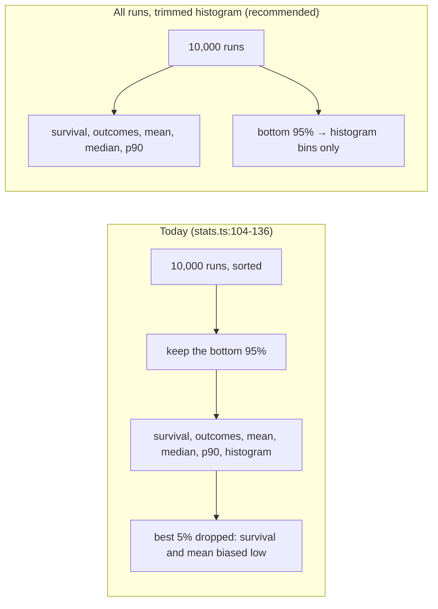
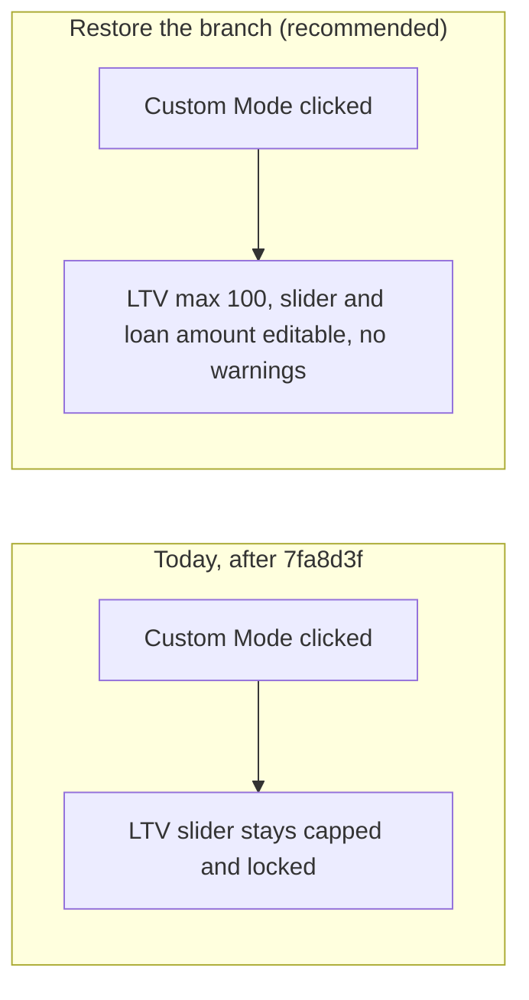
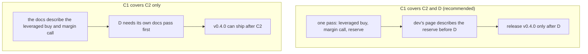
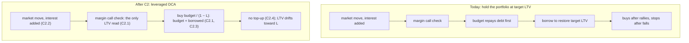
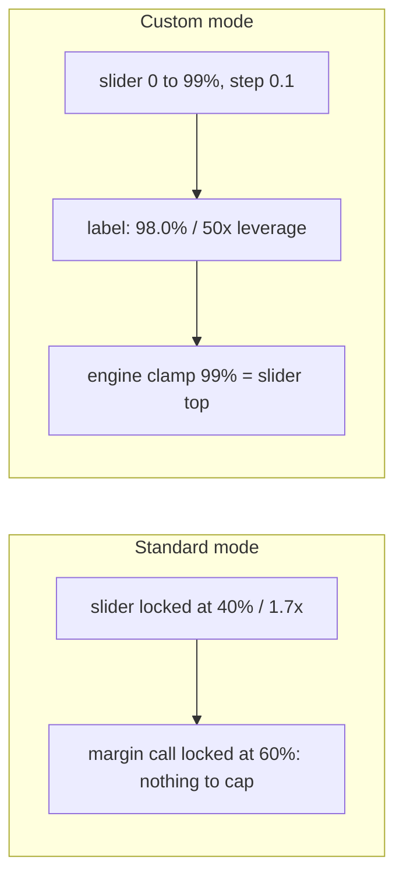
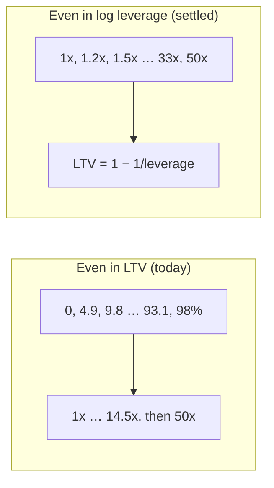
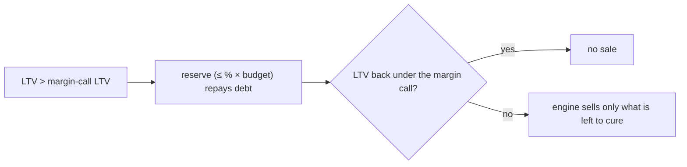

# Plan

Goal, in order (the user's critical path): **fix the bugs (E) → CI for
the release workflow (F) → architecture review (B) → docs and copy (C1) →
leveraged DCA engine (C2) → discretionary reserve (D).** The engine moves from "hold a target LTV" to
"leveraged DCA": the target LTV applies to each month's purchase, whatever
the portfolio's LTV is. Checked on 2026-11-09: you are on a new local
branch `dev`, not pushed, at `81ef2ff` (the Claude Code setup), which is
also `main` and `origin/main`; the history is rewritten into `v0.1.0`,
`v0.2.0`, `v0.3.0`. From now on work lands on `dev`, one commit per GitHub
issue, and only releases reach `main` (DEVELOPMENT.md, Branches and
releases). The unit tests are broken on `main` (commit E): CI's Tests
workflow has failed on every push since 2026-09-20, and Pages deployed
anyway. Each commit opens its own GitHub issue under its `/go` (CLAUDE.md);
E's is #4. The repo is public (`vibqetowi`). Design docs here are
aspirational (CLAUDE.md), so gaps between them and the code wait for the
review. Off-path work is parked in `docs/long_term_plan.md`. A second agent
session plans C1, C2 and D; this session keeps E, F and this header.

## Commits

- **E. Fix the bugs** (E.1 to E.13, issue #4): landed, uncommitted;
  `npm test` 12 files, 69 tests, all pass. Commit it (Your steps, After
  commit E), before C1. Bug fixes only: the two bugs in `docs/bugs.md`, what `7fa8d3f`
  and `141ac62` broke in the tests, the statistics' trim, the median/mean
  mix-up, and the stale `build/sim.*` and `build/math.*`. The first commit
  on `dev`, before C1's.
- **F. CI for the release workflow** (F.1, F.2): after E. Deploy Pages
  only after Tests pass on `main`; benchmark only release pull requests.
- **B. Architecture review** (B.1, #6): landed, uncommitted:
  [docs/architecture-review.md](architecture-review.md). Commit it any
  time (it overlaps no other commit): `git add docs/architecture-review.md`,
  then `git commit -F temp/commit-message-B.txt`. Its findings became G, H
  and I, and three notes for C2.
- **H. Merton inputs reach the engine** (H.1 to H.3): after F, before C2
  (both change `math.ts`). Bug fix.
- **C1. Docs and copy: leveraged DCA** (C1.1 to C1.6), #5: landed,
  uncommitted, but **don't commit it yet**: its copy lost your voice, and
  C1.6 puts it back. Waiting for C1.6's sign-off and `/go C1`.
- **C2. Leverage engine: leveraged DCA** (C2.1 to C2.9): after C1; B may
  reshape it. Makes the engine true to C1's docs. Design settled.
- **D. Discretionary reserve** (D.1 to D.3): after C2. At a margin call,
  the investor pays in up to a % of the budget, which repays debt before
  anything is sold. Design settled.
- **G. Leaner, faster pipeline** (G.1 to G.4): after D (it reshapes the
  worker, orchestrator and both WASM modules). Proposal, waiting for G's
  sign-off.
- **I. DataFlow.md follows the review** (I.1): after G and C1 (both change
  DataFlow.md). Docs only.

## Awaiting sign-off

| #    | Item                                                                                                                                                                                                                           | Sign off | Recommendation & explanation                                                                                                                                                                                                                                                                                                                                                                                                                                                                                                                                                                                                                                                            | Comments                                                                                                                                               |
| ---- | ------------------------------------------------------------------------------------------------------------------------------------------------------------------------------------------------------------------------------ | -------- | --------------------------------------------------------------------------------------------------------------------------------------------------------------------------------------------------------------------------------------------------------------------------------------------------------------------------------------------------------------------------------------------------------------------------------------------------------------------------------------------------------------------------------------------------------------------------------------------------------------------------------------------------------------------------------------- | ------------------------------------------------------------------------------------------------------------------------------------------------------ |
| E.13 | Compare the strategy's median with the DCA median, not the DCA mean, in the summary's "median wealth impact of leverage".                                                                                                      | [x]      | Found by E.4 (a real bug, so a row, not a test change). `calculatorHandler.js:383-388` passes the DCA *mean* (`benchmarkExpected`) and `strategy median − DCA mean` to `getStrategySummaryNarrative`, whose copy (`copywritingHelper.js:256`) calls both "median". Wealth is right-skewed, so the mean is above the median and the copy understates what leverage adds, or shows a loss where there is none. Your answer: the more correct one, and finance calls are mine to settle (now in CLAUDE.md). Fixed: the DCA median and its difference are passed; the copy stays as it is. Belongs in Signed off; moved there next round, the table's padding blocks the edit. | whatever is more correct<br /><br />again i am an idiot and dont know shit about finance<br /><br />write taht in claude  not vefrbatim but seriosuly |
| G    | Rework the pipeline as the review recommends: stats accumulated while simulating (no raw tensor), WASM compiled once with a worker pool sized to the cores, all simulations started together, the rest cancelled on a failure. | [ ]      | Proposal, from [the review](architecture-review.md), findings 1 to 4, diagrams R1 and G1. Today each strategy worker writes ~260 MB, ~5 GB across a run (arithmetic, unmeasured), compiles the WASM itself, and the leveraged strategies wait ~3 s for DCA; a loan past ~39 years overflows the buffer and fails. Expected: much less memory, a faster run, no length cap. Costs a rework of four files and a new sim→stats contract; `npm run perf` before and after measures it. **Q:** do G?                                                                                                                                                                                 |                                                                                                                                                        |
| C1.6 | Put C1's copy back in your voice: your sentences kept wherever still true, only what the new rule made false changed, new lines in your voice.                                                                                 | [ ]      | Your instruction (2026-11-09: "squished the voice", "AI slop"); I flattened it, and that's my defect. The lines, before and after, are table C1-voice in [C1 in full](#c1-docs-and-copy-leveraged-dca-c11-to-c15). **Q:** these lines? Edit any in the table; `/go C1` takes them as they stand.                                                                                                                                                                                                                                                                                                                                                                                 |                                                                                                                                                        |

## Your steps

### Now

- Check the live site: open it and press Calculate. `config.js` throws a
  `ReferenceError` on load since `7fa8d3f` (found by the tests, not checked
  in a browser), so the page is probably broken in production; E.1 fixes it.
- Push `dev`, so CI runs on it and the release pull requests have a base:
  `git push -u origin dev`
- Once you're happy with the rewritten history: `git branch -D backup/pre-rewrite`

### Commit E (landed, uncommitted)

1. Check both bugs in the browser: `npm run dev`. The page opens in
   Standard Mode with its defaults; run a calculation and move the strategy
   slider: the histogram and the position text follow it. Switch to Custom
   Mode: the LTV slider reaches 100, and the GARCH and Heston fields are
   filled. If both bugs are gone: `git rm -f docs/bugs.md`
2. Stage E's files only (C1's five files stay out: `README.md`,
   `index.html`, `documentation/DataFlow.md`, `scripts/copywritingHelper.js`,
   `tests/unit/leveragedDcaCopy.test.js`). The deletion of
   `tests/unit/ltvValidation.test.js` is already staged.

   ```powershell
   git add config.js scripts/calculatorHandler.js scripts/simulationOrchestrator.js assembly/stats.ts build tests/integration/orchestrator-worker-wasm.test.js tests/unit/buttons.test.js tests/unit/copywritingHelpers.test.js tests/unit/navTabs.test.js docs/plan.md docs/DEVELOPMENT.md docs/gap-audit.md CLAUDE.md
   git diff --cached --stat
   git commit -F temp/commit-message-E.txt
   git push
   ```

   The `--stat` line must list none of C1's five files. If a bug is still
   there, skip `git rm` and tell me instead; E stays uncommitted.

### After commit E

- E alone is a fix release if you want the live site repaired now: say so,
  and I open the pull request `dev` → `main` (`v0.3.1`, say).

### After commit C1

- Not yet: C1.6 first (`/go C1`).
- Commit E first: E's deletion of `tests/unit/ltvValidation.test.js` is
  already staged, so a `git commit` before E's would carry it into C1.
  Then C1, with only its files (none is one of E's), one line at a time:

  ```powershell
  git add documentation/DataFlow.md README.md index.html scripts/copywritingHelper.js tests/unit/leveragedDcaCopy.test.js docs/plan.md
  git commit -F temp/commit-message-C1.txt
  git push
  ```

  `docs/plan.md` goes with whichever of E and C1 is committed first; adding
  it again here is harmless.
- `npm run dev`: read the new explainer and labels. The numbers still come
  from today's engine until C2.

### After commit C2

- `npm run asbuild`, then commit the rebuilt `build/` with the source
  (DEVELOPMENT.md, Change workflow 2), with C2's own `git add` and
  `temp/commit-message-C2.txt`.
- Run a calculation with `npm run dev`: the results should now match what
  C1's explainer says. Change the margin-call LTV and check that the max
  purchasing LTV's ceiling follows it.

### After commit D

- The same two steps as after C2, with D's files and
  `temp/commit-message-D.txt`.

## Signed off

| #    | Item                                                                                                                                                                                                                                                                                                                            | Sign off | Recommendation & explanation                                                                                                                                                                                                                                           | Comments |
| ---- | ------------------------------------------------------------------------------------------------------------------------------------------------------------------------------------------------------------------------------------------------------------------------------------------------------------------------------- | -------- | ---------------------------------------------------------------------------------------------------------------------------------------------------------------------------------------------------------------------------------------------------------------------- | -------- |
| E.1  | Restore `GARCH_PARAMS_DEFAULTS` and `HESTON_PARAMS_DEFAULTS` in `config.js`.                                                                                                                                                                                                                                              | [x]      | Bug fix: `7fa8d3f` deleted them while `config.js:134-182` and `calculatorHandler.js:751-757` still use them and `index.html` still has their inputs. Every unit test fails on it.                                                                              |          |
| E.2  | Restore Custom mode's unlocking in `setMode` (LTV slider up to 100, slider and loan amount editable), without the warnings.                                                                                                                                                                                                   | [x]      | You ticked it (2026-11-09).                                                                                                                                                                                                                                            |          |
| E.3  | Delete the empty `tests/unit/ltvValidation.test.js`, and the now-empty `validateAndColorLTV` with its calls.                                                                                                                                                                                                                | [x]      | You ticked it (2026-11-09).                                                                                                                                                                                                                                            |          |
| E.4  | Fix the unit tests still failing after E.1 to E.3.                                                                                                                                                                                                                                                                              | [x]      | Bug fix. Tests follow your copy and UI changes; where a test catches a real bug, the code is fixed instead, as a new row.                                                                                                                                              |          |
| E.6  | Fix `docs/bugs.md` 1: the page opens with no mode chosen; it should open in Standard mode with its defaults.                                                                                                                                                                                                                  | [x]      | Your instruction. Same cause as E.1: init throws at `calculatorHandler.js:751`, before `setMode('standard')` at line 763.                                                                                                                                          |          |
| E.11 | Fix `docs/bugs.md` 2: after a calculation the strategy slider does nothing, and the page stays on the base case.                                                                                                                                                                                                              | [x]      | Your instruction ("e is a full bugfix commit"). Same cause again: the slider's `input` listener is attached at `calculatorHandler.js:768`, after the throw at 751, so it never is. Your console log shows the throw, and the run itself completed (21 strategies). |          |
| E.12 | Compute the survival rate, outcome counts and wealth statistics over all runs; trim only the histogram.                                                                                                                                                                                                                         | [x]      | You ticked it (2026-11-09).                                                                                                                                                                                                                                            |          |
| F.1  | Deploy Pages only after Tests pass on `main`.                                                                                                                                                                                                                                                                                 | [x]      | Your answer ("test first and don't deploy if the tests don't even pass"); was E.5, moved to F because E is bug fixes only.                                                                                                                                             |          |
| F.2  | Run the benchmark only on release pull requests.                                                                                                                                                                                                                                                                                | [x]      | You ticked it (was E.8).                                                                                                                                                                                                                                               |          |
| B.1  | Write `docs/architecture-review.md`.                                                                                                                                                                                                                                                                                          | [x]      | Done (2026-11-09), uncommitted.                                                                                                                                                                                                                                        |          |
| H.1  | Merton's jump intensity, mean and volatility reach the engine as config values.                                                                                                                                                                                                                                                 | [x]      | Bug fix ([review](architecture-review.md), finding 5): Custom mode lets you edit them (`index.html:196-215`), but nothing reads them and `math.ts:43-49` hard-codes the jumps.                                                                                      |          |
| H.2  | The engine draws jumps as Merton's model defines them: Poisson arrivals at the given intensity, lognormal sizes with the given mean and volatility.                                                                                                                                                                             | [x]      | Settled as the correct model (CLAUDE.md, finance questions): `config.js`'s defaults were chosen to match today's hard-coded jumps on average (its comments), so Standard mode's results barely move.                                                                 |          |
| H.3  | Tests for H.                                                                                                                                                                                                                                                                                                                    | [x]      | Follows from H.1 and H.2.                                                                                                                                                                                                                                              |          |
| I.1  | `documentation/DataFlow.md` follows the review's verdicts where the code is better (the two tiers, `PROVIDER_ID_MAP` in `config.js`, `contracts.ts` as the layout, the liquidation flag, the schedule's `months + 1`).                                                                                                | [x]      | Follows from CLAUDE.md, Design docs are aspirational: the review settles each point, and the doc then follows.                                                                                                                                                         |          |
| C1.1 | `documentation/DataFlow.md` describes leveraged DCA: the monthly step and the strategy mapping.                                                                                                                                                                                                                               | [x]      | Your instruction (2026-11-09): the docs lead, the code follows (CLAUDE.md, Design docs are aspirational).                                                                                                                                                              |          |
| C1.2 | The README's opening paragraph says what leveraged DCA is.                                                                                                                                                                                                                                                                      | [x]      | Follows from C1.1: the README is the first thing a visitor reads.                                                                                                                                                                                                      |          |
| C1.3 | The page's copy teaches leveraged DCA, and "Max Test LTV" becomes "Max purchasing LTV".                                                                                                                                                                                                                                         | [x]      | Was C.5 (your instruction, "lots of reengineering to teach the audience"); the rename is your C.6 comment.                                                                                                                                                             |          |
| C1.4 | The copy tests follow C1.3.                                                                                                                                                                                                                                                                                                     | [x]      | Follows from C1.3.                                                                                                                                                                                                                                                     |          |
| C1.5 | C1 also writes D's reserve into the docs and the copy; `v0.4.0` waits for D.                                                                                                                                                                                                                                                  | [x]      | Your "yes" (2026-11-09).                                                                                                                                                                                                                                               |          |
| C2.7 | The `config.js` "max test LTV" comments and the "DCA Ruin" / "DCA Survived" chart labels move from C1 to C2.                                                                                                                                                                                                                  | [x]      | Follows from your parallel-work rule: E has `config.js` and `scripts/calculatorHandler.js` open, and C2 changes `calculatorHandler.js` anyway (C2.6.1).                                                                                                          |          |
| C2.1 | Each month buys `budget / (1 − LTV)` and borrows the difference; the investor never acts on the portfolio's LTV, which only the margin call reads.                                                                                                                                                                           | [x]      | Your answer (2026-11-09): a budget of 10 at a 50% LTV buys 20. I agree, and it is a valid way to model this; the basis and caveats are in [C2 in full](#c2-leverage-engine-leveraged-dca-c21-to-c29), table C0. Was C.1.                                                |          |
| C2.2 | Interest stays capitalized: it is added to the debt, not paid from the budget.                                                                                                                                                                                                                                                  | [x]      | Your answer ("don't reinvent the wheel"). It is today's engine ([math.ts:169-170](../assembly/math.ts)). Was C.2.                                                                                                                                                       |          |
| C2.3 | The monthly budget always buys; it never repays debt.                                                                                                                                                                                                                                                                           | [x]      | Follows from your instruction: today the budget repays debt first ([math.ts:197-202](../assembly/math.ts)), which stops buying after a fall, part of the drag you describe. Was C.3.                                                                                    |          |
| C2.4 | No borrowing to bring the LTV back to target; the LTV drifts with the market.                                                                                                                                                                                                                                                   | [x]      | Your instruction. Margin calls stay as they are ([math.ts:184-195](../assembly/math.ts)). Was C.4.                                                                                                                                                                      |          |
| C2.6 | The max purchasing LTV is a slider labelled "LTV / leverage" (e.g. "98.0% / 50x leverage"): Custom mode 0 to 99% in steps of 0.1, Standard locked at 40%; no margin-call ceiling; 99% is also the engine's clamp. C2.8: a wiped-out account repays its deficit before buying again. C2.9: strategies spaced evenly in leverage. | [x]      | Your instruction (2026-11-09, via the other session): "let the hedge funds get 50x leverage if they want". It replaces your earlier C.6 comment (a ceiling following the margin call); see [C2 in full](#c2-leverage-engine-leveraged-dca-c21-to-c29), C2.6. Was C.6.   |          |
| D.1  | A new input, the reserve as a % of the monthly budget, defaulting to 0%.                                                                                                                                                                                                                                                        | [x]      | Your instruction (10% on a budget of 500 is up to 50 a month). The 0% default leaves C2's results unchanged.                                                                                                                                                           |          |
| D.2  | The reserve is paid in at the margin call only, before anything is sold.                                                                                                                                                                                                                                                        | [x]      | Your answer: "models real behaviour: you get an email about a margin call and scramble to come up with cash".                                                                                                                                                          |          |
| D.3  | The reserve repays debt; whatever goes unused in a month is not carried over.                                                                                                                                                                                                                                                   | [x]      | Your answer ("um duh").                                                                                                                                                                                                                                                |          |

## The items in full

### E. Fix the bugs (E.1 to E.13, issue #4)

Bug fixes only (your rule, 2026-11-09). Its GitHub issue is
[#4](https://github.com/vibqetowi/leveraged-investing-simulator/issues/4),
opened under the first `/go E`; `temp/commit-message-E.txt` closes it.

**State after the first `/go E` (2026-11-09):** E.1 to E.4, E.6, E.11 and
E.12 are written. `npm test`, before your rebuild: 64 of 65 tests pass,
plus 1 failed file. The failing test is E.12's new one, which runs against
the old `build/stats.wasm` and so proves the bug (90 runs counted, not 100).
The failed file is the empty `ltvValidation.test.js`, which you delete.
Left: your rebuild and deletion, then E.13, then the round's end (the scoped
`git add`, `docs/bugs.md`).

**The two bugs of `docs/bugs.md`, one cause.** Your console log
(`docs/bugs.md` 2) shows `config.js:134` and `calculatorHandler.js:751`
throwing `ReferenceError: GARCH_PARAMS_DEFAULTS is not defined`. The second
throw aborts the `DOMContentLoaded` handler (`calculatorHandler.js:637-770`)
before its last two steps: `setMode('standard')` (line 763, bug 1) and
attaching the strategy slider's `input` listener (lines 766-769, bug 2). The
calculation itself runs (all 21 strategies return), and `displayResults`
renders strategy 0, so the page stays on the base case. E.1 fixes both.

**E12, which runs the statistics count:**



The tests: `npm test` on 2026-11-09 (Node v26.13.0, Vitest 5.1.0): 10
files failed, 2 passed; 58 tests failed, 7 passed. The 2 passing files are
the integration tests, so Vite 8 / Vitest 5 run; every unit failure comes
from the code on `main`. CI's Tests workflow (`gh run list`) last passed on `2ba7e58` (2026-09-19).
On `141ac62` "sync" (2026-09-20), 3 files and 5 tests failed: the nav-tab
tests click elements that no longer exist (`Cannot read properties of null (reading 'click')`), one copy test expects "DCA Mean of $60,000: +$4,000",
and one expects the baseline's outcome grid. Then `7fa8d3f` "fix copy"
(2026-09-26):

- deleted `GARCH_PARAMS_DEFAULTS` and `HESTON_PARAMS_DEFAULTS` from
  `config.js`, still exported at `config.js:134-182` and read at
  `scripts/calculatorHandler.js:751-757` (the inputs `garchOmega`,
  `hestonKappa` … are still in `index.html`). `config.js` throws a
  `ReferenceError` when loaded, so all 58 unit tests fail, hiding the 5
  above;
- cut Custom mode's branch out of `setMode` (LTV max 100, slider and loan
  amount unlocked, the warning check), leaving `}}`;
- emptied `validateAndColorLTV` and removed the LTV warnings, their markup
  and their tests, leaving `tests/unit/ltvValidation.test.js` with a helper
  and no tests.

**E2, what Custom mode does:**



- E.1 done: `config.js` has both objects back, as in `7fa8d3f^`.
- E.2 done: `scripts/calculatorHandler.js`, `setMode` has its Custom-mode
  branch back (LTV max 100, slider and loan amount unlocked), without the
  warning call. `modeToggle.test.js` passes.
- E.3
  - E.3.1 your step: `git rm tests/unit/ltvValidation.test.js` (the agent
    can't delete files).
  - E.3.2 done: `validateAndColorLTV` and its three calls are gone.
- E.4 done, in the tests, each now true to the code:
  - `navTabs.test.js`: the lifecycle tab is commented out in
    `index.html:17`, so its two click tests became "no lifecycle tab yet,
    panel hidden" and "the constant tab shows its panel".
  - `buttons.test.js`: the nav-tab test clicks the constant tab.
  - `copywritingHelpers.test.js`: the impact copy's wording (`+$4,000`,
    `median of $60,000`); the criteria table (`.result-criteria`), removed
    on purpose in v0.3.0, is no longer expected.
  - Found a real bug, not a stale test: E.13.
- E.6 done: bug 1 fixed by E.1; `smoke.test.js` "initializes standard mode
  with default values" passes.
- E.11 done: bug 2 fixed by E.1.
  - E.11.1 `copywritingHelpers.test.js`'s base-case test already moves the
    slider after `displayResults`; it now also checks that the "Current
    Position" LTV (`selectedLtv`) follows, so a dead listener fails it. No
    second test (one check, one place).
  - E.11.2 `docs/bugs.md`: both bugs leave it once you've checked them in
    the browser (After commit E); then `git rm docs/bugs.md`.
- E.12 done, waiting for your rebuild: `assembly/stats.ts` computes
  survival, margin calls, the three outcome counts, the mean, standard
  deviation, median, p90 and the monthly mean paths over all runs; only the
  histogram's bins and its `finalWealth` list keep the trimmed lower part.
  `scripts/simulationOrchestrator.js` divides the outcome percentages by
  the counted runs, not by the histogram list's length. `config.js`'s
  comment says what `retained` now trims. DataFlow.md already says the
  counts "sum to the scenario count" (line 204): unchanged. Test:
  `orchestrator-worker-wasm.test.js` checks that the counts sum to all 100
  runs while the histogram keeps 90.
- E.13 the summary's impact line compares medians.
  - E.13.1 done: `scripts/calculatorHandler.js` (`updateSummary`) passes
    DCA's `medianWealth` and `strategy median − DCA median` to
    `getStrategySummaryNarrative`.
  - E.13.2 done: `tests/unit/copywritingHelpers.test.js`, base-case test:
    the benchmark's mean (60,000) differs from its median (50,000), and the
    leveraged summary must say `+$25,000` and `median of $50,000`.
- Found while finishing E (2026-11-09, after your rebuild): `npm run asbuild` also changed `build/sim.*` and `build/math.*`, though
  `assembly/index.ts` and `assembly/math.ts` didn't change. `sim.wat` shows
  a real difference (a clamp now built with `f64.min`), so the committed
  builds were stale against `assembly/math.ts` at `81ef2ff`: the tests ran
  an older engine than the source, while Pages rebuilt and ran the source.
  Their rebuilt files go in E as a bug fix; nothing else to do.

Test results, after your rebuild and E.13.1 (2026-11-09, shared tree with
C1's uncommitted files): 12 files, 69 tests, all pass.

What E leaves alone:

- Plain DCA's histogram is labelled "DCA Ruin" and "DCA Survived" (your
  screenshot, `temp/screenshots/image.png`), where "ruin" means ending at
  or below the real deposits (`stats.ts:123-124`), not a margin call. That's
  wording, for C1.3.2's copy rewrite.
- `calculatorHandler.js:360-363` writes to `summaryCurrentLtv`, an element
  `index.html` doesn't have: dead, harmless code, for B's review.

### F. CI for the release workflow (F.1, F.2)

Its own GitHub issue, opened under `/go F`. The merge strategy (always a
merge commit) is your answer of 2026-11-09, already in DEVELOPMENT.md;
protecting `main` was declined (CLAUDE.md, Known, not a risk).

- F.1 `.github/workflows/jekyll-gh-pages.yml`: trigger on `workflow_run`
  of Tests (completed, branch `main`) and deploy only when it succeeded,
  keeping `workflow_dispatch`; drop the `push` trigger. Docs:
  DEVELOPMENT.md, CI; README, Production.
- F.2 `.github/workflows/test.yml`, `performance` job: run only on
  `pull_request` into `main`. Docs: DEVELOPMENT.md, CI.

### B. Architecture review (B.1)

- B.1 done (2026-11-09), uncommitted: `docs/architecture-review.md`. Its
  findings: G (pipeline, proposal), H (Merton inputs, bug fix), I (DataFlow
  verdicts), and three notes for C2 (a wiped-out account's deficit,
  strategy spacing at high leverage, the input's 99.9% against the engine's
  99% clamp), sent to the session planning C2. Its issue is #6; the commit
  is yours (Commits, B).

### H. Merton inputs reach the engine (H.1 to H.3)

- H.1 `assembly/contracts.ts`: `CONFIG_JUMP_LAMBDA`, `CONFIG_JUMP_MU`,
  `CONFIG_JUMP_SIGMA` (indices 10 to 12; the input buffer has 20);
  `scripts/simulationWorker.js` (`marshalInputs`) writes them;
  `scripts/calculatorHandler.js` reads the three inputs into the request
  (Standard mode: `MERTON_PARAMS_DEFAULTS`); `scripts/simulationOrchestrator.js`
  passes them through.
- H.2 `assembly/math.ts`: `simulateMertonJumpFactor` takes λ (per year), μ
  and σ: each month a jump arrives with probability `1 − e^(−λ/12)`, and
  its factor is `exp(μ + σ·Z)`. Rebuild `build/` (your step).
- H.3 tests: `tests/unit/` (the request carries the three inputs, Standard
  mode the defaults); `tests/integration/orchestrator-worker-wasm.test.js`
  (λ = 0 with Merton gives the same distribution shape as no jumps: no
  jump ever fires). Docs: DataFlow.md, math's Configuration.

### G. Leaner, faster pipeline (G.1 to G.4), proposal

What and why: [the review](architecture-review.md), findings 1 to 4,
diagrams R1 (what crosses from simulation to stats) and G1 (what calls
what afterwards). A large refactor, so no code until G is signed off.

- G.1 `assembly/index.ts`, `assembly/stats.ts`, `assembly/contracts.ts`,
  `scripts/simulationWorker.js`: the simulation keeps, per scenario, final
  wealth and a margin-call flag, and per month the sums of securities and
  debt; stats reads those instead of the raw tensor. The 24M-value buffers
  and `config.js`'s buffer check go. Tests: integration test of a 40-year
  run; the existing stats assertions.
- G.2 `scripts/simulationOrchestrator.js`, `scripts/simulationWorker.js`:
  compile both modules once (`WebAssembly.compileStreaming`) and post them
  to a pool of `navigator.hardwareConcurrency` workers.
- G.3 the same two files: all simulations start together; each strategy's
  stats wait for DCA's mean.
- G.4 `scripts/simulationOrchestrator.js`: on the first failure, terminate
  every other worker.
- `npm run perf` before and after, in the commit message.

### I. DataFlow.md follows the review (I.1)

- I.1 `documentation/DataFlow.md`: the verdicts of the review's sections 1
  to 4, 6 and 7, and G's contract if G lands. After C1 is committed (C1
  changes the same file).

### C1. Docs and copy: leveraged DCA (C1.1 to C1.5)

Your rule (2026-11-09, now in CLAUDE.md, Design docs are aspirational): the
docs lead. C1 writes leveraged DCA into the design doc, the README and the
page's copy, as the "marketing"; C2 then makes the engine true to it. So
after C1, `dev`'s page explains leveraged DCA while its numbers still come
from today's target-LTV engine, until C2 lands. `main` only gets releases,
so the live site never shows that gap.

**When C1 can run.** You allowed it to run alongside the other session's
work, given scoped commits. Two open commits can't share a file, though
(CLAUDE.md, Branches, issues and releases), and C1 shares some:

| C1's file                                 | Also changed by                               | So C1                       |
| ----------------------------------------- | --------------------------------------------- | --------------------------- |
| `tests/unit/copywritingHelpers.test.js` | E.4 (fixes two failing copy tests)            | starts after E is committed |
| `documentation/DataFlow.md`             | E.12 (the stats layout, if it names the trim) | starts after E is committed |
| `README.md`                             | F.1 (Production section)                      | starts after F is committed |
| none                                      | B.1 (a new file only)                         | can run alongside B         |

E.12 also changes the statistics the copy may quote, another reason to
write the copy after E.

**C1-scope, what the docs describe (C1.5):**



- C1.1 `documentation/DataFlow.md`:
  - C1.1.1 Monthly Step Order: steps 5 and 6 ("Deposit", "Buy / Restore
    LTV") become one step, the leveraged purchase of C2.1; the margin check
    is the only place the LTV is read, and with C1.5 the reserve repays
    debt before the forced sale (D.2, D.3).
  - C1.1.2 Strategy Mapping and Schedule Optimization: a strategy's LTV is
    the LTV of each purchase, not a level the portfolio is held at. (Its
    margin-call ceiling, written in C1, goes in C1.6.6: C2.6 now has none.)
- C1.2 `README.md`: the opening paragraph says the simulator compares
  leveraged DCA (each month's budget bought with a fixed share borrowed)
  with plain DCA.
- C1.3 the page's copy:
  - C1.3.1 `scripts/copywritingHelper.js`: an explainer with a worked
    month (budget 500 at a 50% LTV: 500 cash and 500 borrowed buy 1,000);
    why the portfolio's LTV drifts and is pulled back toward the purchase
    LTV (C0 row 2); the loan rate as the hurdle (C0 row 4); what a margin
    call does, and with C1.5 the reserve; that monthly checks understate
    margin calls (C0 row 6). The mode descriptions and the strategy
    spectrum text (lines 116, 123, 213-219) say "purchasing LTV", not
    "max test LTV" or "maintained".
  - C1.3.2 `index.html`: "Max Test LTV (%)" (line 243) becomes "Max
    purchasing LTV (%)", and its tooltip (line 244) says its ceiling
    follows the margin-call LTV; the strategy text (line 359) likewise.
    Done (2026-11-09), plus the slider's title and the "Current Position"
    line ("Purchasing LTV"), the methodology steps, and a "Monthly Margin
    Checks" limitation.
  - C1.3.3 moved to C2.7: the `config.js` comments, and the "DCA Ruin" /
    "DCA Survived" labels, which are in `scripts/calculatorHandler.js:783-784`,
    not `index.html`. E has both files open, uncommitted, and one scoped
    `git add` can't split a file between two commits.
- C1.4 `tests/unit/leveragedDcaCopy.test.js` (new, done): the explainer's worked
  month, the "Max Purchasing LTV" label, the narrative's "purchasing LTV",
  and the reserve copy. The existing copy tests needed no change: they
  assert phrases C1 kept ("Leveraged DCA", "Standard Mode", "simulated DCA
  mean", "against … in deposits"), and `copywritingHelpers.test.js` is
  E's.
- C1.5 done: the explainer, the methodology steps and DataFlow.md's
  margin check describe the reserve, and `getReserveLabelText` /
  `getReserveTooltipText` hold its input's copy for D. `v0.4.0` waits for
  D (your "yes", 2026-11-09).

`npm test` at the end of `/go C1` (2026-11-09, 18:08, the same tree as E's
uncommitted work, after your WASM rebuild): **12 files, 69 tests, all
passed**, `leveragedDcaCopy.test.js` included.

C1's issue is [#5](https://github.com/vibqetowi/leveraged-investing-simulator/issues/5);
its commit message (`temp/commit-message-C1.txt`) closes it.

**C1.6, why the copy failed.** I rewrote your copy as neutral explainer
prose: long sentences, no asides, your jokes gone ("LTV needs monitoring"
became "a margin call needs cash on hand"), and a "Why Not Hold a Target
LTV?" section that explains in a textbook voice what your part 3 post
already said better. The rule is now in CLAUDE.md, Copy keeps the user's
voice: keep your sentences, change only what's false, write new lines the
way the samples do (short lines, deadpan, your own phrasings), and show the
lines here first. The design doc (DataFlow.md) stays technical, as it is.

**C1-voice, the lines** (HEAD = your copy before C1; Now = mine, to be
replaced; Proposed = for sign-off):

| #  | Where                                                 | HEAD (yours)                                                                                                                                                                                                                                 | Proposed                                                                                                                                                                                                                                                                                                                                                                                                                                                     |
| -- | ----------------------------------------------------- | -------------------------------------------------------------------------------------------------------------------------------------------------------------------------------------------------------------------------------------------- | ------------------------------------------------------------------------------------------------------------------------------------------------------------------------------------------------------------------------------------------------------------------------------------------------------------------------------------------------------------------------------------------------------------------------------------------------------------ |
| 1  | README, first sentence                                | "A browser-based simulator for comparing leveraged investing strategies with plain dollar-cost averaging."                                                                                                                                   | "A browser-based simulator for leveraged dollar-cost averaging: borrow a fixed share of every monthly purchase, never sell on purpose, and find the line between stonks and stupid." (then your sentence on WASM, as it was; my 4-sentence paragraph goes)                                                                                                                                                                                                   |
| 2  | Preamble, opening                                     | "Leveraged DCA introduces two additions: maintaining a target LTV and avoiding voluntary sales. The same amount is deposited every period. How much gets bought depends on where LTV sits relative to target."                               | "**Leveraged DCA is DCA with one addition: borrow a fixed share of every purchase.** Same budget every month. Same leverage on every buy. No voluntary sales. What the market does to the portfolio's LTV after that is the market's business, until the margin call."                                                                                                                                                                                 |
| 3  | Working example, intro                                | "Monthly budget of $1,000, target LTV of 50% (2:1 leverage). At target, every $1 of equity supports $1 of debt, so the baseline purchase is $2,000 ($1,000 deposit + $1,000 borrowing):"                                                     | "Monthly budget of $1,000, purchasing LTV of 50% (2:1 leverage). Every month, your $1,000 plus $1,000 borrowed buys $2,000. Every. Month. That's the whole rule:"                                                                                                                                                                                                                                                                                            |
| 4  | Good month                                            | "Growth pushed LTV below target. The $1,000 budget pays down debt … borrows and buys more than $2,000 …"                                                                                                                                   | "**Good month (portfolio up):** LTV drifts below 50%. Still buys $2,000. No chasing the rally."                                                                                                                                                                                                                                                                                                                                                        |
| 5  | Okay month                                            | "LTV drifted near target. $1,000 pays down debt, simulator borrows to buy ~$2,000."                                                                                                                                                          | "**Okay month (flat):** Still $2,000. Interest quietly grows the debt, so LTV creeps up whenever returns trail the loan rate. The loan rate is the bar the market has to clear."                                                                                                                                                                                                                                                                       |
| 6  | Bad month                                             | "LTV is above target. The $1,000 budget reduces debt, modestly improving LTV. No new securities are purchased."                                                                                                                              | "**Bad month (portfolio crashed):** LTV is above 50%. Still buys $2,000, now on sale, which drags LTV back toward 50%. If LTV crosses the margin call, you get the email and scramble for cash: the discretionary reserve repays debt first, and the lender only sells what's left."                                                                                                                                                                   |
| 7  | New section, replaces my "Why Not Hold a Target LTV?" | (none)                                                                                                                                                                                                                                       | "**Version 1 Was Momentum Trading With Extra Steps.** The first version of this simulator held the whole portfolio at a target LTV. Since it only ever buys, the only way to hold a ratio is to cower during downturns when prices are cheap, and borrow more after rallies when they aren't. For finance folks: momentum trading with extra steps. For everyone else: a dog chasing its tail 🤦 So now it doesn't." (your part 3 post, near verbatim) |
| 8  | Comparison table, Leveraged DCA × Resilient          | "Kinda (LTV needs monitoring)"                                                                                                                                                                                                               | "Kinda (margin calls exist)"                                                                                                                                                                                                                                                                                                                                                                                                                                 |
| 9  | "What the Simulator Calculates", question             | "what's the maximum LTV that can be responsibly maintained?"                                                                                                                                                                                 | "what share of every purchase can responsibly be borrowed?"                                                                                                                                                                                                                                                                                                                                                                                                  |
| 10 | Same, next line                                       | "Too low and there are low chances of excess returns. Too high and liquidation happens in the first major crash. The simulator runs thousands of randomized market scenarios across the full 0% to a maximum test LTV …"                    | Yours, verbatim, with "a maximum test LTV" → "the max purchasing LTV".                                                                                                                                                                                                                                                                                                                                                                                      |
| 11 | Same, closing line                                    | "In general, over a long time horizon, more leverage means higher returns. The calculator starts at the DCA base case (0% LTV) and automatically tests the leverage spectrum up to the selected maximum LTV in smooth, readable increments." | Yours, verbatim, with "selected maximum LTV" → "max purchasing LTV". Then: "One caveat: the simulator checks for margin calls monthly. Your broker checks daily. Read the margin call odds as optimistic."                                                                                                                                                                                                                                                  |
| 12 | Strategy narrative                                    | "The selected strategy maintains a target LTV of X while the portfolio evolves through monthly market movements and deposits."                                                                                                               | "The selected strategy borrows X of every monthly purchase and lets the portfolio's LTV fend for itself."                                                                                                                                                                                                                                                                                                                                                    |
| 13 | Tip (Dangerous)                                       | "Increase the Monthly Deposit. Larger deposits reduce the target-LTV exposure more quickly …"                                                                                                                                               | "**Borrow Less Per Purchase.** A lower purchasing LTV keeps the portfolio further from the margin call." and "**Keep a Reserve.** Cash you can find when the margin call email arrives repays debt instead of selling at the bottom."                                                                                                                                                                                                            |
| 14 | Tips (Marginal)                                       | "Lower the LTV by 5%." / "Maintain the Monthly Deposit. Consistent deposits support the target-LTV mechanism …"                                                                                                                             | "Lower the purchasing LTV by 5 points." (rest of your sentence kept) / "**Keep Buying in Bad Months.** That's where the discount is."                                                                                                                                                                                                                                                                                                                  |
| 15 | Mode descriptions                                     | "… the monthly-deposit and max-test-LTV framework …" / "… maximum tested LTV …"                                                                                                                                                          | Yours, with "max-test-LTV" → "max-purchasing-LTV" and "maximum tested LTV" → "max purchasing LTV". Nothing else changes.                                                                                                                                                                                                                                                                                                                                   |
| 16 | Max LTV tooltip                                       | "The simulator automatically tests a full spectrum of strategies from 0% (DCA baseline) up to this maximum LTV, using roughly 20 pretty steps so the range is smooth and readable. …"                                                       | "The share of each purchase that's borrowed. " + yours, verbatim ("this maximum LTV" → "this maximum") + "In Custom Mode, go wild: up to 99%. 98% is 50x leverage, 99% is 100x. The simulator won't stop you. The margin call will." (replaces the Standard/Custom sentence's "unlocked for custom exploration")                                                                                                                                            |
| 17 | Margin call tooltip                                   | "The maximum LTV before the lender forces liquidation. X is a common baseline."                                                                                                                                                              | Yours, verbatim. (My ceiling sentence goes: C2.6 has no ceiling now.)                                                                                                                                                                                                                                                                                                                                                                                        |
| 18 | Budget tooltip, last sentences                        | "Each month, this amount pays down outstanding debt first. If LTV falls below target …"                                                                                                                                                     | "Each month, the whole budget buys, topped up with borrowing at the purchasing LTV. It never pays down debt."                                                                                                                                                                                                                                                                                                                                                |
| 19 | Methodology step list                                 | "Check margin: If LTV exceeds the threshold, the lender forces a liquidation to restore the margin requirement." / "Deposit: …" / "LTV restore: …"                                                                                         | "Check margin: If LTV exceeds the threshold, the discretionary reserve repays debt first. If that's not enough, the lender forces a liquidation to restore the margin requirement." / "Leveraged purchase: The monthly budget plus borrowing at the purchasing LTV buys securities." + your inflation sentence, verbatim. "LTV restore" goes.                                                                                                                |
| 20 | New limitation                                        | (none)                                                                                                                                                                                                                                       | "**Monthly Margin Checks:** Lenders check daily; the simulator checks monthly. Dips that recover within the month never trigger a margin call here, so the margin call odds are optimistic."                                                                                                                                                                                                                                                           |
| 21 | Reserve tooltip (for D)                               | (none)                                                                                                                                                                                                                                       | "How much extra you could scrounge up in a bad month (skip the takeout), as a % of the monthly budget. Only used when the margin call email arrives, and it goes to repaying debt. Unused reserve isn't saved."                                                                                                                                                                                                                                              |

Kept from my version, because it's mechanical and has no voice to lose:
the "Max Purchasing LTV" label, "Explore Purchasing LTVs", "Purchasing LTV
of", and DataFlow.md.

- C1.6.1 `scripts/copywritingHelper.js`: rows 2 to 15 and 21.
- C1.6.2 `index.html`: rows 16 to 20.
- C1.6.3 `README.md`: row 1.
- C1.6.4 `tests/unit/leveragedDcaCopy.test.js`: follows the new lines
  (the worked month's "$2,000", "purchasing LTV", the label, the reserve).
  Run `npm test`.
- C1.6.5 `temp/commit-message-C1.txt`: says the copy keeps the existing
  voice.
- C1.6.6 `documentation/DataFlow.md`: drop "capped at the margin-call LTV
  minus 5 points" (State Vector `target_ltv`, line 103; Schedule
  Optimization, line 129); say instead that the purchasing LTV is any value
  in [0, 0.99], 0.99 being 100x leverage, and that buying at or above the
  margin call is allowed and shows as near-zero survival (C2.6, revised).
- C1.6.7 `documentation/DataFlow.md` (the docs lead): Monthly Step Order
  says a wiped-out account repays its deficit before buying again (C2.8);
  Strategy Mapping says the strategies are spaced evenly in leverage, not
  LTV (C2.9).

### C2. Leverage engine: leveraged DCA (C2.1 to C2.9)

**C0, your proposal (C.1's comment, 2026-11-09) against mine, point by
point.** (The rows were C.1 to C.6 then; they are C2.1 to C2.6 now.)

| # | Your point                                                                                                                  | Me                                                                                        | Basis                                                                                                                                                                                                                                                                                                                                                                                                             |
| - | --------------------------------------------------------------------------------------------------------------------------- | ----------------------------------------------------------------------------------------- | ----------------------------------------------------------------------------------------------------------------------------------------------------------------------------------------------------------------------------------------------------------------------------------------------------------------------------------------------------------------------------------------------------------------- |
| 1 | A budget of 10 at a 50% LTV buys 20.                                                                                        | **Agree**                                                                           | That is what an LTV of 50% means (debt / value = 10 / 20), and the margin-call threshold is an LTV too, so one unit throughout.                                                                                                                                                                                                                                                                                   |
| 2 | Leverage is constant only in the buy phase: each purchase is made at the target LTV, and the portfolio's LTV is left alone. | **Agree; it is valid, and it is the strategy itself rather than a simplification.** | It is how a passive investor with a margin or credit line behaves. It also partly corrects itself: a purchase at LTV L moves the portfolio's LTV toward L (after a fall, the portfolio sits above L and each purchase lowers it; after a rally, below L and each purchase raises it). So C2 needs no rebalancing rule.                                                                                            |
| 3 | "We don't monitor the real LTV unless we're margin called."                                                                 | **Agree on the behaviour, not the wording**                                         | The engine still has to compute the LTV every month, because that is how it knows a margin call has happened (`math.ts:187`, a division that costs nothing). What your rule really says is that the investor never acts on the LTV, and C2.1's row is worded that way.                                                                                                                                          |
| 4 | Interest is added to the debt (C2.2).                                                                                       | **Agree, with a consequence I got wrong before**                                    | Capitalized interest makes the debt grow without any purchase. When the market returns less than the loan rate, the LTV climbs toward the margin call even without a crash, and in a flat market it rises above L. My earlier test "a flat market keeps the LTV at target" holds only at 0% interest, and C2.1's tests are corrected below. The explainer (C1.3.1) teaches this too: the loan rate is the hurdle. |
| 5 | (not in your proposal) What happens when the target LTV is at or above the margin-call LTV.                                 | **New: settled as C2.6**                                                            | Each purchase pulls the portfolio's LTV toward L, so with L ≥ the margin-call LTV the portfolio is forced into a call and sold down every month. Today's engine had the same hole, hidden by the top-up rule.                                                                                                                                                                                                    |
| 6 | (a limit of the model, not of your proposal) Margin calls are checked once a month.                                         | **Caveat, no change**                                                               | Brokers check daily, so a dip that recovers within the month never triggers a call here, and the results understate margin calls. The jump model (Merton) covers part of it. Today's engine has the same limit; C1.3.1's copy says so.                                                                                                                                                                            |
| 7 | The variable-consumption reserve is a separate commit.                                                                      | **Agree: commit D**                                                                 | It changes what happens at a margin call, which C2 leaves as it is (C2.4). D.2 settled the conflict with point 3: the reserve is paid in at the margin call, so the investor still never acts on the LTV.                                                                                                                                                                                                         |

The initial equity (month 0) stays bought at the target LTV, as today
(`initializeLeveragedDCAState`, `math.ts:104-115`): it is the first
purchase under the same rule, so it needs no row.

Today, each month ([assembly/math.ts:153-211](../assembly/math.ts)): market
move, interest added to the debt, margin call, the budget repays debt
first, then the engine borrows to buy only if the LTV is below target. After
a rally the LTV falls, so it borrows and buys high; after a fall the LTV
rises, so it buys nothing and the budget repays debt; margin calls sell at
the bottom. That is momentum: it adds exposure after gains and cuts it
after losses, which drags on returns.

**C2-step, the monthly step, today and after C2 (signed off):**



**C2.6, the max purchasing LTV (signed off, revised 2026-11-09).** Your
newer instruction, relayed by the other session: Custom mode's LTV is a
free input ("let the hedge funds get 50x leverage if they want"; a cap of
100 is "cowardly"). That contradicts your earlier C.6 comment (a ceiling
that follows the margin call), so the newer one wins, and the dynamic
ceiling goes entirely, for both modes:

- Custom mode: free up to the engine's limit, so no margin-call ceiling.
- Standard mode: the max is locked at 40% (`STANDARD_MODE_DEFAULTS.MAX_LTV`)
  with the margin call locked at 60%; a ceiling of 55% would never bind
  there. The other session suggested keeping the ceiling for Standard
  only; it would be code that never changes anything, so I drop it.

Then your next instruction (2026-11-09, via the other session): "make the
slider again … display ltv as LTV / Ratio, so slider 98%/50x leverage". So
it stays a slider (`type="range"`), labelled with both numbers.

The finance (settled, CLAUDE.md, Finance and modelling questions):
leverage = 1 / (1 − LTV), so 50x is 98% and 100x is 99%. The LTV must stay
under 100%: at 100% the purchase `budget / (1 − LTV)` divides by zero, and
above it the equity is negative. The slider's top is **99%**, the same as
the engine's clamp (`math.ts:177`), so what's shown is what's run (the
other session's review, note 3). It moves in steps of 0.1 point, linear in
LTV, so 98.0% (50x) is a stop. Linear is the simple choice for the max;
where leverage spacing matters is the strategies between 0 and the max
(C2.9). Buying at or above the margin call is allowed in Custom mode; it
just shows up as survival near zero, which is the lesson.



**C2.8, a wiped-out account (settled, from the review's note 1).** When
debt exceeds the securities, the margin call sells everything and a
deficit is left (`math.ts:190`). Under C2.1, the next budget would buy at
L on top of that deficit and be sold again, month after month. What
actually happens: the deficit is a debt you owe with nothing behind it.
So while securities are 0 and debt is positive, the whole budget repays
the debt, unlevered; once the debt is 0, leveraged buying resumes. This
is the one exception to C2.3 ("the budget never repays debt"), and only
for an account with nothing left in it.

**C2.9, how the strategies are spaced (settled, from the review's note 2).**
`generateLTVSteps` (`scripts/simulationOrchestrator.js:99-130`) spaces about
20 strategies evenly in LTV. Up to a 40% max that's fine, but at a 98% max,
0% to 90% (1x to 10x) takes 18 of them and 10x to 50x gets two. Risk and
return scale with leverage, not LTV, so the strategies are spaced evenly
in log(leverage) from 1x to the max: at 98% that's 1x, 1.2x, 1.5x … 50x,
each step the same ratio. At a 40% max (1.7x) it's close to today's
spacing.



- C2.1 `assembly/math.ts`: replace `deposit` and `purchaseToRestoreTargetLTV`
  (`math.ts:197-211`) with one `leveragedPurchase(state, budget, L)`:
  securities += budget / (1 − L), debt += budget × L / (1 − L). Tests: unit
  tests of the monthly step: at 0% interest in a flat market the LTV stays at
  L; with interest in a flat market it rises; after a fall, the purchase is
  the same amount and the LTV moves back toward L. Also
  `tests/integration/orchestrator-worker-wasm.test.js` updated. Docs: none,
  C1.1 already describes it. Rebuilding `build/` is your step.
- C2.2 interest: unchanged (`accrueDebtInterest`).
- C2.3 `assembly/math.ts`: the budget never repays debt (part of C2.1's
  change).
- C2.4 `assembly/math.ts`: no top-up borrowing (part of C2.1's change); the
  0% strategy stays plain DCA, so the benchmark is unchanged.
- C2.6 the max purchasing LTV slider:
  - C2.6.1 `index.html` `#ltvSlider`: `type="range"` (it's a number input
    today), `min="0"`, `max="99"`, `step="0.1"`; `scripts/calculatorHandler.js`
    `setMode`: Custom mode unlocks it up to 99, Standard locks it at
    `MAX_LTV`. This replaces E.2's fixed Custom-mode max of 100. Tests:
    `tests/unit/modeToggle.test.js` (Custom reaches 98 and 99, not 100;
    Standard stays locked at 40).
  - C2.6.2 `index.html`, `scripts/calculatorHandler.js`: the slider's
    label shows "98.0% / 50x leverage": the LTV to one decimal, and
    `1 / (1 − LTV)` rounded (one decimal under 10x), updated on input.
    Tests: 98 shows "50x", 50 shows "2x", 40 shows "1.7x", 0 shows "1x".
  - C2.6.3 `assembly/math.ts` `clampTargetLTV`: unchanged at 0.99, the
    slider's top. Tests: 0.995 is clamped to 0.99.
- C2.8 `assembly/math.ts`, `leveragedPurchase`: if securities are 0 and
  debt is positive, the budget repays the debt (any left over buys at L
  once the debt is 0). Tests: after a wipe-out, the deficit falls by the
  budget each month and buying resumes once it's repaid; no margin call
  fires on an empty account. Docs: DataFlow.md, Monthly Step Order (C1.6.7).
- C2.9 `scripts/simulationOrchestrator.js` `generateLTVSteps`: about 20
  strategies evenly spaced in log(leverage) from 1x to `1 / (1 − max)`,
  each converted back to LTV; 0% stays the first. Tests: at a 98% max the
  steps' leverages have a constant ratio and end at 50x; at 40% the first
  and last are 0% and 40%. Docs: DataFlow.md, Strategy Mapping (C1.6.7).
- C2.7 copy moved from C1 (C1.3.3):
  - C2.7.1 `config.js`: the comments "Default max test LTV" (lines 66-67)
    say "max purchasing LTV".
  - C2.7.2 `scripts/calculatorHandler.js:783-784`: the plain-DCA histogram's
    "DCA Ruin" / "DCA Survived" become "DCA below deposits" / "DCA above
    deposits": "ruin" there means ending at or below real deposits
    (`stats.ts:123-124`), and plain DCA can't be margin-called. Tests:
    `tests/unit/copywritingHelpers.test.js` checks the traces' colours, not
    their names; any test that names them follows.

C2 has its own GitHub issue (E.7.2), which its commit message
(`temp/commit-message-C2.txt`) closes. Its `git add` names `assembly/`,
`build/`, `scripts/calculatorHandler.js` and the tests it changed.

### D. Discretionary reserve (D.1 to D.3)

Your idea: when markets are down, people cut discretionary spending, so the
investor can put in up to a % of the budget on top of it (10% of 500 is up
to 50 a month). Settled: it is paid in at the margin call (D.2, "you get an
email about a margin call and scramble to come up with cash") and repays
debt (D.3).

**D1, the margin call with the reserve (signed off):**



Why repaying debt (D.3) beats buying: with value V and debt D, a payment x
toward the debt gives LTV (D − x) / V, while buying with it gives
D / (V + x). At V = 100, D = 65 and x = 5, repaying gives 60%, buying 61.9%.

- D.1 `config.js`, `index.html`, `scripts/calculatorHandler.js`: a
  "discretionary reserve, % of budget" input, default 0, passed to the
  engine. Tests: unit test of the input's default and its range.
- D.2 `assembly/math.ts`: in the margin call, before `applyMarginCall`
  sells, the reserve repays debt; the sale covers only what remains. Tests:
  at a margin call the reserve cuts the forced sale by the reserve amount;
  at 0% nothing changes against C2.
- D.3 `assembly/math.ts`: the reserve is used only that month, never
  saved. Docs: none if C1.5 is ticked (C1 already describes it); otherwise
  DataFlow.md, Monthly Step Order, and the explainer.

D has its own GitHub issue (E.7.2), which its commit message
(`temp/commit-message-D.txt`) closes.

## Done and removed

- Commit A, the Claude Code setup, landed as `81ef2ff` on `main`
  (untagged), on top of the rewritten history: `v0.1.0` `3c7bc95`,
  `v0.2.0` `27f0d12`, `v0.3.0` `ba0f512`. The old history is on the local
  branch `backup/pre-rewrite`; the `copilot/*` remote branches are deleted.
- Uncommitted on `dev` (2026-11-09, docs only): your branch workflow
  written into `docs/DEVELOPMENT.md` (Branches and releases, CI) and
  `CLAUDE.md` (Branches, issues and releases); this plan.
